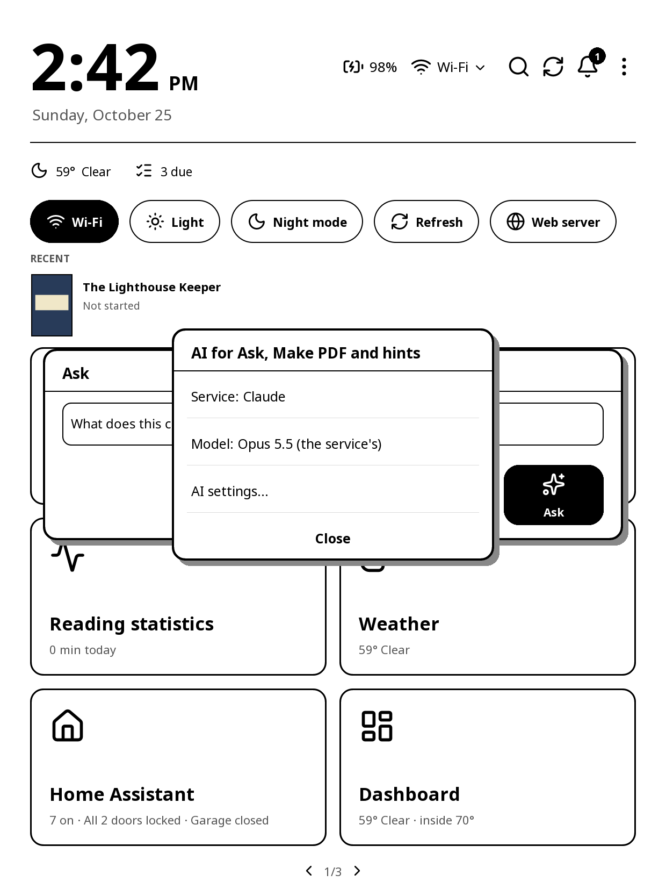
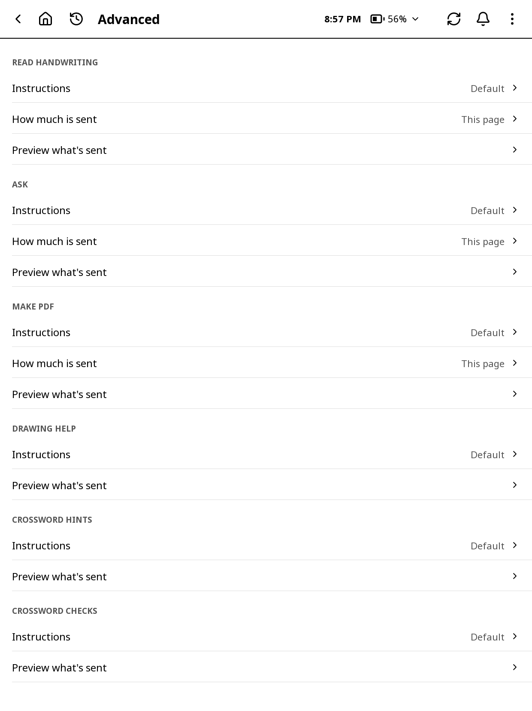

# AI

Some apps use an AI. Notes reads your handwriting (Convert page to text, search, Add to To Do, Suggest name), answers Ask, makes PDFs and helps you draw. Crosswords gives hints and checks your answers. The AI services are set up once, in the launcher's **Settings > AI**, and every app uses them.

Until a service is set up, the apps leave their AI out: no AI buttons or menu items show. Once any service is set up, they all appear.

## Opening the AI settings

- On the launcher: **⋮ > Settings > AI**.
- From an app: Notes' **Settings > Integrations > AI settings…**, or Crosswords' settings. Back returns to the app.
- The first time, **Set up your Kindle** has an **AI** step that opens the same page.

## The AI services

Every service is in one list, under **AI services**. Tap one to set it up. Each keeps its own key and model, so you can switch between them without setting them up again.

- **Claude**: tap **Claude API key** and enter a key from platform.claude.com. Claude Max and Team plans include monthly API credits (claude.ai > Settings > Billing). **Claude model** picks the model; Sonnet and Haiku cost less.
- **Gemini**: an API key from aistudio.google.com and a model. Gemini Flash and Flash-Lite can be used free.
- **OpenRouter**: a key from openrouter.ai and a model. **openrouter/free** uses whichever free model is available; other models are paid.
- **Groq**: a key from console.groq.com and a model.
- **Local AI**: your own AI, for example Gemma on Ollama or a model in LM Studio. It has two addresses, as Home Assistant does:
  - **Internal URL**: your AI on the home network: the computer running it and its port, for example http://192.168.1.50:11434 (it has to accept connections from the network). Used whenever the Kindle can reach it.
  - **External URL** (optional): an address that reaches your AI from anywhere, used when the Internal URL can't be reached. With **API key (optional)**, sent as a Bearer token.
  - **Model** lists your AI's models. **Thinking** makes some models slower but sometimes better.
- **Custom**: any service that works like OpenAI's chat API: its address, key and model.

### The External URL

The External URL works with anything that answers OpenAI-style requests, with an optional Bearer key, for example:

- an AI gateway in front of your AI (such as Pangolin's, LiteLLM or Open WebUI), with its key;
- a reverse proxy (such as nginx, Caddy or Traefik) that checks a key;
- Tailscale or another VPN to your home network (no key needed).

A proxy that asks for a sign-in in a browser first (a login page, as with Pangolin's or Authelia's sign-in, or Cloudflare Access) won't work: the Kindle can't sign in there. The same goes for Home Assistant's External URL.

For every service, pick a model that reads pictures: Notes and Crosswords send pages as pictures.

**Model** (on Claude's, Gemini's, OpenRouter's, Groq's and Custom's pages) asks the service for the models it has now, with your key, so new ones show up without an update. The ones marked **recommended** are known to read pictures and come first; then the newest first (up to 40), and **Type a model…** for any other. A model the service doesn't say reads pictures is marked **may not read pictures**; OpenRouter's list leaves those out. Without Wi-Fi or a key, you get the recommended ones. On the web page's AI tab, **Load models** fills each service's model box the same way.

**AI for this**: hold a button that uses AI (Ask, a hint, Write a command…), or the pen in a text box, for a short menu: **Service** picks which service does that job, and **Model** loads that service's models (as above) and picks one for this job only, or **The service's** to go back to the one set on its page. For Claude, Groq and OpenRouter it also shows **Usage** (as on their pages). **AI settings…** opens the AI page.

**Usage** (on Claude's, Groq's and OpenRouter's pages, and on the web page's AI tab) shows what's left until the service's limits reset, for the services that say. Claude and Groq send their limits with each answer, so it shows the requests and tokens left as of the last answer (after Try a prompt or any AI feature), with when they reset. OpenRouter is asked when you tap it: what you've used today and this month, your key's limit and what's left of it, and your credit. Gemini and your local AI don't say, so they have no Usage.

**No paid key?** Get a free Gemini key at aistudio.google.com. On free tiers, the service may use what you send to improve its products, so keep private pages on Claude, a paid tier or your local AI.

## Checking a service

- **Test it** (on a service's page) asks a short question, to check the address, key and model. For your local AI it says which address answered: the Internal URL or the External URL.
- **Try a prompt** (on a service's page) sends one real request: a small built-in picture of three handwritten lines, with the instructions Read handwriting uses. It shows the reply, how long it took and which model answered, so you can see whether a model reads pictures, how well and how fast, and compare services. On a paid service it costs a little, so it only runs when you tap it.
- **Test connection** (on the AI page) checks every service you've set up at once, for free: a key checked or the models listed, never a question. Your local AI's Internal URL and External URL are checked separately. It is also in **Settings > Launcher > Connection check**, as **AI**.

## Which AI does each job

Each job can use a different service: reading handwriting, search and To Do; Ask, Make PDF and crossword hints; drawing. Tap a job to pick its service. For example, free Gemini for reading handwriting and Claude for Ask. Picking a service that isn't set up yet opens its page.

Notes' **Settings > Integrations > AI** puts all of Notes' jobs on one service. It shows **Mixed** when they use different ones.

## What each feature sends (Advanced)

**Advanced** lists every AI feature of the apps installed: Notes' **Read handwriting**, **Ask**, **Make PDF** and **Drawing help**, and Crosswords' **Crossword hints** and **Crossword checks**. For each:

- **Instructions**: how the AI should do it, in your words, for example "keep my line breaks" or "write in British English". **Reset to default** puts back the original. The form of the answer a feature needs (Make PDF's document, a drawing's format, a check's list of answers) is added after your words and can't be changed, so editing can't break the feature.
- **How much is sent** (Notes' features): **This page**, **This page and the one before** (for context), or for Ask and Make PDF **The whole notebook (up to 10 pages)**.
- **Preview what's sent**: the exact instructions, and **Pictures** for the pages that would go with them (from the notebook you opened last). This is what leaves the Kindle.

## Handwriting recognition

Where the apps ask you to type, you can write instead: tap the pen at the end of the box (**Write it** in To Do's new task), write in the strip at the bottom of the screen with the pen, and tap **Done**. The AI that reads handwriting (Settings > AI > Which AI does each job) turns it into text and puts it in the box, where you can still change it. **Clear** starts again; **Cancel** leaves the box as it was. The box's own buttons and text still work while the strip is up; closing the box closes the strip too. Drag the bar at the top of the strip to move it up or down; it stays there next time. Holding **Done** (with a finger) picks the AI and model that read your writing.

It's there when an AI service is set up, in:

- Notes: the new notebook's name, Rename, the folder names, Search notebooks, a template's name, a new OneNote notebook or section, and Ask AI and Draw with AI.
- To Do: a new task (a date or time written with it becomes its due date or reminder), renaming a task, a list or a step, a new step or list, and Search tasks.
- The launcher: Search, a group's or shortcut's name, your town for the weather, and a font family on Get fonts.
- Home Assistant: Search devices.
- SSH: the command box (Run a command, editing a command), the names of hosts, saved commands and keys, Write a command with AI, Ask more, and the live session's Ask AI.

Boxes that need an exact value (addresses, keys, tokens, the App ID, codes) keep the keyboard only.

What it's told to do is **Handwriting input** in Advanced.

## On the web page

The web page's **AI** tab has the same: which AI does each job, each service's key, model or addresses, **Try a prompt** on each service set up, **Test connection**, and an **Advanced** card with each feature's instructions, how much is sent and the preview with its pictures. Keys typed there are stored only on the Kindle; the page never shows them again.

## Without the launcher

The AI settings are the launcher's. Without the launcher, the apps have no AI.
