# The launcher

The launcher is a full screen of big tiles, one for each app and for anything else you pin there. Each tile has a line saying what is going on in it, such as "2 today · 1 overdue" on To Do or "6 on · All doors locked" on Home Assistant. Tap a tile to open it. The app opens on top of the launcher, so closing the app brings you back.

## Opening the launcher

- **KOReader's menu**: **Tools > Launcher**.
- **A gesture**: **Settings > Taps and gestures > Gesture manager**, pick a gesture, then **General > Launcher**.
- **At startup**: Settings > **Launcher** > **Open at startup** opens it each time KOReader starts.

Opening the launcher when it is already showing just refreshes it.

To leave the launcher, open **Library** or a book, or tap **Exit KOReader**. Back also closes it.

## The top of the screen

- **The clock** and the date. The clock updates every minute while the launcher is showing. **24-hour clock** in the launcher's settings sets it for every app.
- **The battery**, filled to its charge (a lightning bolt while charging), and its percentage.
- **Wi-Fi**: on or **Off**. Tap the battery and Wi-Fi (the **▾**) for the control center.
- **Search**: books, notebooks, tasks, Home Assistant's devices and more (see "Search").
- **Refresh**: the tiles' lines worked out again, and the screen flashed clean.
- **The bell**: Notifications from every app (see Finding your way around), with how many are new.
- **⋮** has **Open on the web page**, **Restart KOReader** (after asking), **Help**, **Light** (on a Kindle with a front light), **Night mode**, **Refresh screen** and **Settings** (every app's).

### At a glance

The line under the clock shows three things when they are available. Tap any of them to go there.

- **The weather**: the temperature, the conditions and today's high and low, such as "59° Clear · 64° / 48°", from Home Assistant or from Open-Meteo (free, no account; see **Weather** below). A weather alert shows instead of the conditions. Tap it for the weather screen.
- **What's next** (the clock icon): your next Home Assistant calendar event, or else the next To Do reminder in the next day and a half, with its time. Tap it for To Do's Today.
- **Tasks due** from To Do: "3 due" (overdue tasks count too) or "Nothing due". Tap it for To Do's Today.

Turn the line off in settings: **At a glance**.

### Quick buttons

Buttons under the clock, two rows at most: what doesn't fit is under **More ▾**, which opens the control center with every button. **Tap** a button for the quick thing; **hold** it for what's behind it. A switch is filled black when it's on.

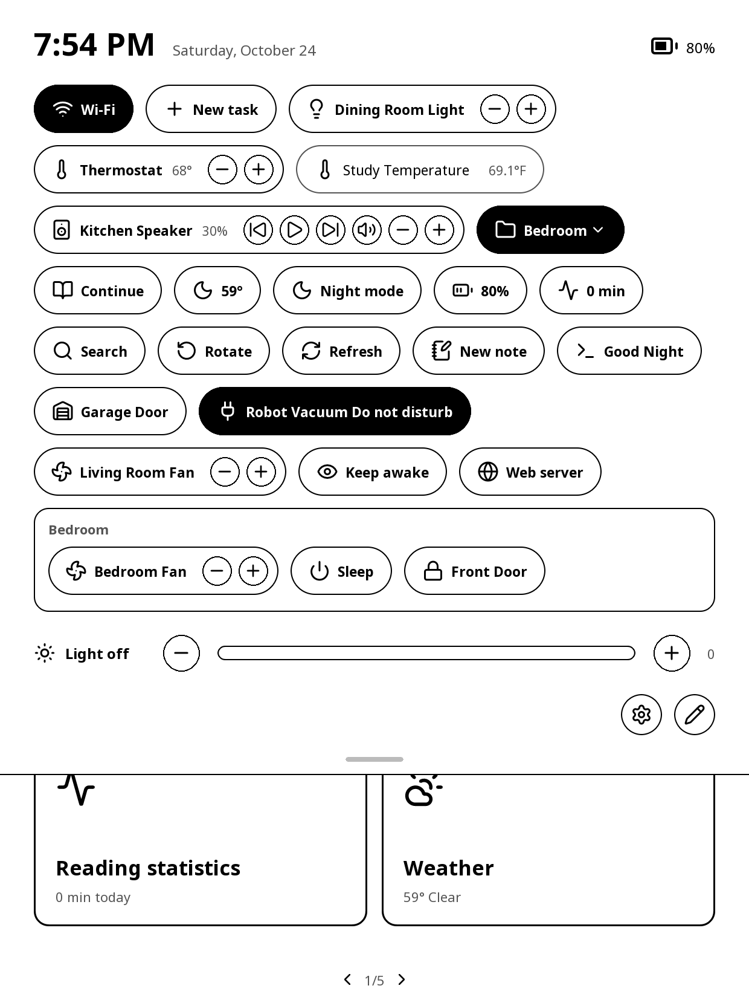

The buttons you can have:

- **Wi-Fi**: on or off. Hold: the networks.
- **Light**: on or off. Hold: brightness and warmth.
- **Night mode**: on or off. Hold: KOReader's settings.
- **Refresh**: a full refresh that clears e-ink ghosting. Hold: how often books do one.
- **Web server**: turns it on or off. Hold: its address and QR code. While it's on, a globe shows by the clock and Notifications has its address.
- **Keep awake**: on or off. Hold: Sleep after.
- **New task**: To Do's add dialog. Hold: To Do.
- **New note**: a quick note in Notes. Hold: your notebooks.
- **Continue reading**: your last book. Hold: the Library.
- **Weather**: shows the temperature; tap for the Weather screen. Hold: change the place.
- **Search**, **Sleep** (hold: Sleep after), **Rotate** (hold: rotation), **Battery** (shows the level; tap for the Battery screen) and **Reading statistics** (today's reading time; tap for Reading statistics, hold for the calendar).
- **Shortcuts**, as in Add shortcut: a Home Assistant screen or room, a To Do view or list (hold: a new task in it), a notebook, a Notes folder, a crossword source or a KOReader action.
- **Home Assistant devices** (picked by room): a light or fan with **−** and **+** (brightness or speed; tap the name to switch it), the thermostat's set point with **−** and **+**, a speaker or TV with **⏮ ⏯ ⏭**, mute and the volume, switches, locks, the garage, scripts and scenes (asked first where Home Assistant's own tiles ask), and sensors as a reading. Hold any of them for the device in Home Assistant.
- **From the other apps**: **Syncthing** (on or off; hold: the app), a saved **SSH command** (tap runs it; hold: its host), **Sync To Do** (how many changes wait; hold: the Sync screen) and **Refresh Home Assistant** (hold: Home Assistant). They're under **Add a button** when those apps are installed.
- **Groups**: one button that drops its own buttons down in the control center (hold to rename it, change its icon or edit the buttons).

Settings > **Quick buttons** (or **Edit quick buttons** on a group's hold, or the pencil in the control center) lists them: **Show on the home screen** turns the rows under the clock on or off. The list is in sections, so you can see where each button shows: **ON THE HOME SCREEN** (the ones that fit in the two rows, which depends on how long their names are), **ONLY IN THE CONTROL CENTER** (the rest, under **More**), and **ALWAYS IN THE CONTROL CENTER** (Wi-Fi, Night mode, Refresh, Web server and Keep awake when they aren't among yours; tap one to add it and place it yourself). Each button's **⋮** has **Move to top**, **Move up**, **Move down**, **Move to bottom**, **Move to a group…** (or **Out of the group**) and **Remove** (with Undo), and **Add a button** adds a built-in, a shortcut or a new group. The web page's Launcher tab has the same sections, drawn as on the Kindle, with drag and drop between them. While Wi-Fi, Light, Night mode or Web server is a button, its tile leaves the main page, so you don't have both.

> Turned on its side, the launcher puts the At a glance line and the buttons on one line.

### Recent books

**RECENT BOOKS** shows the last books you read (three across, five on its side), with the cover when KOReader has one, the title and how far you are: a progress bar and "42% read", **Finished** or **Not started**.

- **Tap** a book to open it.
- **Hold** a book for:
  - **Open**
  - **Book details** (its page in the Library, when the Library is installed)
  - **Mark as finished** (or **Mark as reading**)
  - **Remove from history**
  - **Open its folder** (the Library, at the book's folder)

Turn the row off in settings: **Recent books**.

### Recent notebooks and crosswords

With Notes installed, two more rows can show under the books:

- **RECENT NOTEBOOKS**: the notebooks you used last, with their first page and when they were edited. A locked notebook shows a lock instead of its page. Tap one to open it; hold it for **Open**, **Add to launcher** or **Remove from recent**.
- **RECENT CROSSWORDS**: the puzzles you worked on last, with the grid as you've filled it so far, and "23 of 78 clues" with a bar (or **New** or **Done**). Tap one to go straight to that puzzle; hold it for **Open** or **Remove from recent**.

**Remove from recent** takes a notebook or crossword off its row until you write in it again (or solve more clues). To bring one back sooner, open settings > **Removed from recent** (it shows only once something has been removed, with how many) and pick it, or **Show all**.

Turn each row off in settings: **Recent notebooks** and **Recent crosswords**. Rows that fit together share a line (one book beside two notebooks, say), to leave room for tiles. **Recent items** > **One row** shows just the newest book, notebook and crossword side by side, in a single row. The **Small** clock and the **Compact** layout give more room too.

## The tiles

- **Continue reading**: the last book and how far in. Tap to open it.
- **Library**: your books and folders (see the Library chapter). Without the Library app, or with Library settings > **Browse books with** set to KOReader's file browser, it opens KOReader's file browser.
- **Reading statistics**: how long you've read today and how many days in a row you've read, such as "25 min today · 4 days in a row". Tap it for your reading statistics (see below). It uses KOReader's reading statistics, so the Reading statistics plugin must be on.
- **Home Assistant** and **Dashboard**: see the Home Assistant chapter. The Dashboard tile shows once Home Assistant is set up (it's Home Assistant's screen).
- **To Do**: "2 today · 1 overdue", or what's coming this week.
- **Notes**: how many notebooks, and the last one you wrote in.
- **Crosswords**: today's crossword and whether it is new, started or done. Tap to open your puzzle books (see the Crosswords chapter).
- **Wikipedia**: how many articles are saved and the last one read. Tap to open Wikipedia.
- **Syncthing**: "On · Up to date", "On · Syncing · 3 files left" or "Off". Tap to open Syncthing.
- **SSH**: how many hosts are saved, such as "3 hosts". Tap to open SSH.
- **Web server**: "On" and its address, or "Off · Tap to start".
- **Fonts**: your fonts, getting more, and the font settings (see below). Its line says the font new books open in.
- **Gestures**: what each KOReader gesture does (see below).
- **Battery**: the battery level and how fast it's going, such as "71% · 3.0% an hour awake", or "71% · Charging". Tap for the Battery screen (see below).
- **Settings**: the launcher's Settings list, every app's settings (the same as **⋮ > Settings**).
- **KOReader settings**: KOReader's own menu, opened at its Settings (gear) tab: Device (including **Autosuspend timeout**), Screen, Network, Taps and gestures and the rest.

On a new install, **Gestures**, **Battery** and **KOReader settings** start hidden: they're set up once or looked at now and then, and each is also in **Settings** and in search. Show any of them in **Edit home screen**. A launcher set up before keeps them as they were.
- **Wi-Fi**: on, off or connected. Tap to switch.
- **Light** and **Night mode**: as the quick buttons.
- **Exit KOReader**: back to the Kindle's home screen, after asking.
- **Restart KOReader**: closes KOReader and opens it again, after asking. Hidden to start with; show it in Settings (the eye) if you want a tile. It's always in the **⋮** menu too.

A tile only shows when its app is installed. More tiles than fit turn pages: swipe left or right, or tap the arrows at the bottom.

If KOReader crashed or stopped answering the last time it ran, the launcher says so (with the time) the first time it opens. The web page's **System** tab (**Problems**) has the details.

### Holding a tile

Hold any tile for:

- **Move up** and **Move down**
- **Move to a group…**
- **Hide** (or **Remove** for a shortcut)
- **Edit home screen** (the list of every tile, below)

### Groups

A group is a tile that opens a page of its own, like a folder on a phone.

1. Hold a tile and choose **Move to a group…**.
2. Choose **New group…** and give it a name, or pick an existing group.
3. The group's tile shows a folder (or the icon you picked) and how many tiles are in it. Tap it to open its page.

To leave a group's page, tap its name at the top, press Back, or swipe in from the left edge. To take a tile out of a group, hold it and choose **Move to a group… > Main page**. Hold a group's tile to **Rename group**, **Sort…** (**Custom**, the order you put them in, or **A–Z**, by name, which stays sorted as you add tiles), **Change icon** (pick one from the grid; the folder is the first) or **Delete group** (its tiles go back to the main page).

**Suggested groups** (in **Move to a group…**, at the end of **Edit home screen**, and in Set up your Kindle > Your home screen) offers ready-made groups: **Settings** (Fonts, Gestures, Battery, KOReader settings, Restart KOReader), **Reading** (Library, Reading statistics, Wikipedia), **Home** (Home Assistant, Dashboard, Weather), **Writing** (Notes, Crosswords), **Tools** (SSH, Syncthing, Web server) and **Device** (Wi-Fi, Light, Night mode, Exit KOReader). Each lists only the apps you have that aren't in a group yet, and shows when at least two are left. Tap one, then **Make group**; hidden tiles in it show again, and the group starts sorted **A–Z**.

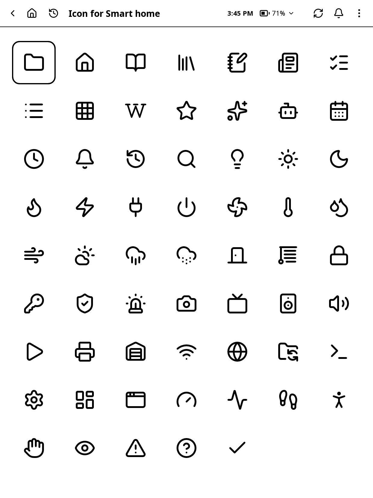

### Shortcuts

A shortcut is a tile that goes straight to one place. In Settings > **Edit home screen**, at the end of the list, tap **Add shortcut**:

- **Home Assistant screen or room**: Home, the Dashboard, any of its screens (Security, Climate, Weather…) or a room. Its line shows that place's summary, such as "Inside 70° · 40%".
- **To Do view or list**: Today, Agenda, Starred, Calendar, Search, or one of your lists.
- **Notebook**: a Notes notebook, with when it was last edited.
- **Notes folder**: a folder of notebooks.
- **Crossword**: one newspaper's newest crossword.
- **KOReader action**: anything a gesture can do that needs no setting, such as **Calibre: Connect** or **Push progress from this device**. Pick a group (General, Device, Screen and lights, File browser, Book) and then the action. It runs when you tap the tile, just like the gesture. Book actions need a book open.

Home Assistant, To Do and Notes can add shortcuts themselves: their **⋮** menu has **Add to launcher** on the screen you're looking at.

To remove a shortcut, hold it and choose **Remove**, or tap its **x** in settings.

## Weather

The **Weather** tile works with or without Home Assistant. With Home Assistant's weather it opens Home Assistant's Weather screen. Without it, it uses **Open-Meteo**, a free forecast that needs no account or key: the first tap asks for your town or city (type it, then pick the right one from the matches), and the forecast loads over Wi-Fi.

- **Now**: the temperature, the conditions, today's high and low, what it feels like, the chance of rain today, the wind and the humidity.
- **ALERTS** (in the US): warnings, watches and advisories from the National Weather Service, such as a Wind Advisory and until when. Tap one for the whole text and what to do.
- **NEXT 24 HOURS**: each hour's conditions, temperature and chance of rain.
- **NEXT 7 DAYS**: each day's conditions, chance of rain, and high and low.

It updates every 30 minutes while Wi-Fi is on and something shows it (the tile, At a glance, the widgets sleep screen), and keeps the last forecast for when Wi-Fi is off. ⟳ in the title bar loads it again.

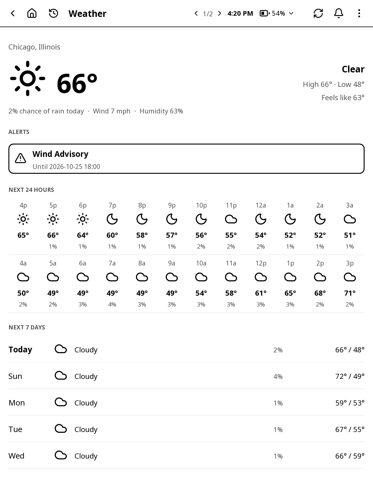

Settings > Launcher > **WEATHER**:

- **Weather from**: **Automatic** (Home Assistant's when it has weather, else Open-Meteo once a place is set), **Home Assistant**, **Open-Meteo (free)** or **Off**.
- **Place**: the town or city for Open-Meteo.
- **Units**: °F or °C (°F to start with in the US).

## Reading statistics

Tap the **Reading statistics** tile. At the top:

- **Today**, **Last 7 days** and **Last 30 days**: your reading time.
- **In a row**: the days you've read in a row (today counts once you read; until then it counts from yesterday). **Longest streak**: the most days in a row ever.
- **In all**: your reading time in every book.
- **Calendar**: KOReader's calendar of what you read each day.

**WHEN YOU READ** shows your reading by hour of the day ("Mostly 9 PM to 11 PM") and by day of the week ("Most on Saturday").

**BOOKS** lists every book you've read, last read first: its time, how far along you are, the time left at your own pace in that book, and when you last read it. A finished book says **Finished**.

Tap a book for its own page: how far along (percent and page), **About … left**, the time reading it, your pace (pages an hour), the days you read it (tap for the list, with each day's time), the average a day, when you started and last read it, pages read, highlights and notes, and when you read it by hour. With the Library app, **Book details** at the top opens the book's page in the Library (its status, collections, what the book says about itself, its file, and Continue).

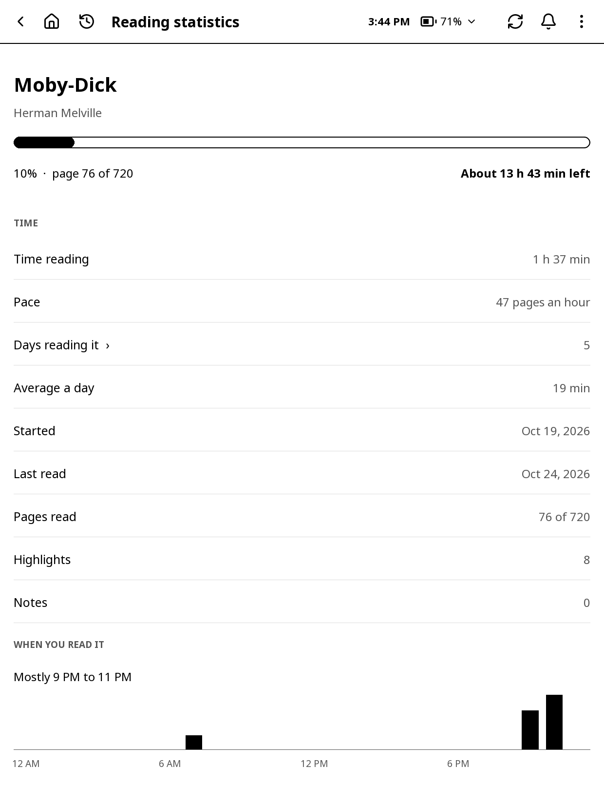

The time left is the pages still to go times your average time per page in that book so far, so it gets better as you read. Everything here comes from KOReader's reading statistics.

### Fixing reading sessions

A book's page ends with **SESSIONS**: each time you read it, newest first, with the day, start and end, minutes and pages. Tap one:

- **Edit**: change its **Day**, **Start** or **End** (KOReader's pickers), then **Save**. The menu shows the new length and the old one. Moving keeps it as it was; an earlier end cuts the time after it (a book left open by mistake becomes the minutes you really read); a later end stretches each page's time to fit. It can't overlap other reading.
- **Delete**: takes it out of the statistics.

**Reset statistics** at the bottom takes all of the book's reading out, after asking. Each of these offers **Undo** for a few seconds. The web page's Reading tab does the same with the same code.

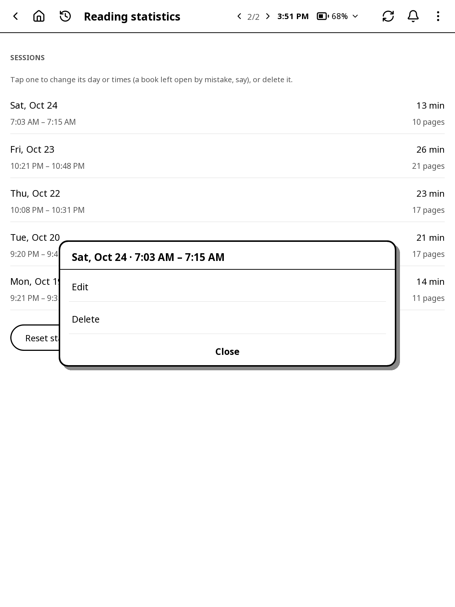

## Fonts

The **Fonts** tile (also in **Settings** and search) has everything about the fonts books use:

- **Get more fonts** at the top opens the **Get fonts** page, with free fonts from Google Fonts over Wi-Fi:
  - The box at the top: type any Google Fonts family's name (such as Lora or Source Serif 4) and tap **Get**.
  - **SUGGESTIONS**: good reading fonts, each with what it's like: Literata (made for e-books), Merriweather, Lora, EB Garamond, Crimson Pro, Source Serif 4, Alegreya, Bitter, Atkinson Hyperlegible (made for low vision) and Lexend. **Get** next to one gets it.
  - The Kindle downloads the family's regular, bold and italic styles in the background, and says when it has them.
- **YOUR FONTS**: every font KOReader can use, each name drawn in its own typeface. The one new books open in says **Default**, and ones you added say **Added**. Tap a font for **Set as default for new books**, or **Remove** for one you added (with **Undo**; KOReader's own fonts stay).
- **FONT SETTINGS**: the font size for new books, the fallback font, more fallback fonts, the book's own fonts, the font weight, hinting and kerning, as in KOReader's own menus.

Books see added or removed fonts after KOReader restarts: a box at the top says so, with **Restart**.

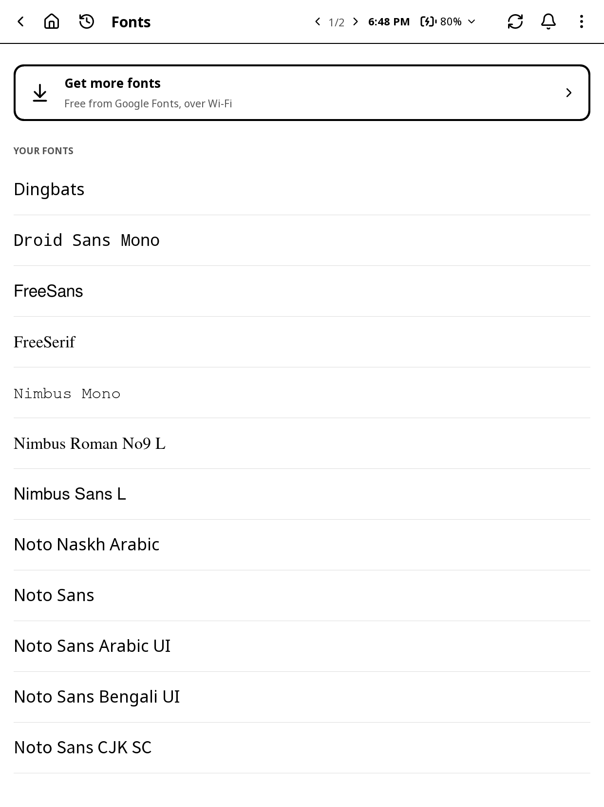

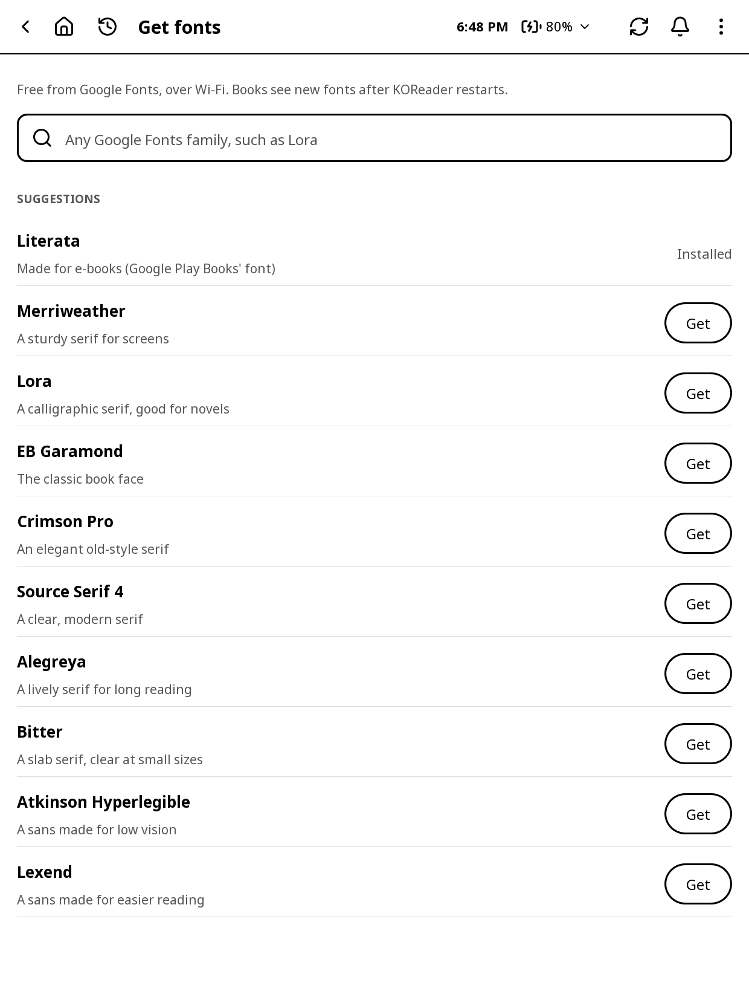

## The Battery screen

The **Battery** tile opens KOReader's own battery statistics, shown plainly. It needs KOReader's **Battery statistics** plugin, which is on unless you've turned it off:

- The level, and about how long it will last awake at the rate you've been using it.
- **SINCE THE LAST CHARGE**: how much went while **Awake** and while **Asleep**, how long each, and how much an hour; **In all** for both.
- **THE LAST CHARGE**: how much it charged, in how long.
- **ON NOW**: what is on that uses power: Wi-Fi, the front light, the web server, Syncthing, the Home Assistant dashboard keeping the screen on, anything keeping the Kindle awake.
- **Reset statistics** starts counting again.

KOReader can only tell awake from asleep, not which app used what. To see what costs most, reset, use the Kindle one way for a while (say Syncthing on, or the web server running), and look again.

## The Gestures screen

The **Gestures** tile lists every KOReader gesture that does something, with what it does, in KOReader's own words. For example, "⇐ → Folder shortcuts" under **TWO-FINGER SWIPE**. It's handy for finding a gesture that fires by accident.

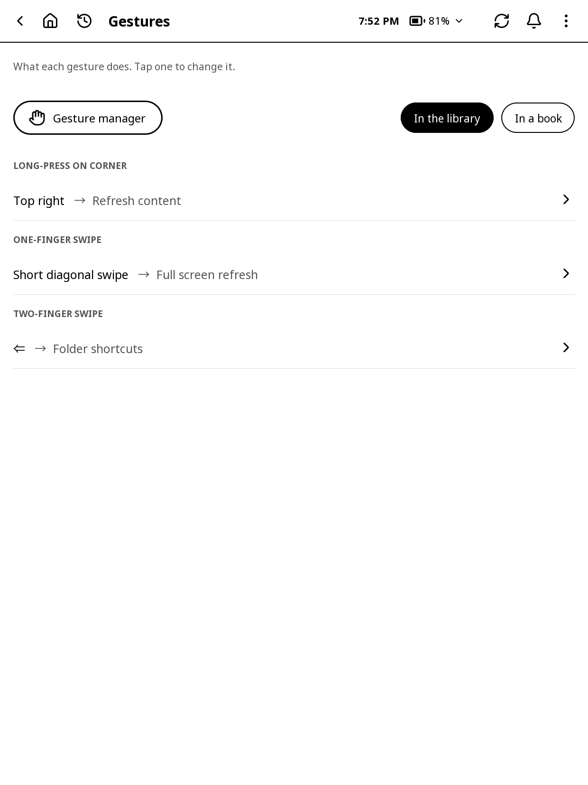

- **In the library** and **In a book** switch between the two sets of gestures.
- **Tap a gesture** to change it in KOReader's own menu for it: choose another action, **Pass through** (do nothing here) or **Nothing**. Changes take effect at once.
- **Gesture manager** opens KOReader's whole gesture menu, to set up new gestures.

You can only change the set you are in: the library's while in the library, a book's while reading. The other set is shown for reference.

## Search

Tap the magnifying glass at the top of the launcher and type a word. The results come grouped by app, the books a moment after the rest (they're looked for in the background, so the screen never waits):

- **Books**: titles and authors KOReader knows (from the covers it has read), and file names under the home folder.
- **Notebooks**, **To Do** tasks, **Home Assistant** devices (by name or room), crosswords, saved Wikipedia articles, Syncthing folders and SSH hosts.
- **Apps and settings**: every app and screen of the launcher by name (hidden tiles too, such as Battery or Gestures), and every page in Settings.

Tap one to open it: a book opens, a task opens in To Do, a device opens its room. The magnifying glass on the results searches again.

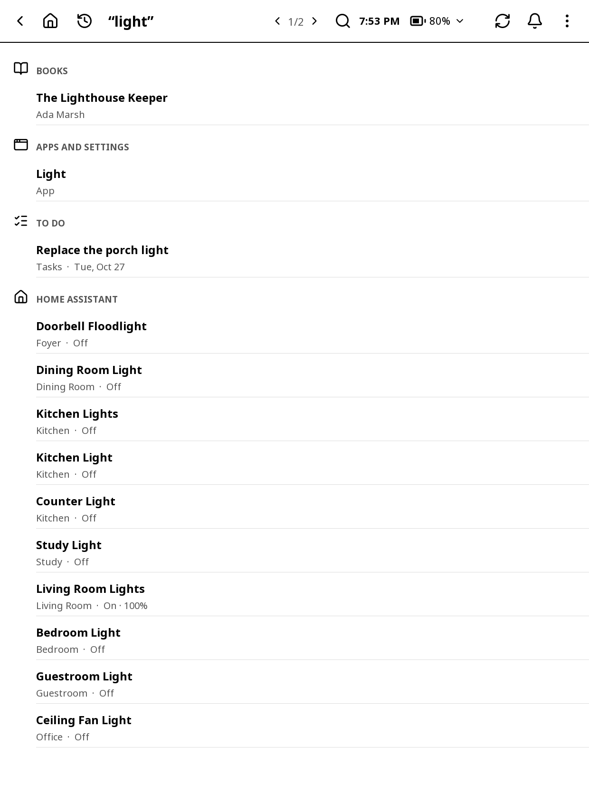

## The control center and Recent apps

Both are part of every app's bar; see "Finding your way around" in Getting started. On the launcher, tap the battery and Wi-Fi (or **More ▾** under the clock) for the control center; Recent apps is in **⋮**. The control center has every quick button in every app (Wi-Fi, Night mode, Refresh, Web server and Keep awake are always there), with a group's buttons dropped down when you tap it, pages when there are more than fit, the pencil to change them, and the light and warmth.

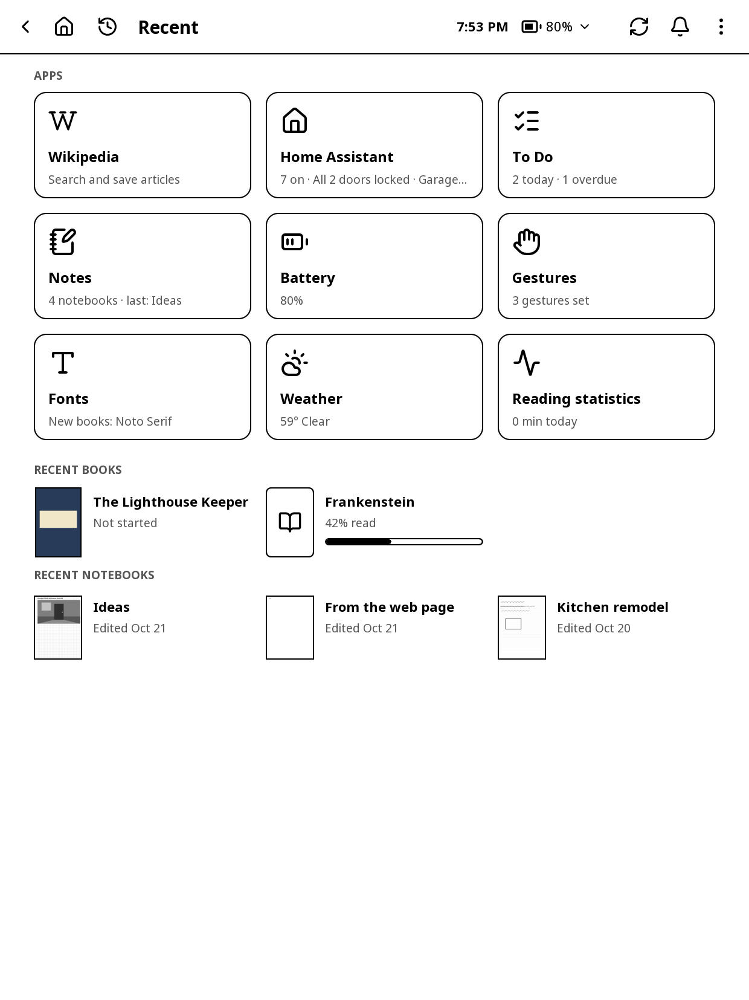

## Settings

**⋮ > Settings** lists every app's settings in one place (see Getting started). **Web server** there opens its settings as a page: on or off, its address, **Keep the Kindle awake while on**, **Stop after 30 minutes unused**, the **Port**, the **Password** and **Undo a plugin update**. **KOReader** opens KOReader's most-used settings on one page (see "KOReader settings" below).

### KOReader settings

KOReader's own settings, the same ones as in KOReader's menu, so a change here shows there too and takes effect at once:

- **Sleep after**: how long the Kindle waits, untouched, before it goes to sleep (also in the launcher's Sleep section).
- **Full refresh**: while reading, how often the page flashes clean: **Never**, **Every page**, every 6, 12 or 22 pages, or **Every chapter**.
- **Rotation**: **Auto-rotate** (the Kindle turns the screen as you turn it), or locked to **Portrait** or **Landscape** in books and the library alike.
- **Page turn tap zones**: **Default**, **Left / right**, **Top / bottom** or **Bottom / top**.
- **Invert page turns**: swaps the next and previous sides, for left-handed reading or right-to-left books. It's the default for new books and changes the open one; a book you've set yourself keeps its own.
- **Font for new books** and **Font size for new books**: what a book you haven't opened before starts with. Books you've already opened keep their own. To add fonts, or for the fallback fonts and the rest, use the **Fonts** screen (see "Fonts") or the web page's **Fonts** tab.
- **Status bar in books**: on or off. **Status bar items** opens KOReader's own Status bar menu while a book is open.
- **Progress sync**: KOReader's automatic progress sync, when its Progress sync plugin is on. It needs a sync account (KOReader's menu > **Tools** > **Progress sync**).
- **Open KOReader's full menu**: everything else, at its Settings tab.

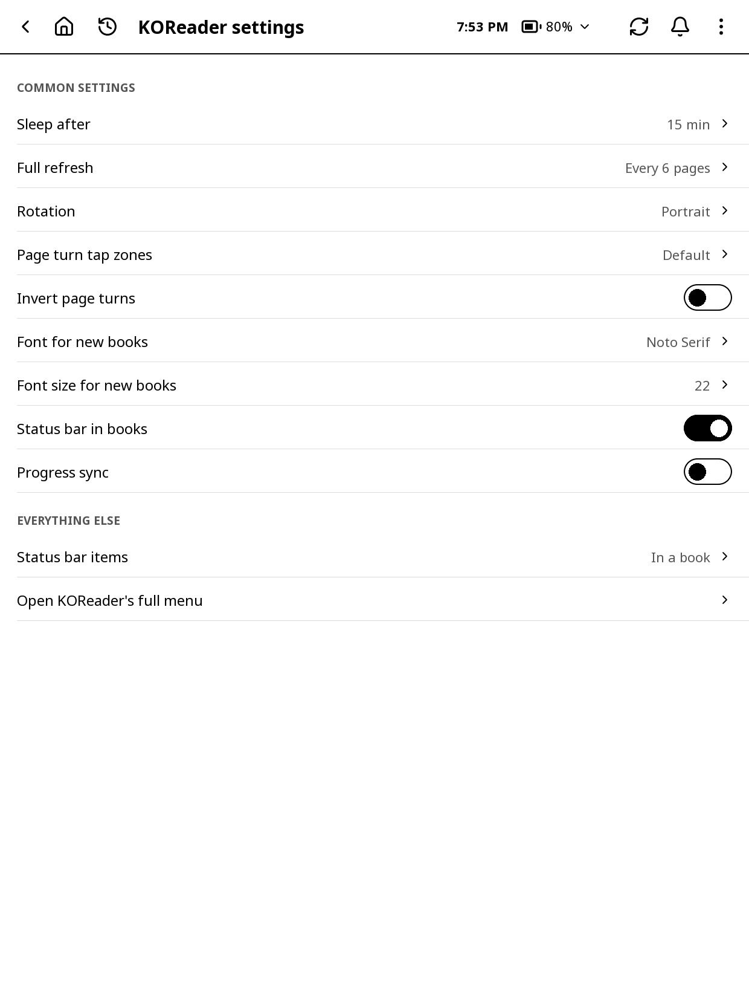

The launcher has these rows there: **Edit home screen** (which tiles show and in what order, groups and shortcuts), **Launcher** (everything else, below), and its screens **Fonts**, **Gestures** and **Battery** (Back returns to the list). Long screens have pages; swipe or tap the arrows next to the page number.

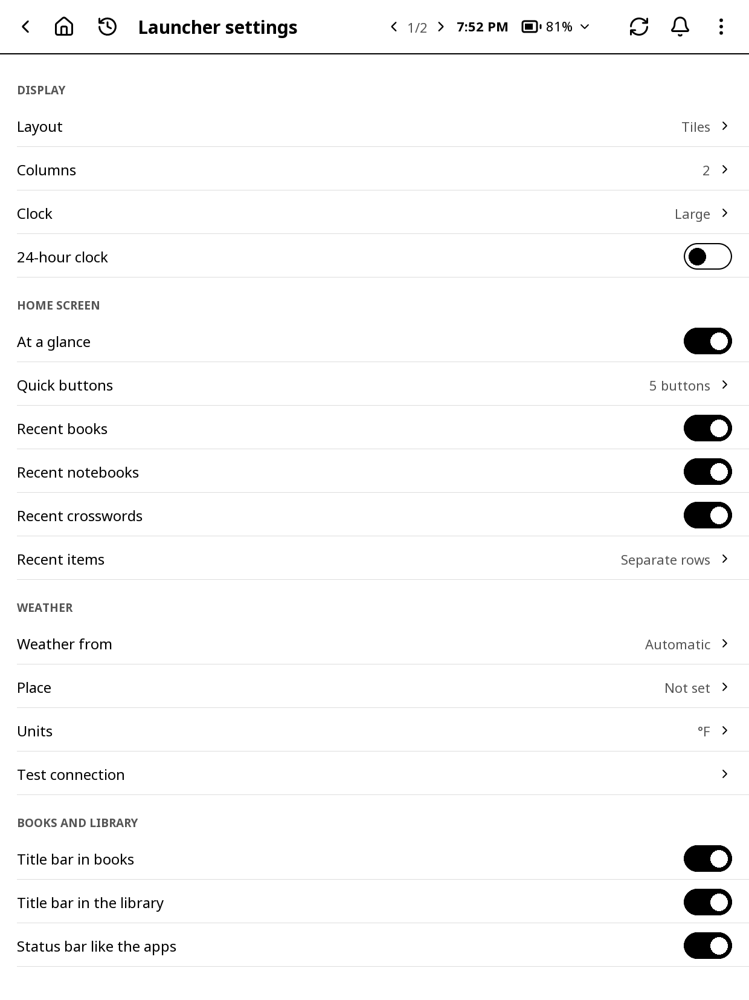

### Edit home screen

Every tile is listed, hidden ones greyed and grouped ones with their group's name.

- **The arrows** move a tile to the top, up one, down one or to the bottom.
- **The eye** shows or hides it.
- **The x** removes a shortcut or deletes a group.
- **Undo** at the top puts back the last move (tap again for the one before).
- **Add shortcut** is at the end of the list, then **Suggested groups**.
- **Saved home screen** keeps a copy of the tiles' order, shortcuts, hidden tiles and groups: **Save the home screen now**, and later **Put back the saved one** (with Undo). Backups keep it too, along with the home screen itself.

The web page's Launcher tab has the same, drawn as the home screen: drag tiles into order, into a group or to Hidden.

### Display

- **Layout**: **Tiles** (outlined), **Bold tiles** (filled black), **Compact** (small tiles, just the icon and name, so many fit on a page), **List** (a row each; two columns on its side) or **Icons** (like a phone; smaller when that fits two rows).
- **Clock**: **Large**, or **Small** (the time and date on one line, leaving more room for tiles). On its side the clock is always the one-line kind.
- **Recent items**: **Separate rows** (books, notebooks and crosswords each in a row, sharing lines when they fit) or **One row** (the newest of each).
- **Columns**: 1, 2 or 3 tiles across (two more when turned on its side).
- **24-hour clock**: KOReader's own setting (the same as in its **Time and date** menu), so every clock follows it: the launcher, every app's bar, a book's status bar and the sleep screens.
- **Button labels**: the buttons in every app's pop-ups and text boxes (Cancel, Save, Search…) show an icon over a word; off, just the icon, in smaller squares. Its page has the switch for every app, then each app on its own: **Default** (as for every app), **On** or **Off**.

For a dark screen, use **Night mode** (the quick button, the control center or **⋮**): KOReader's own, for every app.

### Home screen

- **At a glance**, **Quick buttons** and **Recent books**: the three rows under the clock.
- **Recent notebooks**, **Recent crosswords**, **Removed from recent** and **Recent items**.

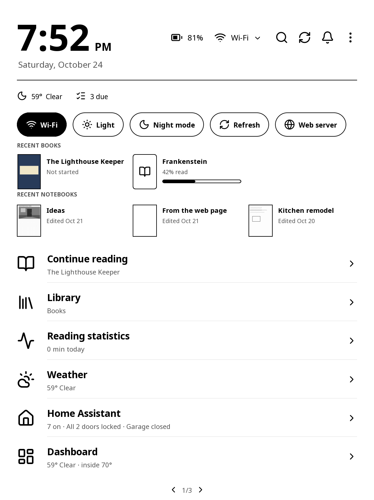

### Weather

- **Weather from**, **Place** and **Units**: see "Weather" above.
- **Test connection**: tries Open-Meteo for your place and, in the US, the weather alerts.

### Books and library

- **Title bar in books** and **Title bar in the library**: what a tap at the top of a book or of the library shows (see "In a book and in the library"). Both are on to start with; off, the tap opens KOReader's menu as before.
- **Status bar like the apps**: a book's status bar (at the bottom) with the apps' clock ("11:48 PM", or 24-hour), the items set apart with "·", and the apps' font, at the size set in KOReader. On to start with; off, KOReader's own.

### Sleep

- **Sleep after**: how long the Kindle waits, untouched, before it goes to sleep: 5, 10, 15 or 30 minutes, 1 or 2 hours. It's KOReader's own sleep timer, so it's the same setting as in KOReader's menu and on the web page's KOReader tab. To keep the Kindle awake for a while, use **Keep awake** in the control center.
- **Sleep screen** and **Sleep screen updates**: see "The sleep screen" in Getting started. They're only here: Home Assistant's and To Do's settings open this section. **Widgets** is one of the choices (see below).
- **Widgets** (with the Widgets sleep screen): which parts show. Tap one to turn it on or off. Their order is set on the web page's Launcher tab.

### Start

- **Open at startup**: the launcher opens when KOReader starts.

### Wi-Fi

- **Turn off when idle**: **Off**, or after 5, 15 or 30 minutes with no network use. Downloads, syncing and Home Assistant's updates count as use. It never turns Wi-Fi off while the web server is on, and time asleep doesn't count. A notice says when it happens.
- **Connection check**: tests your internet connection and every app that's set up, the same way each app's own **Test connection** does. Under **WHAT TO TEST** every one is ticked to start with; untick the ones you don't want (**Select all** or **Select none** at the right), then **Test selected**. Each address shows **Works** and how long it took, or what went wrong in plain words with the exact error under it. What doesn't work also goes in KOReader's log and the web page's diagnostics file.

### Plugins

- **Undo a plugin update**: lists the plugins that have an earlier version, each as "name (before <date>)". Pick one and confirm with **Go back**; KOReader restarts. With none to undo it says "No plugin has an earlier version to go back to."

## In a book and in the library

Tap the top of a book's page (where KOReader opens its menu) and the same bar as in the apps shows over the top of the page:

- **‹** goes back to where you opened the book: the launcher (or Recent apps or search) or the library. **The house** goes to the launcher (the book stays open: **Continue reading** comes back to it).
- **The book's title**, with the chapter and "Page 41 of 230" under it.
- **The clock and battery**, **refresh** (flashes the page clean), **the bell** (Notifications) and **⋮**.
- **⋮** has **KOReader menu** (KOReader's whole menu, as the tap used to open), **Table of contents**, **Bookmarks**, **Go to page**, **Search**, **Text and layout** (the font, margins and the rest at the bottom), **Light**, **Night mode**, **Refresh screen** and **Settings** (KOReader's menu at its settings).
- A tap anywhere else closes the bar. Swiping down from the top still opens KOReader's menu. Tap the time and battery for the control center.
- A swipe in from the left edge of the page goes back the same way (in the library, up a folder). Other swipes turn pages as before.
- The first book you open shows a tip once: "Tap the top of the page for the apps bar".

In KOReader's file browser the bar is the same, titled **File browser** (**Library** without the Library app) with the folder under it: **‹** goes up a folder, and **⋮** has **KOReader menu**, **Home folder**, **Library** and the rest. With the Library app, Back from a book goes to the Library instead (see its chapter).

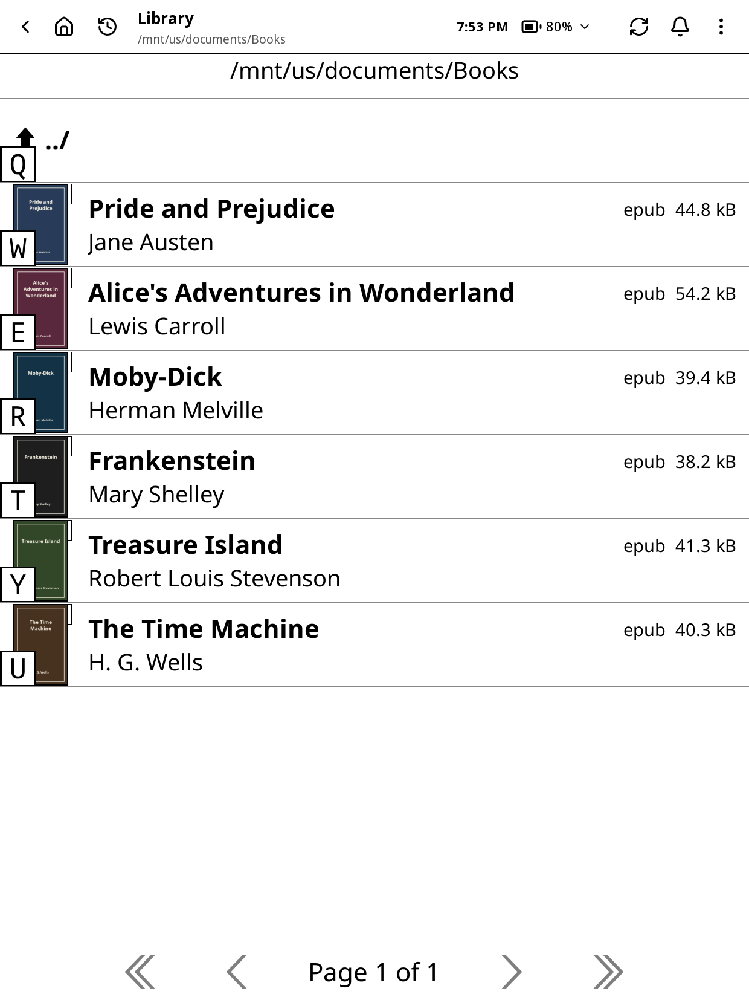

Settings > **Launcher** > **Title bar in books** and **Title bar in the library** turn it off.

## The launcher's sleep screens

With **Sleep screen** set to **Summary**, the sleeping Kindle shows:

- The date, "Sleeping since 3:05 PM" and the battery (with the charging sign on the charger).
- The weather with today's high and low.
- **NEXT**: the next event or reminder.
- **TODAY**: today's and overdue tasks, with boxes.

With **Widgets** it shows the parts you pick (Settings > **Launcher** > **Widgets**), each in a box:

- **Clock**: the time, the date and the battery.
- **Current book**: its cover, title and how far you are.
- **To Do today**: today's and overdue tasks.
- **Home Assistant alerts**: whether the doors are locked and the garage shut, and the alerts you chose in Home Assistant's settings.
- **Latest notifications**: the newest four.

Each part uses what the Kindle already has (nothing is fetched as it goes to sleep) and says how old it is, such as "Updated 5 min ago".

## Set up your Kindle

On the first start, while nothing is set up yet, a walkthrough shows: **Wi-Fi**, **Home Assistant** (sign in), **Weather** (your town, when Home Assistant doesn't give the weather), **Microsoft** (the App ID and one sign-in for To Do and OneNote), **AI** (a service's key or your local AI's address), **Syncthing** (pairing with your computer or phone), **Your home screen** (which tiles show, the layout, the recent row (**One row**, the newest book, notebook and crossword side by side, or **Separate rows**), **Suggested groups…** and the quick buttons; **Gestures**, **Battery** and **KOReader settings** start hidden, so tick them under **Tiles…** to show them), **Hold for more** (what holding a tile, a group, a quick button or a recent item does, the control center and swiping back) and **The web page** (what it's for, with a picture: updates, books and fonts, arranging the home screen, typing with a keyboard; and its password), and last **More to explore**: what needs nothing set up, among what you have (Notes, Crosswords, Wikipedia, Reading statistics, Fonts and Search). Each step says whether it's done and has a button to do it, and **If you skip it** says what you get without it (To Do, for one, keeps lists on this Kindle). **Skip** goes on without it, and **Back** returns to the step before. The last page lists each step as **Done** or **Not set up**, with what a skipped one means when there's room. The first page has **Skip** and **Don't show again**. Run it again any time from **Settings > Set up your Kindle**: once it's been finished or turned off, it opens on that list. Tap a step to set it up or change it (**Done** brings you back to the list), or **Go through every step**.

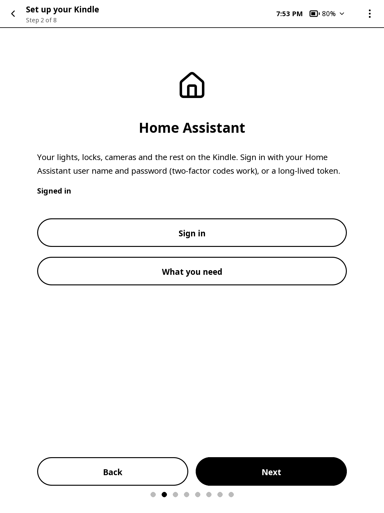

A step that needs something from another website has a **How to…** button (To Do's is **How to get an App ID**): the steps in short, and a QR code that opens the full steps in this guide on your phone. To Do's step can also be skipped for good: To Do works without an account, with lists kept on the Kindle.

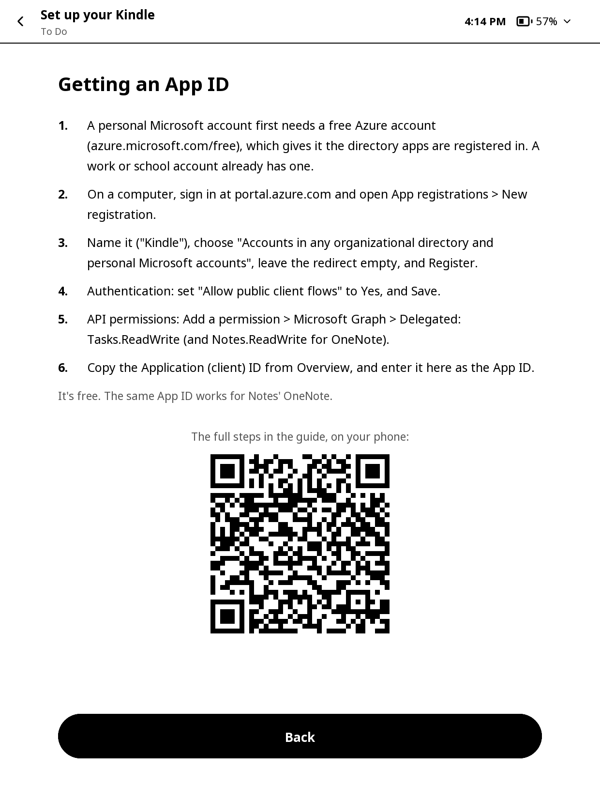

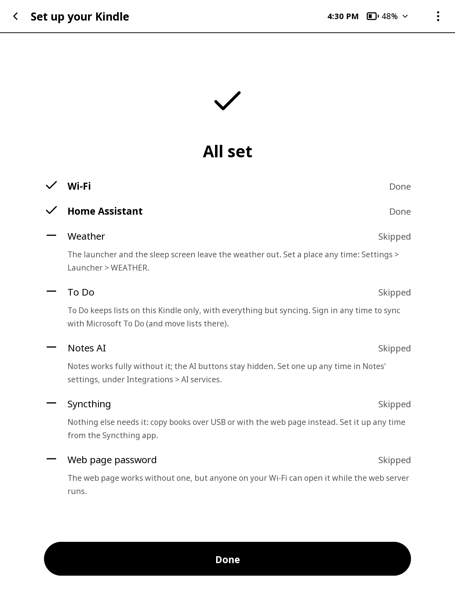

## Gestures on the launcher

- **Swipe** left or right to turn pages (also up or down).
- **Swipe in from the left edge** to go back (from Settings, Gestures, Battery, a group or a search); other swipes right turn back a page.
- **Swipe diagonally** for a full refresh.
- Your own KOReader gestures that aren't taps work here too, for the light, night mode, a refresh, Wi-Fi, a screenshot and the apps.

### Tips

- Hold anything that has no menu of its own and it acts like a tap.
- Removing a shortcut or group, or hiding a tile (hold it), shows **Undo** for a few seconds.

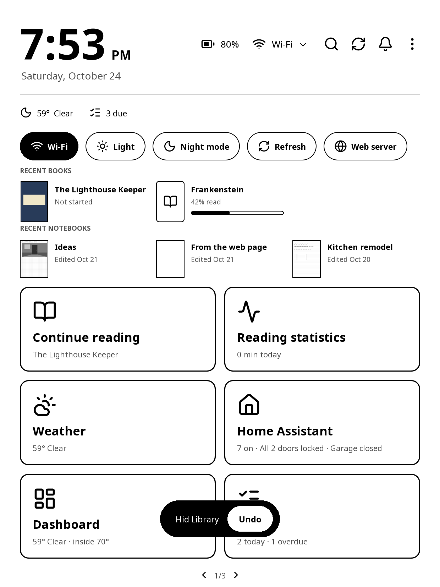
- The screen flashes clean every few changes and whenever you come back from another app or a dialog.
- Shortcuts to a To Do list or a Home Assistant room show that place's own line, so the launcher becomes a small dashboard.
