# Crosswords

Crosswords downloads puzzles from five newspapers, lays them out for the Kindle and lets you solve them with the pen, just as on paper. You can also import a PDF of puzzles, or a crossword file, and write on it the same way.

Crosswords needs the Notes plugin installed: you write with the same pen and tools, and Notes keeps your puzzle books.

Open it from its tile on the launcher (the tile also shows today's puzzle), from **Tools > Crosswords** in KOReader's menu, or with a gesture (**General > Crosswords**). It lists your puzzle books, one per newspaper, plus any you've imported. Tap one to open it, or hold it to rename or delete it (**Undo** puts a deleted book back). Along the top:

- **+ Get a crossword**: download a puzzle.
- **Today's**: open (or download) today's puzzle from your usual source. The button shows the source and whether you've started it.
- **Import**: add puzzles from a PDF, .puz or .ipuz file on the Kindle.
- **Stats**: how many you've done and how fast.
- **Sort**: by name, date created, date changed, or your own order.

The title bar is the same as in the other apps. Its **⋮** has **Open on the web page** (a QR code for the web page's Crosswords tab, when the Web page plugin is installed) and, last, **Settings**. **‹**, or a swipe in from the left edge, goes back to the launcher.

The launcher's search finds your puzzles too, by day ("21 oct"), kind ("quick") or book.

## Getting crosswords

### The sources

- **The Guardian**, in four kinds:
  - **Quick**: short, plain clues. Back to 2001.
  - **Cryptic**: the classic cryptic.
  - **Quiptic**: an easier cryptic, good for learning.
  - **Prize**: a harder cryptic whose answers come out a week later (see "Prize answers" below).
- **USA Today**: daily, back to 2010.
- **Universal**: daily, back to 2019.
- **Washington Post (Sundays)**: the big 21 × 21 Sunday puzzle, with its circled squares. Back to May 2025.
- **New Yorker (weekdays)**: back to 2018.

The crosswords are for your own use.

### Get a crossword

1. Turn on Wi-Fi.
2. Tap **+ Get a crossword** (or, inside a crossword book, tap **⋯** and **Get a crossword…**). It opens at the source you used last.
3. To use another, tap **Another source…** at the bottom and pick it (The Guardian's Quick, Cryptic, Quiptic and Prize are listed separately).
4. Tap a day. The latest five are listed first, with **Today** marked.
   - **Older** and **Newer** step back and forth through the years, five at a time.
   - **Random** picks a puzzle from any year that isn't in your book yet.
   - **Get the last 7 days** downloads every puzzle from the last week that you don't have yet. Use it before a trip without Wi-Fi.

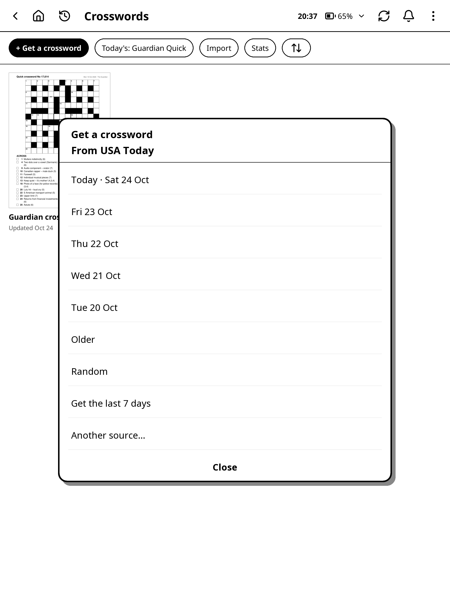

A message such as **Getting the crossword for Wed 21 Oct from USA Today…** shows while the Kindle downloads it, and the puzzle opens as soon as it's in. If it's already in your book, it just opens, with your writing as you left it.

> Downloads run in the background, so a slow or patchy Wi-Fi connection never freezes the Kindle. To stop waiting, tap **Cancel** (a tap anywhere else does nothing): the puzzle then isn't opened. A download that gets no answer gives up after a minute or two.

Each source has its own book: "Guardian crosswords", "USA Today crosswords" and so on, all in the Crosswords list.

### Get new ones automatically

Crosswords can fetch new puzzles for you.

1. Open Crossword settings (**⋮ > Settings** on the Crosswords list).
2. Tap **Get new ones automatically**.
3. Tick the sources you want (Guardian Quick, Guardian Cryptic, Guardian Quiptic, Guardian Prize, USA Today, Universal, Washington Post, New Yorker).

When you open Crosswords and Wi-Fi is already on, puzzles from the last 3 days that aren't in your books are added, at most once an hour. This happens quietly in the background while you carry on, and a notice such as "Added 3 new crosswords" says when they're in. With the launcher installed, it also goes in your notifications: "3 new crosswords are ready", and tapping it opens the first. It goes away once you open a crossword. It never turns Wi-Fi on for this. With Guardian Prize ticked, Prize puzzles also get their answers once they're out. A book you have open at the time is left alone until the next try.

### Today's crossword

**Today's crossword** opens the newest puzzle from one source: the one in your book if you have it, otherwise it downloads it in the background and opens it (KOReader asks to turn on Wi-Fi if needed). If today's isn't out yet, you get the one before.

Pick the source in **Crossword settings > Today's crossword**, or leave it on **The one last opened** to follow whichever source you used last in Get a crossword.

You can open it three ways:

- **Today's** at the top of the Crosswords list.
- A gesture: in KOReader, go to **Settings > Taps and gestures > Gesture manager**, pick a gesture, then **General > Today's crossword**.
- A shortcut on the launcher for one source: **Add shortcut > Crossword**, then pick the source. Each source can have its own tile, showing whether today's puzzle is started or done.

### Recent crosswords on the launcher

The launcher has a **RECENT CROSSWORDS** row, under RECENT BOOKS and RECENT NOTEBOOKS, with the puzzles you opened or wrote in most recently: up to 3 cards, or 5 with the Kindle on its side. It covers every crossword book, imported puzzles and PDF puzzle books, but not hidden puzzles or locked notebooks.

- Each card shows a small picture of the grid as you've written it so far, the puzzle's name, and how far you've got: "23 of 78 clues" with a progress bar, or **New**, **Started** or **Done** (always one of these for a PDF puzzle book). The picture is redrawn a moment after you close a puzzle, so it can take a refresh of the launcher to catch up.
- Tap a card to open that puzzle. A locked notebook asks for its PIN first.
- Hold a card for **Open** or **Remove from recent**. A removed card stays off the row until you work on that puzzle again (its state or ticked clues change).
- The row starts empty after updating and fills as you open puzzles.
- To turn it off, set **Recent crosswords** to **Off** in **Launcher** settings, or in the web page's Launcher tab. It's on to start with.

### Prize answers

The Guardian Prize answers are published a week after the puzzle. Get the same puzzle again after that (or have Guardian Prize ticked in Get new ones automatically) and its answers page is added. Your writing stays.

## Solving

Write the letters in the squares with the pen, as on paper. The toolbar down the left starts with **Home** (the house, back to the launcher, when it's installed) and the book (closes the puzzle book, back to where you opened it). Then come the pen (tap it again for its tips and sizes), eraser, lasso, zoom, Undo, Redo and **Done** (the ✓), and under them the buttons you've pinned: **Hint** and **Check my answers** to start with. Lower down are the page arrows, the puzzle list, **⋯** and the button that folds the toolbar away, and at the very bottom, always: **Refresh screen**, the **bell** (notifications, with the launcher installed) and **Settings**, which opens Crossword settings.

### Your toolbar buttons

Anything in a crossword book's **⋯** menu can go on the toolbar: Hint, Check my answers, Get a crossword, Page orientation, Open on the web page, Ask AI, Export, Hide page, Rename notebook, Pen pressure, Light and Night mode. (Refresh screen and Settings are always at the bottom.)

1. Open **Crossword settings** (the toolbar's **Settings** in a crossword book, or **⋮ > Settings** on the Crosswords list), then **Toolbar buttons**.
2. Tick the ones you want. They go under the tools, in the same order as in **⋯**.
3. Tap **Done**.

The more you pin, the closer together the buttons sit, so they all fit.

> Two-finger tap is Undo and two-finger hold is Redo, as in any notebook.

> Tick boxes, clue numbers and the clue arrows all work with a finger, even while you hold the pen near the screen. Finger taps are only ignored while the pen is writing and for a moment after, so a palm resting on the page doesn't tick or turn anything.

### Tapping a clue number

Tap a clue's number (in the clue list) with the pen or a finger, and its squares are outlined in the grid, with the clue itself outlined too. If the clue is on another clue page, it goes back to the grid's page first.

Tap a number in the grid, and the clues that start in that square are outlined: the Across one and the Down one.

- The clues are pinned in a card just above where you tapped (below, if there's no room above), just as wide as the clue needs.
  - Its tick box ticks the clue off, just as the box in the clue list does. Once every clue on the card is ticked, the card closes, and **Undo** at the bottom unticks the last one and brings the card back (for 3 seconds; **Crossword settings > Undo after a tick** sets how long, or Off).
  - Drag the card out of the way with the pen or a finger. When you let go, the screen is cleaned up where it moved.
  - To get the card only for clues on another clue page (the ones on the same page are just outlined in the list), set **Crossword settings > Clue card** to **Clues on other pages**.
  - Tap its **X** to close it. Otherwise it stays while you work.
- The outline goes away with your next pen stroke, or a finger tap anywhere else.
- The tap doesn't leave a dot.

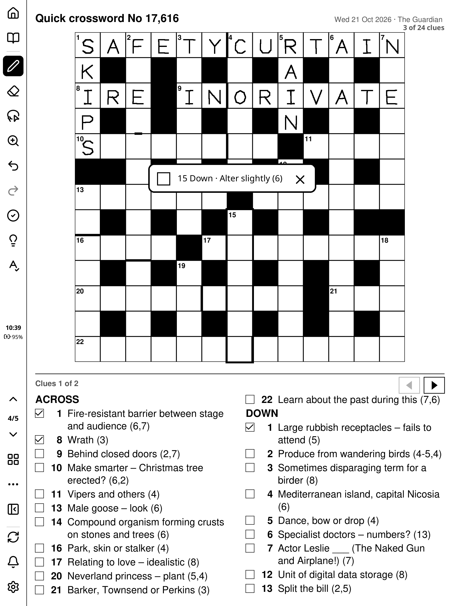

To turn this off, set **Crossword settings > Tap a number to find it** to **Off**.

### Ticking clues

With **Clue boxes** on (it is to start with), each clue has a small box in front of it.

- Tap the box with the pen or a finger to tick it. Tap again to untick it.
- Or draw a small tick or cross in it: it becomes a neat tick (a mark in a ticked box unticks it).
- Draw a line through several boxes, as if crossing clues out, and they're all ticked.
- Rub a tick out with the eraser to untick it.

The top of the page shows how many are done, such as "23 of 78 clues", and the puzzle list shows it too.

### More clues than fit

When the clues don't all fit under the grid (on big puzzles, or with Large clues), the grid stays where it is and only the clues turn.

- A bar above the clues says "Clues 1 of 2", with ◀ and ▶ arrows. Tap them with the pen or a finger.
- The toolbar's up and down arrows turn the clues too.
- Or swipe across the clues with a finger: left or up for the next clues, right or down to go back.

Only the clue part of the screen changes. What you write in the grid shows on every clue page. Anything you write beside the clues stays on that clue page.

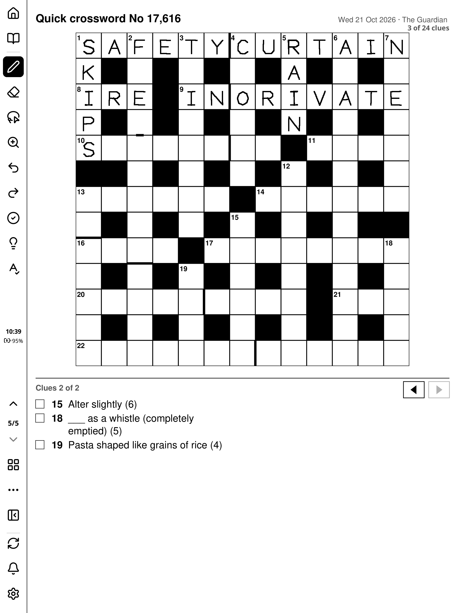

### Hints

Tap **Hint** (the lightbulb) on the toolbar, or **⋯ > Hint**, and pick one:

- **Reveal a letter**: then tap a square. Its letter appears in grey, with a small mark in the square's corner so you can tell it was revealed.
- **Reveal a word**: then tap a clue, or a square of the word. The whole answer appears in grey, each square marked.
- **Check my answers**: checks the whole grid, as the toolbar's button does.
- **Check a word**: then tap a clue or a square. Only that word is checked: the AI reads your letters and puts a dot in each square that looks wrong, without showing the right letter.
- **Ask AI for a hint**: then tap a clue or a square. **Asking the AI for a hint…** shows while it thinks (tap **Cancel** to give up; a stray tap elsewhere doesn't stop it), then a short nudge, never the answer, appears in a card by the clue. Ask again for the same clue and each hint goes further than the last (for a cryptic clue: first which part is the definition and the kind of wordplay, then how the wordplay works, then the strongest hint short of the answer). Drag the card out of the way, tick the clue off from it, copy the hint with its copy button, or tap its **X** to close it.
- **Show the answers page**: opens the puzzle's hidden answers page.

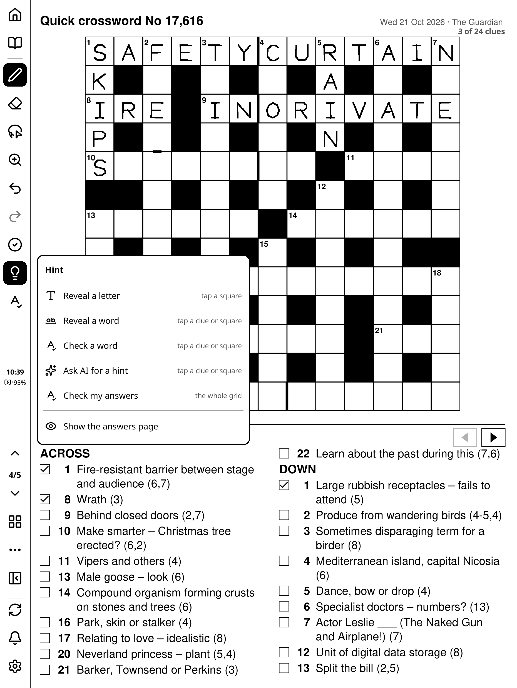

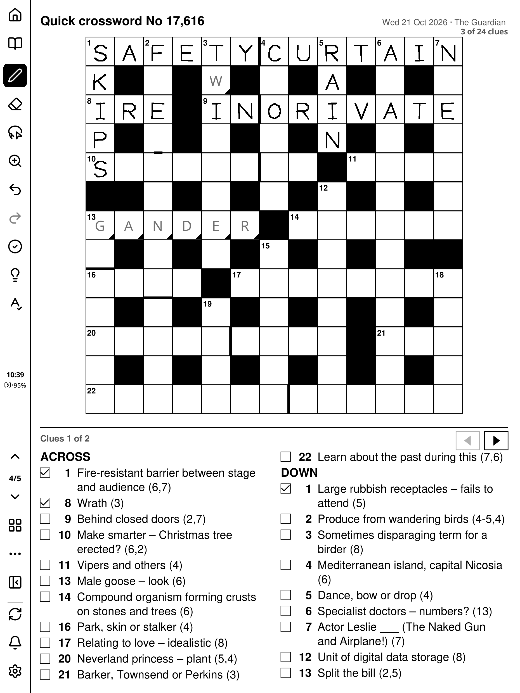

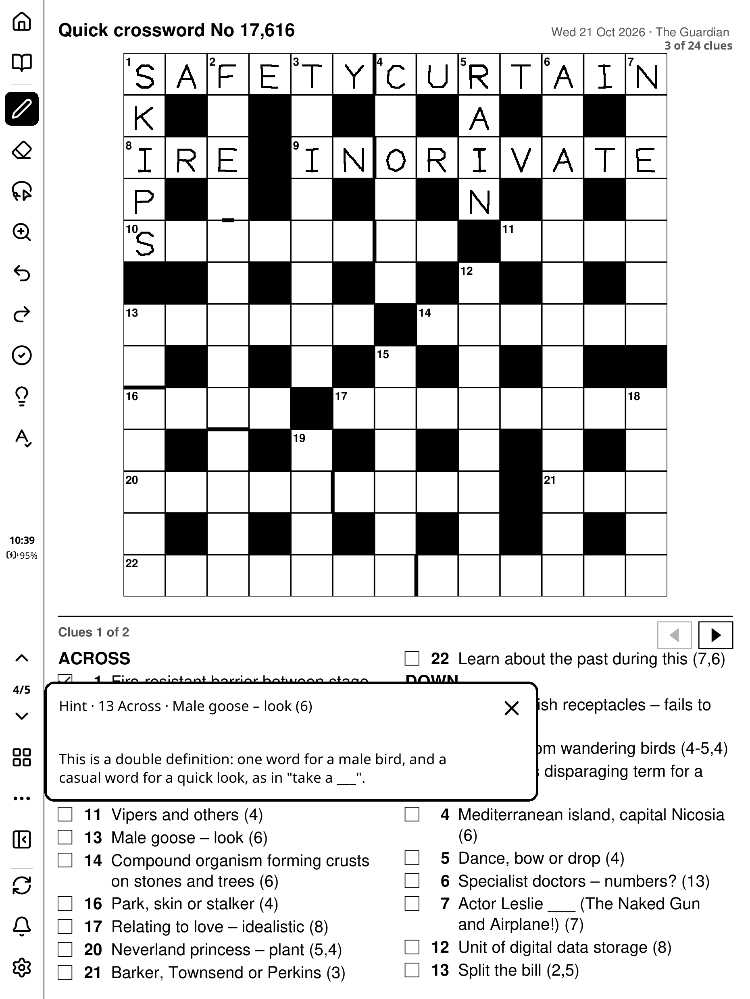

While a hint waits for your tap, a bar at the bottom says what to tap, with **Cancel**. Tapping a square where an Across and a Down word cross asks **Which word?**.

- Undo takes revealed letters out again.
- The puzzle list counts the hints you used, such as "Done · 14 min · 2 hints".
- If the AI's hint gives the answer away, Crosswords asks it again; if it still does, the hint isn't shown.

> Check a word and Ask AI for a hint need an AI set up first: see "Setting up the AI" below. Claude's hints are noticeably better than a small local AI's for cryptic clues.

### Answer

To see a whole answer without the Hint button:

1. Pick the lasso.
2. Draw around a clue, or some squares in the grid.
3. Tap **Answer** (beside **Ask**, below what you circled).

The answer shows, or "No answer yet" for a Prize puzzle whose answers aren't out. Tap **Copy** to copy the answers, or **Show in the grid** to put it in its squares, in grey and marked as revealed. Undo takes it out again.

To see just some letters, circle those squares and tap **Reveal** instead: only the squares you circled get their letters, in grey and marked as revealed. Undo takes them out again.

### Check my answers

The AI can read what you wrote and tell you which squares look wrong, without giving the right letters away.

1. Tap **Check my answers** on the toolbar (or **⋯ > Check my answers**).
2. A picture of the grid goes to the AI that reads handwriting (see "Setting up the AI" below).
3. **Checking your answers…** shows while the AI reads the grid (tap **Cancel** to give up; a stray tap elsewhere doesn't stop it). Then each square that looks wrong gets a small dot, and a line at the bottom says how many, such as "2 squares look wrong (dotted) · 41 filled".
4. Clues whose squares are all right are ticked for you.
5. Tap **Clear dots** when you're done with them.

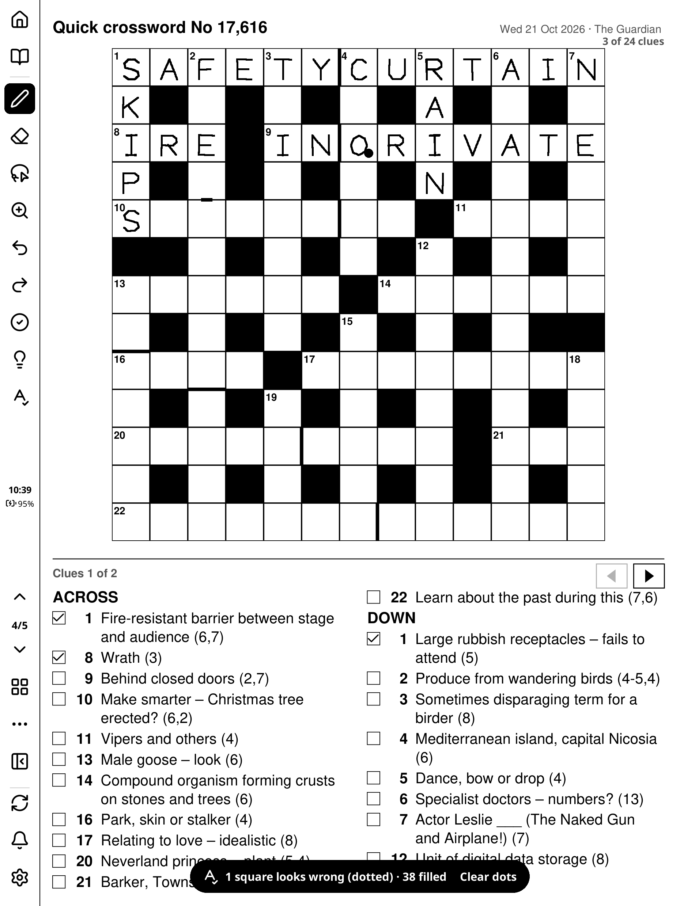

To check one word, use **Hint > Check a word**. To check some squares, circle them with the lasso and tap **Check**.

If the grid changed while it was being checked (you turned the page, or wrote or erased in it), no dots go on it, and a message says "The grid changed while it was being checked. Check again."

> Claude reads handwriting much more reliably than a small local AI. If many rows come back "not read", write the letters a little larger, or switch reading handwriting to Claude.

### Setting up the AI

Check my answers, Check a word, Ask AI for a hint and Ask all need an AI. Crosswords uses the AI services set up in the launcher's **Settings > AI** (shared with Notes and SSH): Claude, Gemini, OpenRouter, Groq, an AI you run on your own computer (Local AI, such as Ollama), or a Custom one. Until one is set up, they're left out: the Hint menu keeps Reveal a letter, Reveal a word and the answers page, the lasso keeps Answer and Reveal, and Crossword settings shows **AI services: Not set up**. They come back as soon as a service is set up.

1. Open Crossword settings (**⋮ > Settings** on the Crosswords list) and tap **Check my answers** or **Hints from the AI** under **AI**. That opens **Settings > AI**; Back returns to Crosswords.
2. Set up a service under **AI services**: for Claude, its own page takes the API key (from platform.claude.com) and the model; Gemini, OpenRouter and Groq have free tiers, which may answer "too many requests" when used a lot; for Local AI, enter the computer running Ollama and its port (for example http://192.168.1.50:11434) and pick a model that can read pictures.
3. Choose which service does each job. Check my answers and Check a word use the one for **reading handwriting**; Ask AI for a hint and Ask use the one for **Ask and Make PDF**.

To pick the AI and model for one job straight from a crossword, hold an AI button (**Check my answers**, the Hint menu's **Check a word** or **Ask AI for a hint**, or the lasso's **Ask** or **Check**): **AI for this** opens.

To change how the AI is asked, open **Advanced** in the AI settings: **Crossword hints** and **Crossword checks** each have their own wording, which you can edit (**Reset to default** puts it back), and a preview of what's sent. The rule that a hint never gives the answer, and the form a check's reply has to take, always stay.

The AI chapter has more detail, including using a local AI away from home.

### Ask AI anything

For a question of your own, circle a clue (or part of the grid) with the lasso and tap **Ask**. That part of the page, print and your writing, goes to the AI with your question. **⋯ > Ask AI…** asks about the whole page.

### Zoom

Tap the zoom button and drag a box around the grid with the pen. The zoom then shows that area as large as it fits, on every page of the book. Write while zoomed and the letters land small in the squares, so you can write big. The page arrows keep the zoom. **Change area** draws a new box; tap the zoom button again for the whole page.

### The timer and Done

With **Timer** on, each puzzle times itself while it's open and you're writing on it. A pause of more than 3 minutes counts as 3, so leaving it open doesn't add up.

When you finish, tap **Done** (the ✓ on the toolbar). The timer stops and the puzzle list shows "Done · 14 min". Tap ✓ again to mark it not done.

### Landscape

Turn the Kindle on its side (or tap **⋯ > Page orientation**) and each puzzle is laid out sideways: the grid on the left, the clues beside it.

- What you wrote in the grid comes with you, in the same squares.
- Writing elsewhere on the page stays with the way you wrote it.
- Done, the timer and the ticks are shared between the two.
- **Page orientation** also offers **Inverted portrait** and **Inverted landscape**.

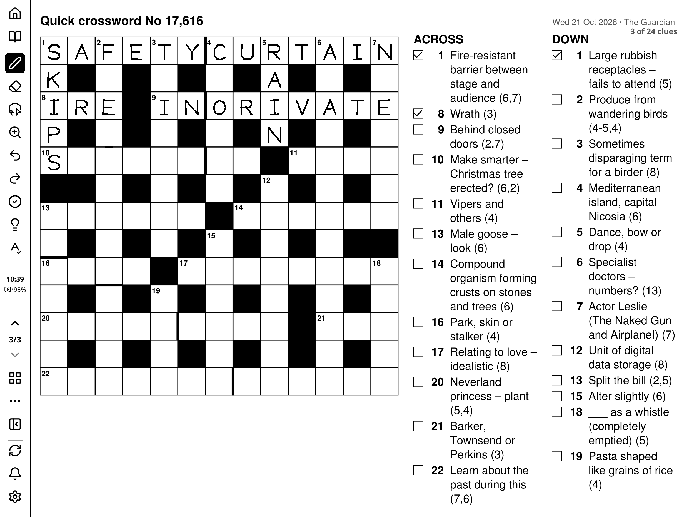

## The answers page

Every downloaded puzzle has an answers page right after it, hidden so you don't turn to it by accident. To see it, tap **Hint > Show the answers page**, or open the puzzle list, tap **Hidden**, then the answers page.

## The puzzle list

Tap the grid button on the toolbar to see the book's puzzles.

- Each puzzle is listed once, named by its day, with its state: not started, "Started · 6 min so far" or "Done · 14 min", and how many clues are ticked.
- **Newest first** switches to oldest first.
- **Next unstarted** opens the newest puzzle you haven't started.
- Filter with **All**, **Not started**, **Started**, **Done** and **Hidden**.
- The chart button in the title bar (**Stats**) shows your streak of days in a row with one done, this week's and this month's count, and for each source how many you've done, with the average and best time.

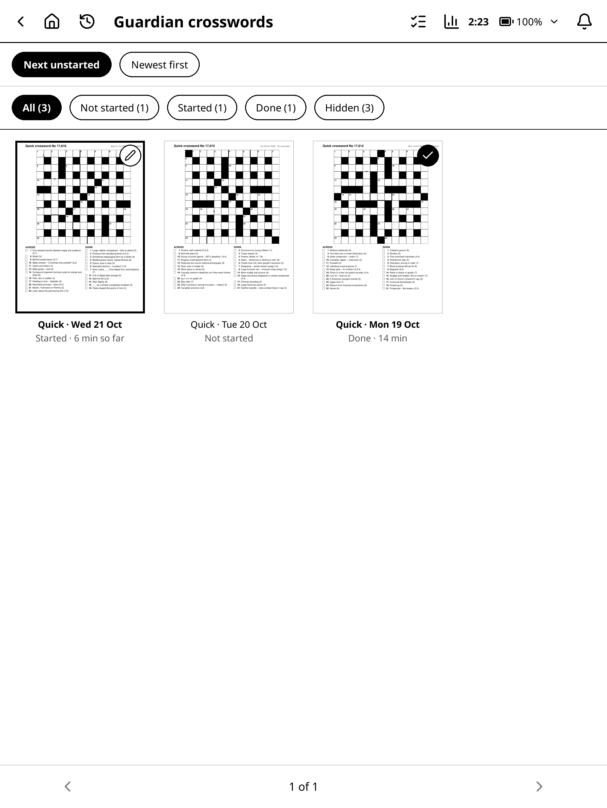

Hold a puzzle for more:

- **Mark as done** or **Mark as not done**.
- **Hide page** or **Show page**.
- **Clear writing**: rub out everything you wrote on it (after asking).
- **Remove puzzle**: takes its pages, its answers and your writing out of the book. Changed your mind? Tap **Undo** at the bottom of the screen within a few seconds to put it back.

The select button in the title bar (the list with ticks) lets you tick several and mark them done, hide them or clear them together.

To hide the page you're on without opening the list, tap **⋯ > Hide page**. The page arrows pass hidden pages by.

### Finished puzzles

**Crossword settings > Finished puzzles** decides what happens to puzzles marked done:

- **Keep**: they stay as they are.
- **Hide after 7 days**: a week after you finish, they move to Hidden. Your writing is kept.
- **Remove after 30 days**: a month after you finish, they're removed from the book.

## Importing puzzles

### A PDF of puzzles

Any PDF works: a puzzle magazine, a scanned book, a printout, with crosswords, sudoku or word searches. Nothing is read from the pages, so scanned pages work too.

1. Copy the PDF to the Kindle (over USB, or with the web page's Files tab).
2. On the Crosswords list, tap **Import**.
3. Pick the PDF.

It becomes a puzzle book in the Crosswords list, each page ready to write on. Done, Hidden, the puzzle list, zoom and Ask AI all work. Answer, Check my answers, clue boxes and tapping numbers need a downloaded or imported crossword, because the Kindle can't read the puzzle out of a PDF's pages.

> Hide a magazine's solution pages (hold the page in the puzzle list > **Hide page**) and the page arrows pass them by.

### A .puz or .ipuz file

These are the standard crossword file formats many puzzle sites offer.

1. Copy the file to the Kindle.
2. On the Crosswords list, tap **Import**.
3. Pick the file.

It's laid out just like a downloaded crossword and goes into the **Imported crosswords** book, with an answers page when the file includes the answers. Every crossword feature works on it, except that a file with scrambled answers has no Answer or Check my answers.

## Crossword settings

Crosswords has its own settings, full screen like the other apps' settings: tap **Settings** at the bottom of the toolbar in a crossword book, **⋮ > Settings** on the Crosswords list, or **Crosswords** in the launcher's Settings list. Switches turn things on and off; the others open a list.

- **DISPLAY**
  - **Clue size**: **Normal** or **Large**. Large clues that don't fit carry on to more clue pages; the grid stays put.
  - **Clue boxes**: the tick box before each clue. **On** to start with.
  - **Clue card**: when you tap a number in the grid, a card for **Every clue** (to start with) or for **Clues on other pages** only.
  - **Toolbar side**: **Left** or **Right**.
  - **Toolbar buttons**: which of the **⋯** menu's items go on the toolbar (see "Your toolbar buttons").
- **SOLVING**
  - **Tap a number to find it**: tapping numbers to outline clues and squares. **On** to start with.
  - **Timer**: times each puzzle. **On** to start with.
  - **Finished puzzles**: **Keep**, **Hide after 7 days** or **Remove after 30 days**.
- **GETTING CROSSWORDS**
  - **Today's crossword**: the source that Today's crossword, the gesture and the Crosswords tile on the launcher open.
  - **Get new ones automatically**: the sources to fetch for you (see above).
  - **Test connection**: checks that the Kindle reaches each newspaper you get puzzles from (with the launcher installed; also on the web page's Crosswords tab).
- **AI**
  - **Check my answers** and **Hints from the AI**: which AI service each uses. Tap one to change it; it opens the launcher's **Settings > AI**, shared with Notes and SSH. With no service set up, this is one row: **AI services: Not set up**.

When you change Clue size or Clue boxes, your crossword books are laid out again the next time you open them. Your writing is kept.

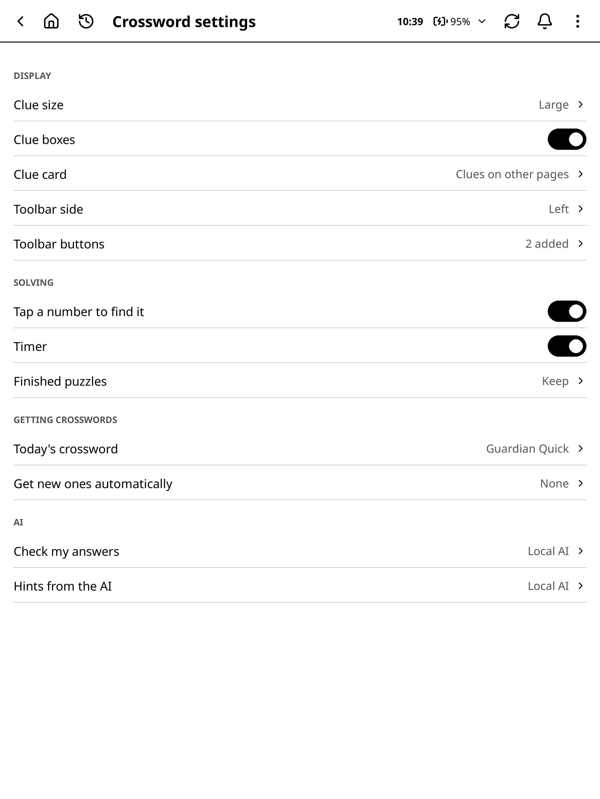

## Crosswords on the web page

With the Web page plugin running, the **Crosswords** tab in your browser lets you manage crosswords from a computer or phone. The Kindle does the downloading, so it needs to be on Wi-Fi.

- Your crossword books, with each puzzle's day, state and time.
  - **Open on Kindle** opens that puzzle on the Kindle.
  - **Remove** takes it out of the book.
- **Get crosswords**: pick a source (and for The Guardian, the kind), tick the days you want (**Older ›** and **‹ Newer** move through them), then tap the **Get** button. Days already in the book say "(in the book)". The Kindle downloads them in the background: the button says "Getting 3…" until they're in, then a message says how many were added. For The Guardian, the list of days can take a moment to appear while the Kindle fetches it.
- **Import PDF, .puz or .ipuz**: upload a file from your computer. A PDF becomes a puzzle book; a .puz or .ipuz goes into Imported crosswords.
- **Crossword settings**: the same settings as on the Kindle.

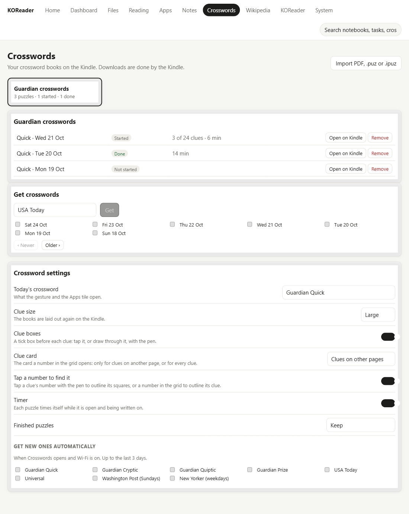

To open it on your phone straight from the Kindle, tap **Open on the web page**: in a crossword book it's in **⋯**, and on the Crosswords list it's in **⋮**. The Kindle starts the web page if it isn't running and shows a QR code. Scan it with your phone's camera and the Crosswords tab opens there, at the book and puzzle you were on.

> A book that's open on the Kindle can't be changed from the web page. Close it on the Kindle first.
