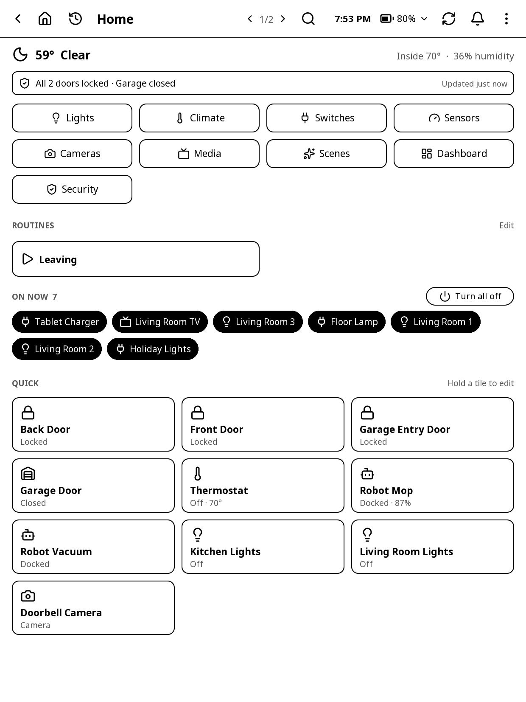
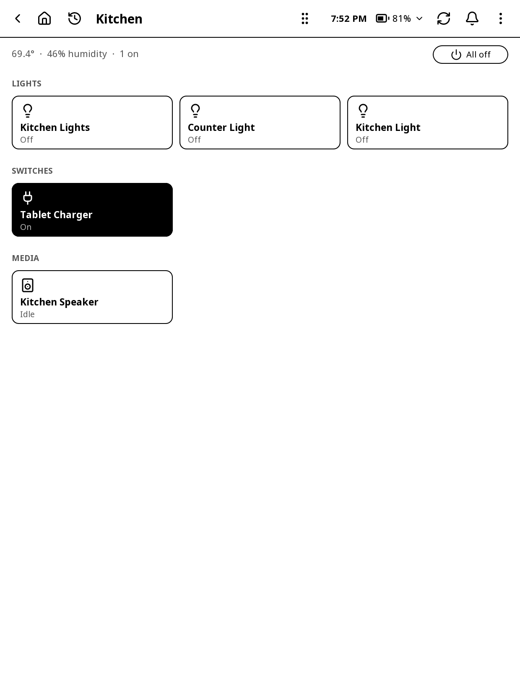
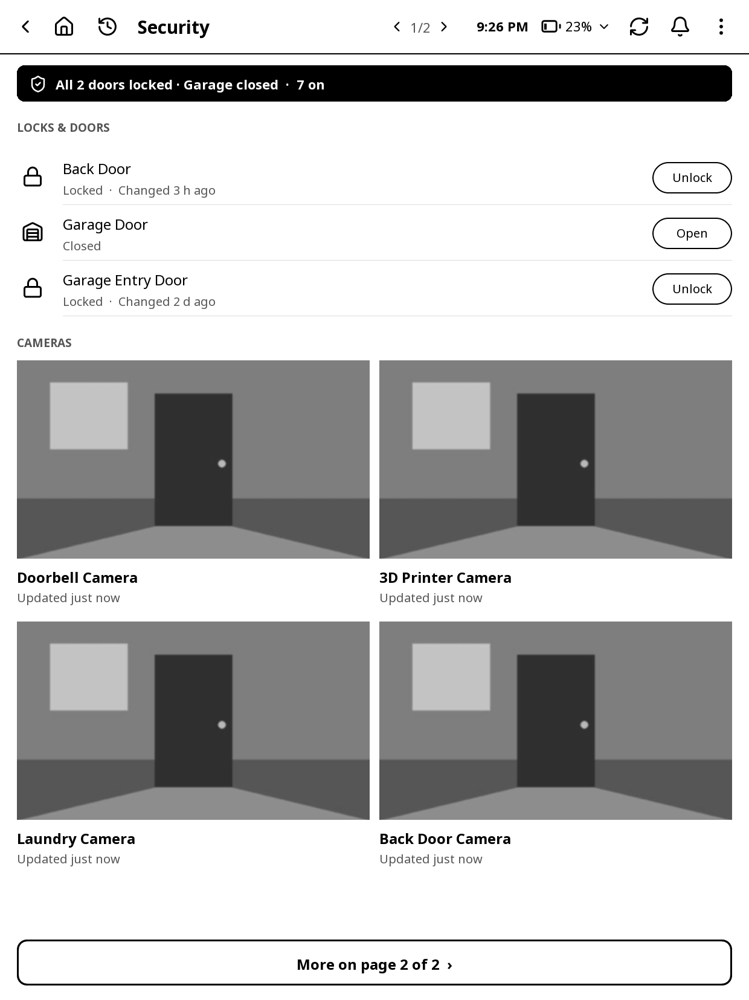
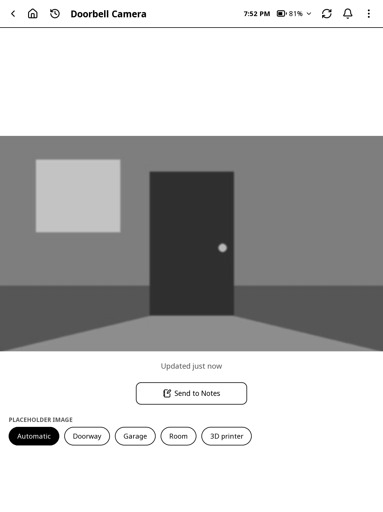
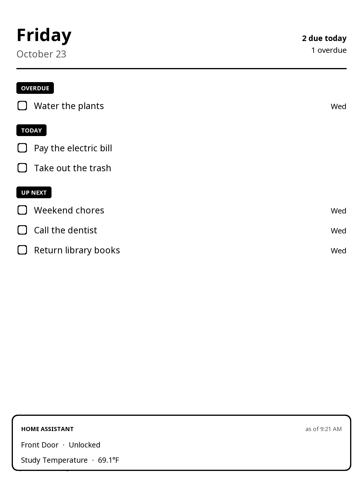
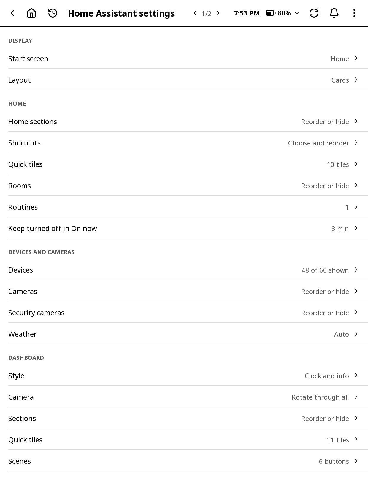

# Home Assistant

Control your home from the Kindle: lights, switches, fans, the thermostat, locks, the garage, vacuums, speakers and TVs, cameras, scenes and scripts, room by room. A dashboard turns the Kindle into a nightstand display.

## Opening it and signing in

Open it from the launcher's **Home Assistant** or **Dashboard** tile, **Tools > Home Assistant**, or a gesture (**General > Home Assistant** or **Home Assistant dashboard**). The **Dashboard** tile shows once you're signed in.

Any device can also be one of the launcher's quick buttons, under the clock and in the control center in every app: a light with − and +, the thermostat, a speaker's controls, a sensor's reading (see the launcher chapter, Quick buttons).

Without Home Assistant, nothing else is affected: the other apps don't need it, and the launcher's weather can come from Open-Meteo instead (see the launcher chapter, Weather).

The first time, **Connect to Home Assistant** asks how to sign in:

- **Sign in with username and password**, as in the phone app, one step at a time (**Next**, and **Back** to change an earlier step):
  1. **Internal URL**: the address at home, such as `http://homeassistant.local:8123`. Turn on **External URL** under it if you also have an address that works from anywhere; it becomes its own step.
  2. Your **User name**.
  3. Your **Password**, then **Sign in**.
  4. If your account has two-step sign-in, a **Two-factor code** box asks for the code from your authenticator app.
- **Use a long-lived token**: make one in Home Assistant (your profile > Security), then **Load from file** (copy it to the Kindle first) or **Enter manually**.

The internal address is tried first, then the external one; the one that answered is tried first next time. "Connected to Home Assistant" says it worked.

> Home Assistant keeps working without Wi-Fi: the last states are kept, so the screens open at once. It updates every minute while it's open and the Kindle is online. It never turns Wi-Fi on by itself; tapping refresh or a device does (KOReader asks).

## The title bar

The bar every app has (see "Finding your way around" in Getting started). In Home Assistant:

- **‹** on the screen Home Assistant opened on goes back to the launcher.
- The screen's own buttons, such as **search** on Home and **refresh** on Cameras.
- **The time and battery** (the control center).
- **Refresh**: the states again from Home Assistant, and the screen flashed clean.
- **The bell**: Home Assistant's notifications are in the shared list; tapping one opens Home Assistant's own **Notifications** screen, where **Dismiss** removes it from Home Assistant (and from the list).
- **⋮**: **Open on the web page** (a QR code for the web page's Home Assistant tab), **Add to launcher** (puts this screen on the launcher; on screens that can be a tile, not on Search, Settings or Routines), **Home Assistant notifications**, **Recent apps**, **Light**, **Night mode**, **Refresh screen** and **Settings**. On Cameras and Security it also has **Reorder or hide cameras**.

## Home

Home is made of sections. Settings > **Home sections** reorders or hides them.

### Weather and status bar

- **The weather**: the temperature and conditions. Tap it for the Dashboard.
- **Inside**: the temperature and humidity inside.
- **The status bar** turns dark with a warning when something needs attention:
  - an unlocked lock
  - the garage open, and for how long
  - a door or window open, and for how long
  - a leak, smoke, gas or carbon monoxide
  - a device problem
  - a battery under 20%
- Otherwise it is light with a shield: "All 3 doors locked · Garage closed", or "All clear".
- Its right end says when Home Assistant last answered: "Updated 2 min ago", "Updating…" or "Update failed".

### Shortcuts

A row of buttons for whole kinds of things. **Lights**, **Climate**, **Switches**, **Sensors**, **Cameras**, **Media**, **Scenes**, **Dashboard** and **Security** show to start with. **Doors**, **Vacuums**, **Weather**, **Activity**, **Batteries** and **3D printer** can be added in Settings > **Shortcuts**. Hold a shortcut for **Open** or **Add to launcher**.

### Routines

Your routines as play buttons (see Routines below). Tap one to run it, hold it to change it. **Edit** opens the Routines screen.

### On now

Everything that is on: lights, switches, fans, players. Tap one to turn it off, hold it for its controls. **Turn all off** turns them all off.

Something you turn off here stays in On now for a few minutes, drawn as off (white), so a tap turns it straight back on if it was a mistake. Settings > **Keep turned off in On now** sets how long (**Off**, 1, 3, 5 or 10 minutes; 3 to start with).

### Quick

Your Quick tiles: the things you use most. To start with, the locks, covers, thermostats, vacuums and each room's lights. To add one, hold any device and choose **Quick & dashboard > Add to Quick**.

### Rooms

Each room with a summary such as "2 on · closed · locked · 70°". Tap a room to open it. Rooms follow Home Assistant's floors unless you order them yourself (Settings > **Rooms**). Devices without a room are under **Everything Else**.

## Tiles: tap and hold

**Tap** a tile for the obvious thing:

- **Lights, switches, fans**: on or off.
- **Locks**: lock or unlock.
- **Covers and the garage**: open or close.
- **Scenes**: turn on. **Scripts**: run.
- **Buttons** (a button device): press it. One named like cancel, stop, reboot, shutdown or restart asks first.
- **Cameras**: take a new picture.
- **Thermostats, players, vacuums and sensors**: open their controls.

The new state shows at once; Home Assistant's real one follows a moment later.

Some taps ask first: **Unlock** a lock, **Open** or **Close** the garage, **Run** a script. Each can be turned off in Settings > **CONFIRM**.

**Hold** any tile for its controls, which slide up from the bottom:

- **Lights**: brightness in steps; colors (**Red**, **Orange**, **Yellow**, **Green**, **Cyan**, **Blue**, **Purple**, **Pink**, **Warm white**, **Cool white**) or **Warm**, **Neutral** and **Cool** white.
- **Fans**: **SPEED**, **PRESET** and **Oscillate**.
- **Thermostats**: **MODE** (Heat, Cool, Heat/Cool, Off…), the set temperature with big − and + (both **HEAT TO** and **COOL TO** in Heat/Cool), and **FAN**.
- **Covers**: **Open**, **Stop**, **Close** and **POSITION**.
- **Locks**: one big **Lock** or **Unlock**.
- **Vacuums**: **Start**, **Pause** and **Return to dock**.
- **Players**: previous, play/pause, next, mute, volume and **Source**, with what's playing.
- **On and off**: lights, switches, fans and players have an on/off switch at the top right. A TV that Home Assistant can't wake says so: it can turn it on only once Wake-on-LAN or a turn-on automation is set up for it.
- **Cameras**: **Open full screen**, and **PLACEHOLDER IMAGE**: the drawing shown until the picture arrives (**Automatic**, **Doorway**, **Garage**, **Room**, **3D printer**).
- **How old a reading is**: a lock's or sensor's sheet starts with a small line such as "Changed 12 min ago", so you can tell whether a reading is stale. The same line is under locks and sensors on Security and in a room, and on the web page's Devices list. It counts minutes, then hours, then days, and moves on when the screen redraws.
- **Sensors with a number**: a bar graph of the **LAST 24 HOURS** with its highest and lowest.

At the bottom of every sheet:

- **Quick & dashboard**: add it to or remove it from Home's Quick tiles, or the dashboard (scenes and scripts become the dashboard's scene buttons).
- **Hide**: takes it off the screens. Settings > **Devices** brings it back.

## Rooms

A room's screen shows its temperature and humidity, how much is on (with **All off**), then its devices by kind: **LIGHTS**, **SWITCHES**, **CLIMATE**, **DOORS**, **MEDIA**, **CLEANING**, **CAMERAS**, **SCENES & SCRIPTS** and **SENSORS**. Cameras show their picture: tap to refresh, hold for full screen. The grip icon at the top reorders or hides the room's devices.

## The other screens

- **Lights**, **Switches**, **Sensors**, **Doors**, **Vacuums**: everything of that kind, by room. Lights and Switches have **Turn all off**.
- **Climate**: a card for each thermostat with the temperature now, what it is doing, and − and + for the set point; then **FANS** and each room's temperature and humidity.
- **Cameras**: every camera's picture. Tap one for a new picture, hold for full screen. Refresh at the top updates them all.
- **Media**: each playing speaker or TV with its controls, then the others. With Plex set up in Home Assistant, **PLEX** comes first: who's watching what and where, **Scan clients**, and **Scan a library** (its library sensors when they're turned on in Home Assistant; otherwise type the name once and it's remembered).
- **Scenes & scripts**: each with **Run**.
- **Security**: the status bar, **LOCKS & DOORS** (with **Lock all** when something is unlocked), the security cameras, and door, window, motion, smoke and leak sensors.
- **Weather**: now (temperature, humidity, wind, inside), **NEXT HOURS** with the chance of rain, and **NEXT DAYS** with highs and lows.
- **Activity**: what changed, newest first.
- **Batteries**: every battery, lowest first, bold under 20%.
- **3D printer**: its camera, the print's progress, file, time left and layer; **TEMPERATURES** (nozzle and bed); **CONTROLS**, named as the printer names them (such as **Pause**, **Resume**, **Cancel** or **Stop**); and **DETAILS**.
- **Search** (the magnifier on Home): find a device by name, room or id. Launcher search also finds devices and routines; a device opens its controls.
- **Notifications** (the bell): Home Assistant's notifications, each with **Dismiss**, and **Dismiss all**.

## Cameras and Send to Notes

A camera's full-screen view shows its newest picture. Tap it, or refresh, for a new one. While a picture loads, a drawing stands in (a doorway, a garage, a room or a 3D printer). Pictures are dithered for e-ink and never stretched.

**Send to Notes** (when Notes is installed) puts the picture as a new page in a notebook:

1. Tap **Send to Notes** under the picture.
2. Pick the notebook.
3. Notes adds a page with the picture and its camera and time above it, such as "Front door · 3:42 PM". A notice says where it went.

## The dashboard

For the nightstand or a wall: open it with the **Dashboard** tile, a shortcut, a gesture or as the start screen. **Settings > DASHBOARD > Style** picks one of five looks:

- **Clock and info**: a big clock and date, the weather with tomorrow's, and the sections below.
- **Security**: up to four cameras, the status bar, and the locks and doors with their buttons.
- **Info cards**: big numbers for the weather, inside, doors, locks, the garage, lights on, vacuums and the lowest battery.
- **Camera**: one big picture.
- **Clock only**: a huge clock, the date, the weather and the status bar.

### Clock and info sections

**Settings > DASHBOARD > Sections** orders or hides them:

- **Status bar**: what needs attention, and how many things are on.
- **Room temperatures**.
- **Next up**: the next calendar event, or a To Do reminder in the next day and a half.
- **Now playing**: what a speaker or TV is playing, with buttons.
- **Today's tasks**: To Do's tasks due today. Tick the box to complete one; tap its text to open it.
- **Scenes and routines**: buttons for your routines and chosen scenes.
- **24-hour graph**: a sensor's last day (Settings > **Graph** picks which).
- **Camera**: fills the rest of the screen. Tap to refresh, hold for full screen.
- **Quick tiles**: the dashboard's own Quick tiles.

Today's tasks, Scenes and routines, and the 24-hour graph are off to start with. A section that doesn't fit is left out.

### Using the dashboard

- **Tap the clock** to leave the dashboard. **Tap the weather** for the Weather screen.
- The bottom line shows when it last updated ("Updated 2 min ago"), whether the screen stays on ("Screen on while charging", "Screen always on" or "Normal sleep"), and **Tap to exit**. **⋮** and the gear are at the bottom right.
- The Kindle's battery shows next to the date in the **Clock and info**, **Info cards** and **Clock** styles.
- **Update interval**: how often it updates (every 1 to 30 minutes; 5 to start with). Pictures are taken again at each update, rotating through the cameras unless **Camera** picks one.
- **Keep awake**: **While charging** (to start with), **Always** or **Never**: whether the Kindle stays awake while the dashboard shows.
- **Auto brightness**: on a Kindle with a light sensor, the front light follows the room's light while the dashboard shows.
- **Doorbell alerts**: when the doorbell rings or sees motion (**Ring and motion**, **Ring only** or **Off**), its camera fills the screen for a minute, updating every few seconds, then the dashboard comes back.

## Routines

A routine runs several things in one tap, such as "Leaving": lights off, lock the door, close the garage. Routines are kept on the Kindle.

1. Settings > **Routines**, then **New routine**, and give it a name.
2. **Add step**: pick a device, then what it should do (**Turn on**, **Turn off**, **Lock**, **Unlock**, **Open**, **Close**, **Run**, **Start**, **Return to dock**, **Pause**).
3. Add as many steps as you like. Tap a step to remove it.
4. **Run now** tries it. **Rename** and **Delete** are there too (**Undo** for a few seconds after a delete).

Routines show on Home (tap to run, hold to edit) and in the dashboard's Scenes section. They also work from outside the app: add one as a quick button (in the group **Routines**; tap runs it, hold opens it), find it in Search (it opens the routine's page), or give a gesture the action **Home Assistant: run a routine** and pick the routine. A routine that unlocks a door, opens the garage or runs a script asks first, like those taps do. When it finishes, a notice says it's done, or how many steps didn't work.

## Alerts

### Wake alerts

When the Kindle wakes, Home Assistant checks the house. If a lock is unlocked, the garage is open, or a door or window is open, a box lists them with a **Security** button. Settings > **Wake alerts** turns this off.

### Sleep screen alerts

Chosen things are shown at the bottom of any sleep screen when they need attention.

1. Settings > **Sleep screen alerts**.
2. Tap the eye next to each one to show: locks, doors and covers, sensors such as leaks and motion, and sensors with a number such as a temperature. The arrows order them.

When the Kindle sleeps, a box titled **HOME ASSISTANT** lists:

- a lock that is unlocked
- a door or cover that is open
- a sensor that is on (a leak, motion)
- each number sensor with its value, always

It shows "as of" the time of the last update. Nothing is shown when all is well.

### The Home Assistant sleep screen

With **Sleep screen** set to **Home Assistant**, the sleeping Kindle shows:

- the date and when it went to sleep
- the weather
- the status bar
- notifications
- the inside temperatures
- your Quick tiles' states

## Settings

**⋮ > Settings** on any screen, or **Settings > Home Assistant** on the launcher. The settings are on full pages; swipe or tap the arrows next to the page number. (The light, night mode and a screen refresh are in **⋮**.)

### Display

- **Start screen**: **Home** or **Dashboard**.
- **Layout**: **Cards**, **Big tiles**, **List** (a switch or button on each row, such as **Unlock** or **Start**) or **Minimal**.

### Home

- **Home sections**, **Shortcuts**, **Quick tiles** and **Rooms**: each opens a list to order (see below).
- **Routines**.
- **Keep turned off in On now** (see On now).

### Devices and cameras

- **Devices**: which devices show at all. Tap a device to show or hide it; **All**, **Shown** and **Hidden** filter the list, and search finds one. Settings that are switches on a device (its LED, motion detection, firmware updates) are hidden to start with.
- **Cameras** and **Security cameras**: lists to order (see below).
- **Weather**: **Auto**, or which weather service to use when Home Assistant has more than one. It is used by Home, the dashboard, the Weather screen and the launcher.

### Dashboard

- **Style**, **Camera** (**Rotate through all**, **None** or one camera), **Sections**, **Quick tiles**, **Scenes**, **Graph**, **Auto brightness**, **Doorbell alerts**, **Update interval** and **Keep awake**, as described under The dashboard.

### Sleep screen

- **Sleep screen**: opens the launcher's settings at **Sleep**, where the sleep screen is chosen for every app.
- **Sleep screen alerts**: a list to order (see below).
- **Wake alerts**.

### Confirm

- **Unlock doors**, **Open or close garage** and **Run scripts**: whether these ask first.

### Connection

- **Update interval**: every 1, 2, 5 or 10 minutes, or **Manual only**.
- **Internal URL** and **External URL**.
- **Test connection**: tries the **Internal URL** and the **External URL** separately, so you can see which one works: **Works** and how long it took, or what went wrong (no answer, the name couldn't be looked up, a proxy's sign-in page instead of Home Assistant, a sign-in that ran out), with the exact error under it.
- **Account**: signed in, using a token, or **Sign in**. **Sign out** also removes the Kindle's sign-in from Home Assistant.
- **Long-lived token**.

### Ordering lists

The lists in Settings (Home sections, Shortcuts, Rooms, Cameras and the others) all work the same way:

1. Tap a row to select it. Four arrows appear: to the top, up, down, to the bottom.
2. **The eye** shows or hides it. Lists you add to (Quick tiles, the dashboard's tiles and scenes) have **✕** to remove one instead.
3. **Undo** at the top puts back the last move, one at a time.

The web page's Home Assistant tab (**Order**) draws Home as it looks, its sections, shortcuts, Quick tiles and rooms, to drag into order or to Hidden.

### Tips

- Your KOReader gestures for the light, warmth, refresh, night mode, Wi-Fi and a screenshot, and the other apps' actions (Launcher, Notes, To Do, Web server, Wikipedia, Syncthing, SSH), work on Home Assistant's screens too.
- Swipe in from the left edge to go back (a sheet closes first). Other swipes turn pages. For a dark screen, use KOReader's **Night mode** (⋮ or the control center).
- A diagonal swipe flashes the screen clean.
- Hidden a device by mistake? Settings > **Devices > Hidden**, and tap it.
- On its side, every screen uses the extra room: more tiles across, and the dashboard's camera on the right.
