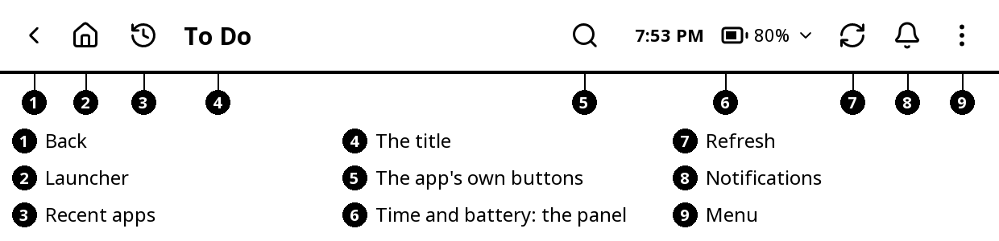
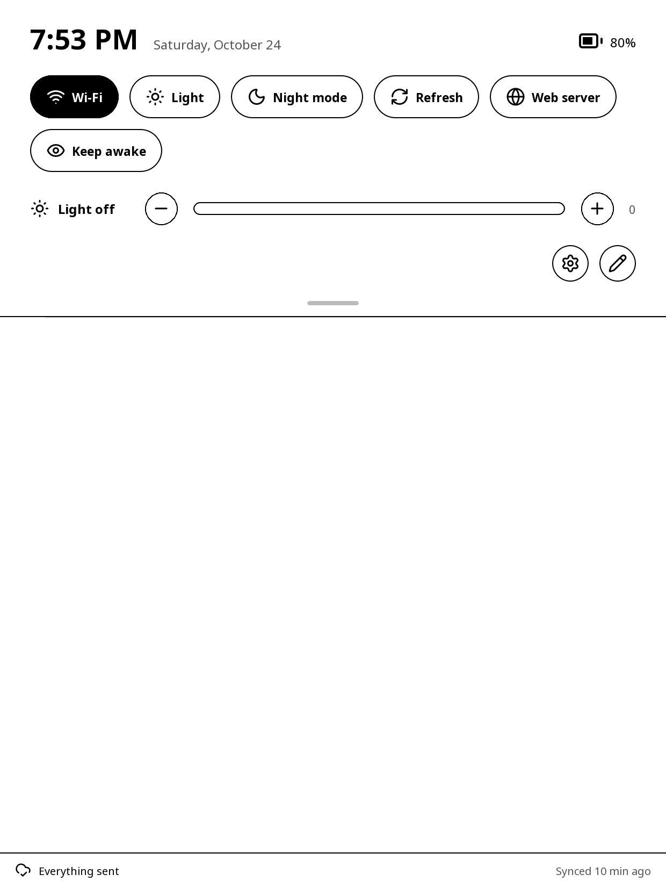
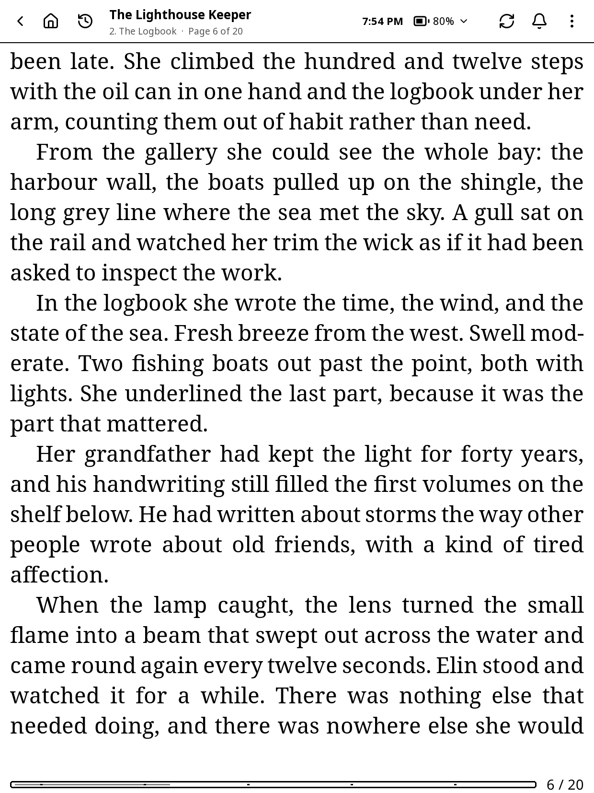
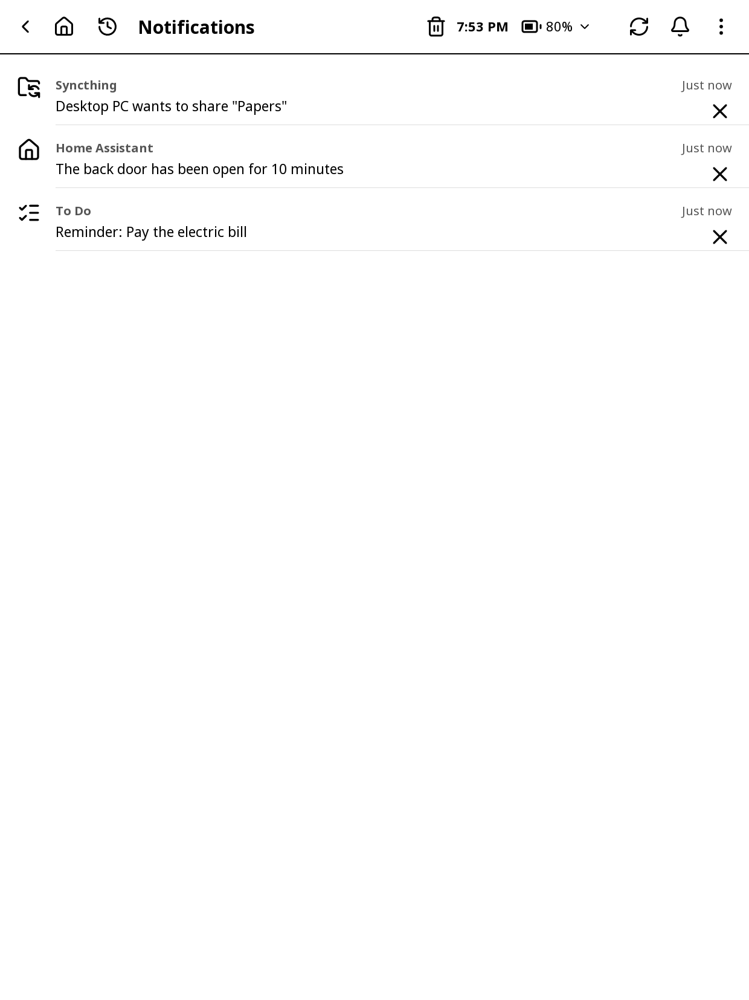
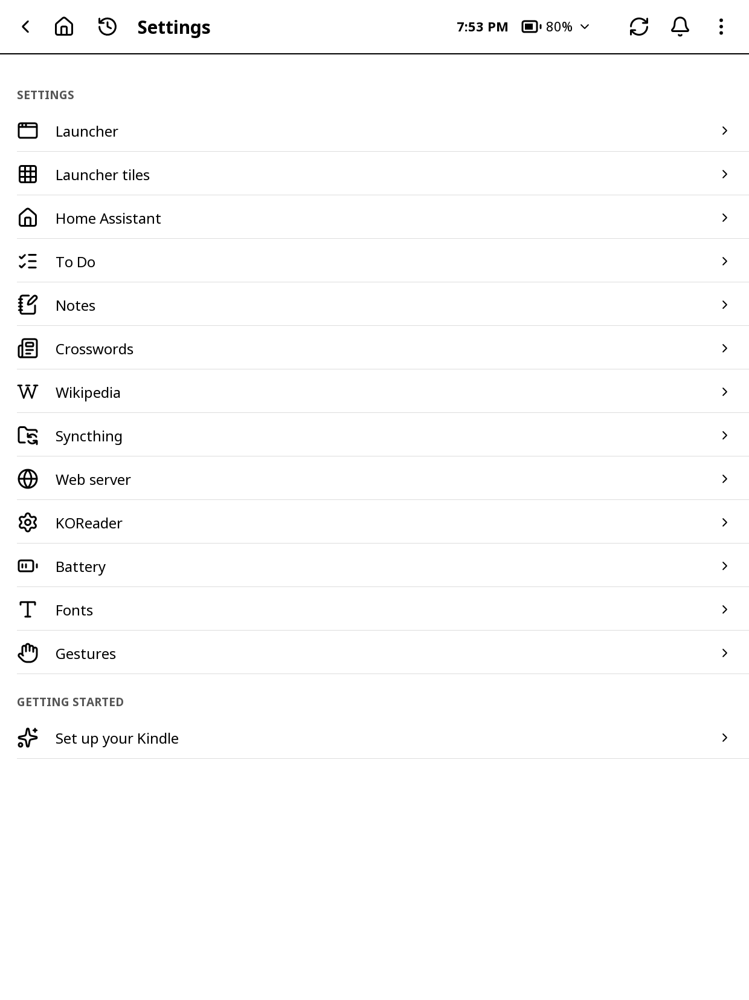
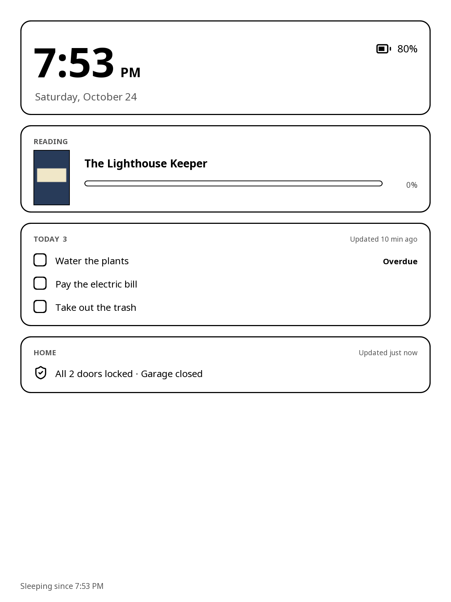

# Getting started

This guide covers these plugins for KOReader on a Kindle Scribe:

- **The launcher**: big tiles for everything else, the weather (with or without Home Assistant: a free forecast, US alerts, 24 hours and 7 days), reading statistics, what's next and your recent books; also the shared pieces every app uses (the bar at the top, notifications, settings, search).
- **Home Assistant**: your lights, locks, thermostat, cameras and more, plus a nightstand dashboard.
- **To Do**: your Microsoft To Do lists and tasks, also when Wi-Fi is off, or lists kept on the Kindle with no account.
- **Notes**: handwritten notebooks for the pen.
- **Crosswords**: puzzle books from several newspapers, solved with the pen. Its own app, but it needs Notes (it draws with Notes' pen and pages).
- **Wikipedia**: look up and read Wikipedia articles, and save them to read offline.
- **Syncthing**: keeps folders on the Kindle in sync with your computer or phone over Wi-Fi.
- **SSH**: run commands on your other devices (a PC, a NAS, a Raspberry Pi) and read what they print, or open a live session.
- **Web server**: a web page on the Kindle for your phone or computer, to manage all of the above with a keyboard.

Smaller things the plugins add, and where to find them:

- **Reading time and statistics**: the launcher's **Reading statistics** tile (every book's statistics and the calendar), and the web page's **Reading** tab (today, days in a row, each book; fix or delete a reading session; progress sync).
- **Battery**: the launcher's **Battery** screen (**Settings > Battery**, search, or a tile you can show), the control center (see below), and the **Battery** card on the web page's **System** tab: how fast it goes awake and asleep, and what is on that uses power.
- **Fonts**: the launcher's **Fonts** tile: your fonts drawn in their own typefaces, **Get more** (all of Google Fonts to browse and search, with suggested reading fonts to start with), and the font settings. The web page's **Fonts** tab has the same.
- **Quick buttons**: buttons under the launcher's clock and in the control center in every app (Wi-Fi, a new task, a Home Assistant light with − and +, your book and many more). See the launcher chapter.
- **KOReader's own settings**: **Settings > KOReader**, the launcher's **KOReader settings** tile (one you can show), and the web page's **KOReader** tab (folders, the common settings and KOReader's whole menu).
- **Restart KOReader**: the launcher's **⋮** menu (or a tile you can show).
- **When something goes wrong**: the web page's **System** tab: crashes and freezes (**Problems**), memory, a network check, when the Kindle slept and woke, detailed logging, and a diagnostics file to send. The launcher also says when KOReader crashed or froze the last time.
- **Files and books from a browser**: the web page's **Files** tab: upload (or get a file from a link), search every folder, favorites and collections, a book's details and its highlights.
- **Arranging things on a big screen**: the web page draws the launcher's tiles, the quick buttons, Home Assistant's Home, the widgets sleep screen, To Do's Home tiles and Notes' toolbar as they look on the Kindle, to drag into order.

Each chapter starts with how to open the app and then goes screen by screen. Names in **bold** are what you see on the Kindle's screen.

## Finding your way around

All the apps work the same way, so what you learn in one works in the others.

### The bar at the top

Every app's screens have the same bar:

- **‹** goes back one screen. On an app's first screen it goes back to the launcher.
- **The house** always goes to the launcher.
- **Recent apps** (a clock with an arrow, next to the house) shows the apps you opened lately as cards, then your recent books, notebooks and crosswords. Tap one to go straight there; an app that is still open comes back as you left it. It's also in **⋮ > Recent apps**.
- The screen's **title**, and on long screens the page number with arrows: tap an arrow for the next or previous page.
- At the right: the app's own buttons (search, **+** and so on), then **the time and battery** with a small **▾**, **refresh**, **the bell** and **⋮**.
- **Refresh** gets the app's latest (Home Assistant's states, a To Do sync) and flashes the screen clean.
- **⋮** has the app's own actions, **Recent apps**, the light, **Night mode**, **Refresh screen**, and **Settings** last. **Open on the web page** (in most apps) starts the web server and shows a QR code: scan it with your phone to open the same place there, handy for typing a lot.

### The control center

Tap **the time and battery** (the **▾** says you can) in any app's bar for the control center, a panel that drops down from the top:

- The time, the date and the battery; tap the battery for the Battery screen.
- Your **quick buttons** (see the launcher chapter), then **Wi-Fi**, **Night mode**, **Refresh**, **Web server** and **Keep awake** (the Kindle doesn't go to sleep until you turn it off again) when they aren't among them. Black means on. Tap does the quick thing; hold opens what's behind it. A group drops its buttons down; with lots of buttons there are pages.
- **Light**, and **Warmth** on a Kindle that has it: **−** and **+**, or tap a spot on the bar.
- The cog (**Settings**), the pencil (change your quick buttons), and over a book or the library **KOReader menu**.

Tap below it, or swipe up, to close it. On the launcher, tap its battery and Wi-Fi.

### Going back and turning pages

- **Swipe in from the left edge** to go back: start the swipe in the leftmost tenth of the screen. It works on every screen of every app, and in a book (back to the launcher or the library, wherever you opened it) or the library (up a folder) while the title bar is on (see below).
- Other swipes turn pages: **left** is the next page, **right** the one before. On the first page, a swipe right does nothing.
- A **diagonal swipe** flashes the screen clean.
- **Hold** something (a tile, a task, a notebook, a book) for more choices.
- Your own KOReader gestures still work inside the apps (two-finger swipes, the edge swipes along the sides, multiswipes, pinches), for what makes sense there: the light, night mode, a refresh, Wi-Fi, a screenshot and the apps' own actions. The pen in Notes and Crosswords is never affected.

### In a book and in the library

Tap the top of a book's page (where KOReader opens its menu) and the same bar shows over the page: **‹** back to where you opened the book (the launcher or the library), **the house**, **Recent apps**, the book's title with its chapter and page, the time and battery (the control center), **refresh**, **the bell** and **⋮**. **⋮** has **KOReader menu** (KOReader's whole menu, as before), **Table of contents**, **Bookmarks**, **Go to page**, **Search** and **Text and layout**. A tap anywhere else closes the bar; swiping down from the top still opens KOReader's menu. The library has the same bar, titled **Library** (**‹** goes up a folder). The first book you open shows a short tip about it. Settings > **Launcher** > **Title bar in books** and **Title bar in the library** turn it off.

### Notifications

**The bell** opens **Notifications**: one list for every app, newest first: To Do's reminders and sync problems, Home Assistant's notifications, Syncthing's requests, finished SSH commands, saved Wikipedia articles, new crosswords. The number on the bell is how many are new.

- Tap one to open it where it belongs (that also takes it off the list). A To Do reminder brings its pop-up back instead (**Snooze**, **Open**, **Done**), over the list; hold it to open the task.
- **✕** at its right takes one off without opening it; **the bin** at the top clears them all.
- They clean up after themselves: a To Do reminder goes when its task is done, deleted or moved to another day or time; a Home Assistant notification goes when it's dismissed there; a request goes once you've answered it.

### Settings, search and setting up

- **One Settings for everything**: on the launcher, **⋮ > Settings** lists every app (**Launcher**, **Edit home screen**, **AI**, **Microsoft**, **Fonts**, **Gestures**, **Battery**, **Home Assistant**, **To Do**, **Notes**, **Crosswords**, **Wikipedia**, **Syncthing**, **Web server**, **KOReader**); each row opens that app's own settings or screen. Each app's own **⋮ > Settings** opens its settings too. SSH has no settings; its dark terminal is the moon/sun key in a live session.
- Settings look the same in every app: full pages of rows in sections, a value or a switch at the right; tap a row to change it.
- **Search everything**: the magnifying glass at the top of the launcher finds books (by title, author or file name), notebooks, tasks, crosswords, saved Wikipedia articles, Home Assistant's devices, the launcher's apps and Settings pages, each setting by its name (type "labels" for **Button labels**, "port" for the web server's **Port**), and more, grouped by app. Tap one to open it; a setting opens its settings page at that row.
- **Set up your Kindle**: on the first start, while nothing is set up yet, a short walkthrough helps with Wi-Fi, Home Assistant, the weather, your Microsoft account (To Do and OneNote), the AI, Syncthing, your launcher and the web page's password. Each step says what you get if you skip it, and some have a **How to…** page with a QR code of this guide. **Skip** is on every step, and **Don't show again** on the first page. Run it again any time from **Settings > Set up your Kindle**.

### Pop-ups, Undo and Night mode

- Menus, questions ("Unlock the door?"), messages, short notices ("Saved") and "please wait" boxes look the same in every app: a white box with a black border.
- **Undo**: after you delete something (a task, a list, a notebook, a shortcut, a routine, a host…), a bar at the bottom says what went, with **Undo** for a few seconds. Deletes that can't be undone still ask first.
- **Night mode** is KOReader's own, one setting for every app and for books: the control center, the launcher's quick button or **⋮ > Night mode**.
- **The clock** is one setting too: **24-hour clock** in the launcher's settings (KOReader's own **Time and date** setting) changes it in every app and in books. The time and battery are always in the bar, since tapping them opens the control center.
- When a menu or box closes, the screen under it flashes clean, so nothing of it stays behind.

Hold the text in a box you type in for **Paste** (what you copied: from a book, the SSH terminal or another box), **Copy all** and **Clear**.

## Opening the apps

There are three ways:

- **The launcher**: open it and tap a tile. It can open by itself when KOReader starts (Settings > **Launcher** > **Open at startup**).
- **KOReader's menu**: the **Tools** tab (the wrench) has **Launcher**, **Home Assistant**, **To Do**, **Notes**, **Crosswords**, **Wikipedia** and **Web server**; **Syncthing** and **SSH** are under **Settings (gear) > Network**.
- **A gesture**: KOReader's **Settings > Taps and gestures > Gesture manager**, pick a gesture, then **General**. Each app has its actions there, such as **Launcher**, **Home Assistant dashboard**, **To Do: add a task** or **Notes: today's page**.

## The sleep screen

When the Kindle sleeps, it can show one of the apps instead of KOReader's own sleep screen. Choose in **Settings > Launcher > Sleep** (Home Assistant's and To Do's settings open it there too):

- **Widgets**: the parts you pick (Settings > **Launcher** > **Widgets**): the clock, the book you're reading (its cover and how far), To Do's today, Home Assistant's alerts and the latest notifications. Each part says how old its information is.
- **Summary**: the date, battery, weather, what's next and today's tasks.
- **To Do tasks**: today's date with overdue tasks, today's and what's next.
- **Home Assistant**: a summary of the home.
- **KOReader's own**: KOReader's usual sleep screen.

**Sleep screen updates** (Off, every 15 or 30 minutes, every hour) wakes the Kindle briefly to draw the sleep screen again, so the time and tasks stay current. Each wake uses a little battery.

Home Assistant can also add **Sleep screen alerts** to any of these sleep screens: a box at the bottom listing a door left unlocked, a leak or a temperature you chose.

> KOReader can only draw the sleep screen when Amazon's lock-screen ads ("special offers") are off. With ads on, the setting says so.

## Updating the plugins

New versions come as one file, **kindle-plugins.zip**, on the Releases page of github.com/Mcp20091/kindle-koreader-apps. The easiest way: in Settings > **Updates** (at the top), tap **Check for updates**, then **Update** (it also tells you by itself, once a day on Wi-Fi). Or download the zip to your phone or computer, then:

1. On the Kindle, start the web server: **Tools > Web server > Start web server** (or **Web server** in the control center).
2. On your phone or computer, open the address it shows.
3. On the **System** tab, under **Update plugins**, tap **Install a zip…** and pick kindle-plugins.zip.

KOReader restarts with the new versions. Your settings, sign-ins and notebooks stay as they are.

If an update causes a problem, you can go back to the version before it:

- In Settings > **Launcher**, tap **Undo a plugin update**.
- Or in KOReader's menu: **Tools > Web server > Undo a plugin update**.
- Or on the web page's **System** tab: **Go back**.
