# Library

Your books and folders in one place, drawn like the other apps: covers or a list, what you're reading, authors, series and collections, and your folders with Move, Copy, Rename and Delete. Books open in KOReader's reader as always, and Back from a book comes back here. It uses KOReader's own records, so your progress, highlights, history and collections are the same as in KOReader and on the web page.

## Opening the Library

- The **Library** tile on the launcher.
- Back from a book (its **‹**, or a swipe in from the left edge): the Library, where you left it.
- **Hold** a book in the launcher's **RECENT BOOKS** for **Book details** or **Open its folder**; hold the **Continue** quick button.
- In Reading statistics, a book's **Book details**.
- A gesture: **Settings > Taps and gestures > Gesture manager**, pick a gesture, then **General > Library**.

KOReader's own file browser is still there: **⋮ > KOReader file browser** opens it (the Library steps aside until you next open a book). To use it all the time, set Library settings > **Browse books with** to **KOReader's file browser**; Set up your Kindle asks the same once.

Without the launcher, the Library still works; the house, the bell and Recent apps are left out of its title bar.

## Home

The chips across the top switch between **Home**, **All**, **Reading**, **To read**, **Finished**, **Authors**, **Collections** and **Folders**. Home has:

- **CONTINUE READING**: the last book, how far you are and the time left at your pace. Tap it (or **Continue**) to read on; hold it for its menu.
- **RECENT**: the books before it. Tap a cover for the book's page; **See all** lists every book you've read, newest first.
- **BOOKS**: **Reading**, **To read** (never opened), **Finished**, **On hold**, **Authors**, **Series** and **Collections**, each with how many and the first titles.
- **FOLDERS**: the Home folder and your favorite folders.

## Books

**All**, **Reading**, **To read** and **Finished** show their books as covers (five across) or a list. A book being read shows a progress bar; the others say **To read**, **Finished** or **On hold**.

- **Tap** a book for its page; **hold** it for its menu (below).
- The **list or grid** button in the title bar switches between a list and covers, for every page.
- The **sort** button (the up and down arrows) has **Sort by** (Recently read, Recently added, Title, Author, Progress, File name, Size) and **Group by** (None, Author, Series, Status, Format, Language, Folder). Each page keeps its own.
- Grouped, each group has a grey heading with how many. Tap the heading for **Select these**, **Make a collection** (from the group, named after it) and the author's or series' own page.
- Swipe left or right, or tap **‹ 1/2 ›** in the title bar, to turn pages.

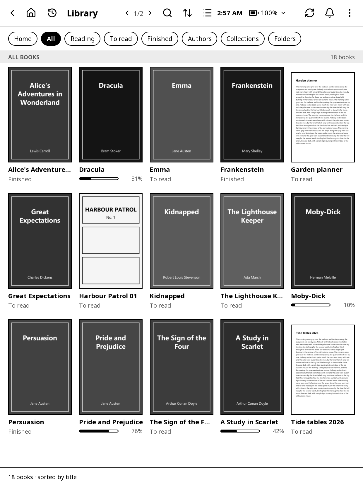

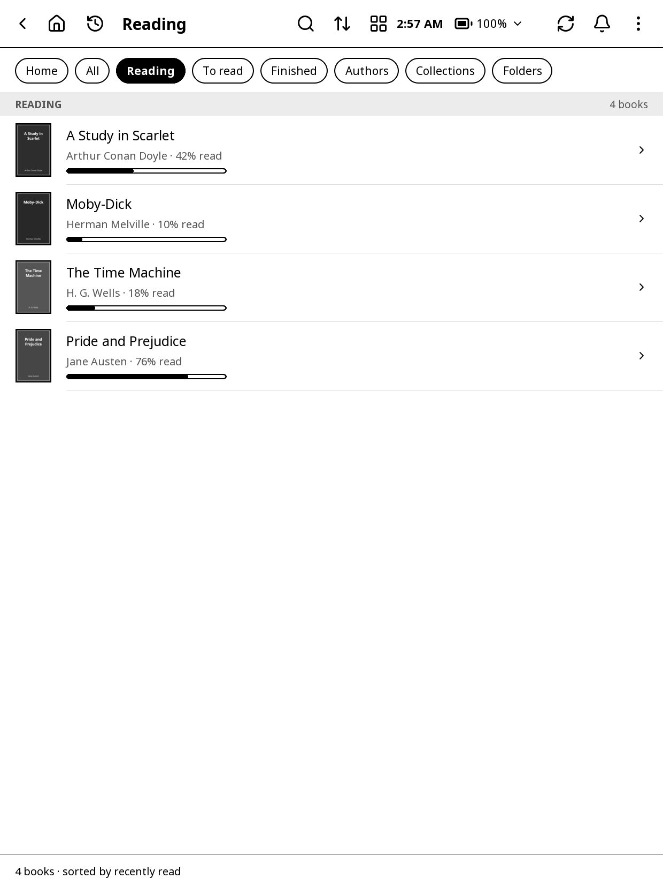

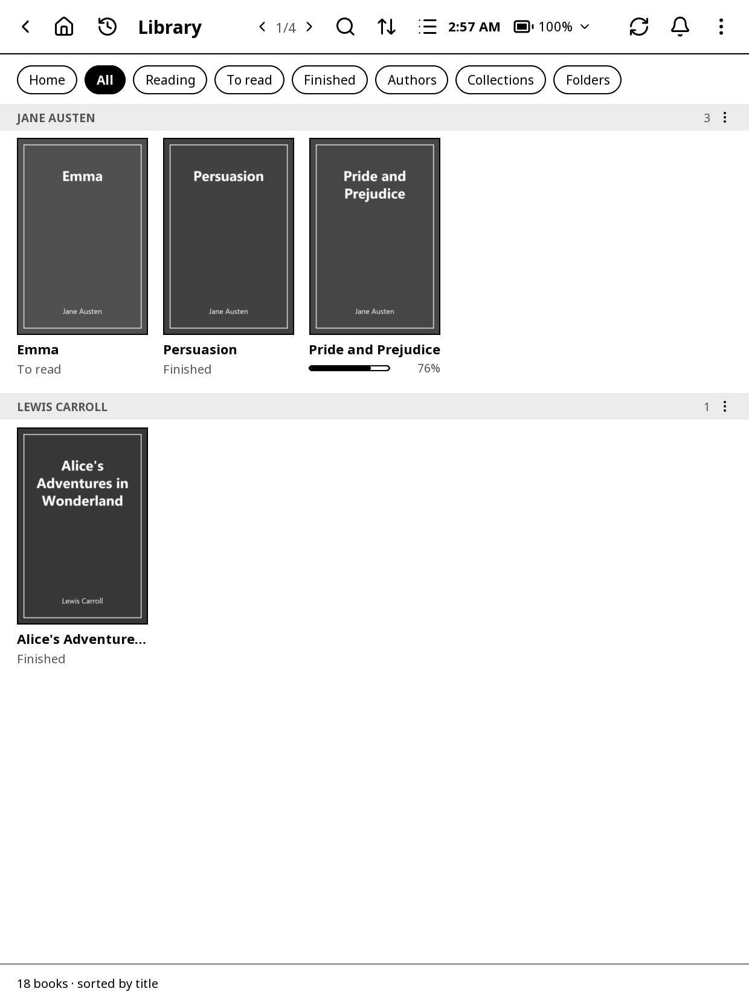

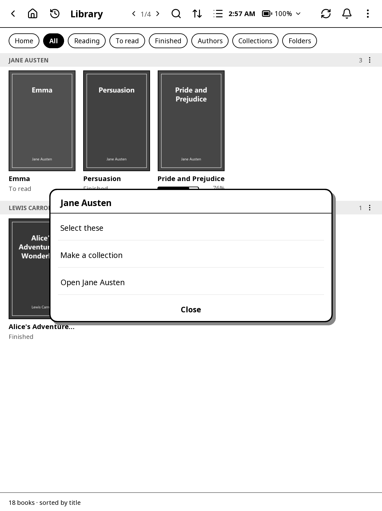

### Authors, series and collections

- **Authors**: every author, by last name, with how many books and where you are with them. Tap one for their books.
- **Series** (on Home): every series; a series' page lists its books in order.
- **Collections**: KOReader's collections, Favorites first. Tap one for its books; **+** makes a new one; hold one to **Rename** or **Delete** it (with Undo). Favorites can't be renamed or deleted.

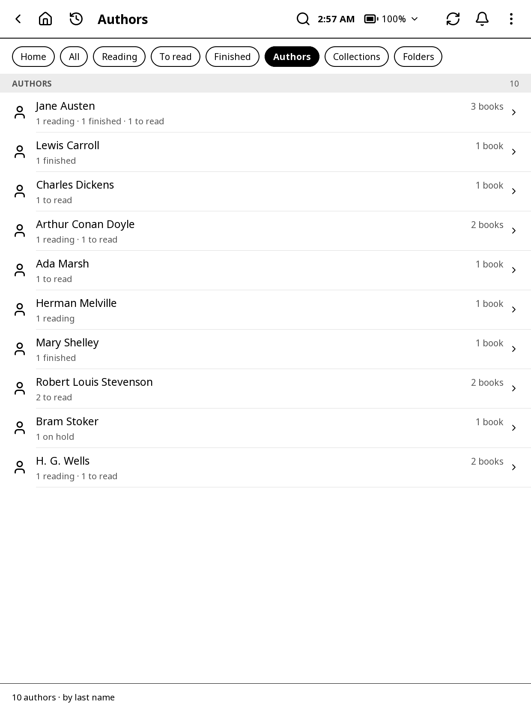

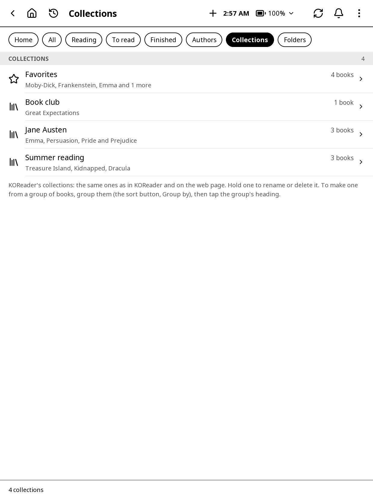

## A book's page

Tap a book anywhere for its page:

- The cover, title, author and series, the format, size and pages, how far you are and the time left at your pace.
- Its status: **Reading**, **On hold** or **Finished**, a tap each (**To read** shows while the book has never been opened). The star in the title bar adds it to Favorites.
- **READING**: first read, last read, time reading, days reading it, pace, pages read, and highlights and notes. **Time reading** and **Days reading it** open the book's Reading statistics; **Highlights and notes** lists them, with the chapter and page.
- **BOOK**: what the book says about itself: series, authors, when it was published, publisher, language, pages, print length, subjects and ISBN. A row shows only when the book has it. A book with few details: **More > Find details online** (below).
- On page 2: the **DESCRIPTION**, and the **FILE**: name, format, size, when it was added, its folder and its collections (tap for the folder, or to change the collections).
- The buttons: **Delete**, **Rename**, **Move to**, **More** and **Continue** (**Open** for a book not started).

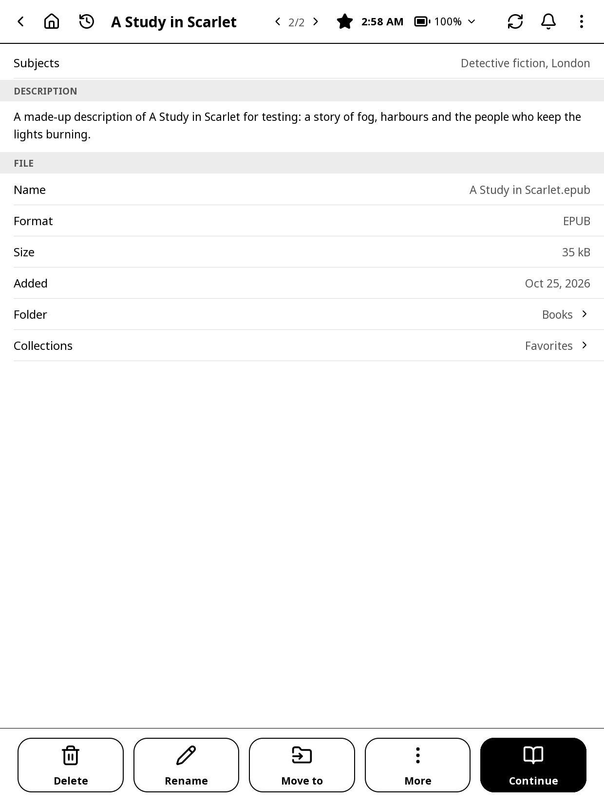

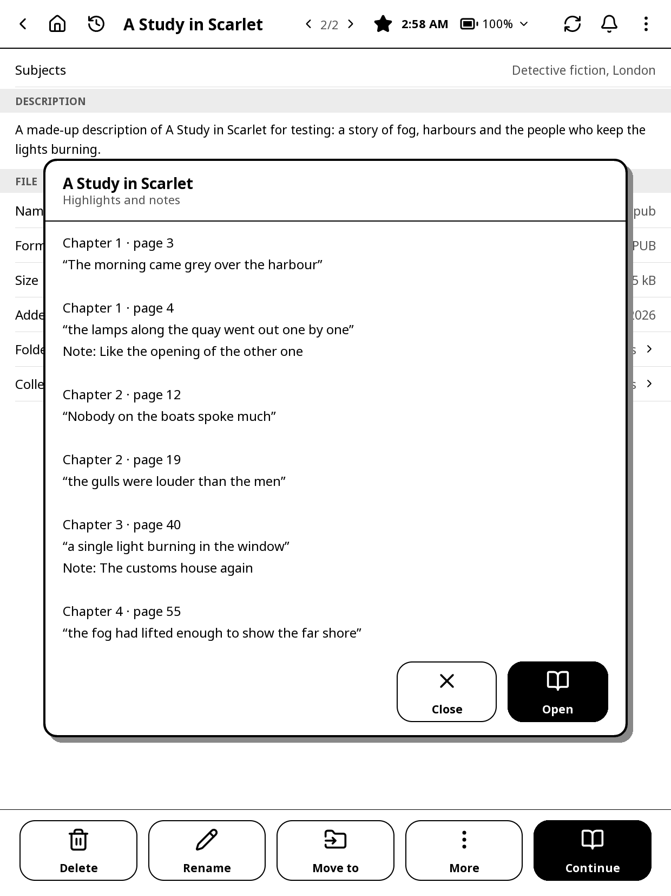

### A book's menu

Hold a book (or tap **More** on its page):

- **Open**, **Book details**, **Status…**, **Add to Favorites** (or **Remove from Favorites**), **Add to a collection…** and **Find details online** (below).
- **Write on it in Notes** (PDFs, with Notes installed): a notebook made from the PDF, to write on.
- **Open its folder**, **Move to…**, **Copy to…**, **Rename** and **Delete**.
- **Reset reading progress…** (on the page's **More**): the book starts from the beginning again, its highlights and notes kept. It asks first.

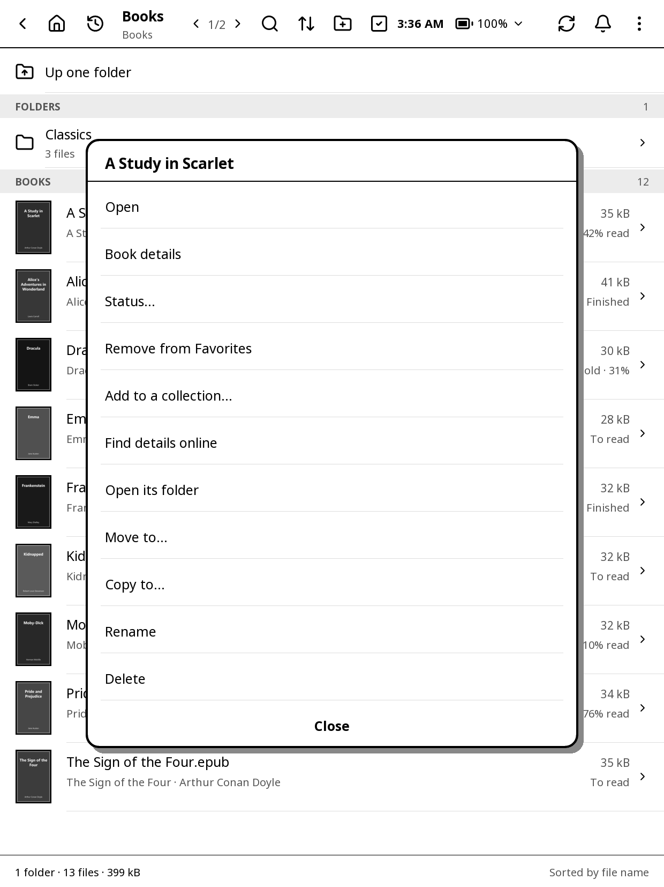

### Find details online

Many books come with only a title and an author. **Find details online** (in a book's **More**, or hold the book) looks it up in **Open Library**, and in **Google Books** when Open Library has nothing. Both are free and need no account. It looks the book up by its ISBN when it has one, otherwise by its title and author. If Wi-Fi is off, KOReader asks to turn it on first.

- **Details found**: the cover found next to the book's own, then each detail found (series, published, publisher, print length, subjects, language, description) with what the book has under it. Details the book doesn't have are ticked; details it has something else for are not. Tap a row, or the cover, to tick or untick it.
- **Save** saves only what's ticked, with **Undo** at the bottom for a few seconds. **Cancel** (or Back) leaves the book as it was.
- **Other matches**: the other books found, each with its author, year, publisher and where it was found. Tap one to see its details. When a search finds several and none has the book's exact title, this list comes first.
- **Search again**: a box with the title and author to change, or type an ISBN.
- **Nothing found** offers **Search again**. **Couldn't connect** means neither site answered: check Wi-Fi and **Try again**.

The details are saved where KOReader keeps its own **Set custom metadata** (Book information), so KOReader's Book information, the Cover browser and the Library all show them. Published, publisher and print length are kept in the same place, but only the Library shows them. To go back to the book's own details later, use Book information's **Reset** in KOReader.

For several books: **Select** them, then **More > Find details online**. Each book is shown first, one at a time, with **Skip** (leave this one as it is) and **Stop**. At the end, **Undo** puts back every book saved.

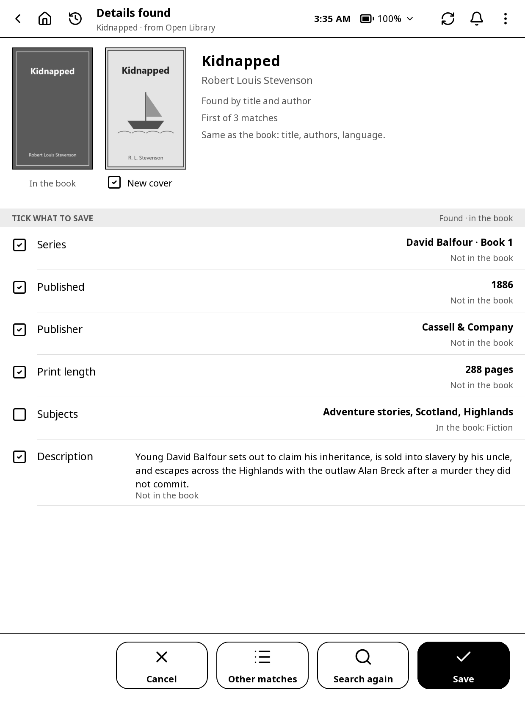

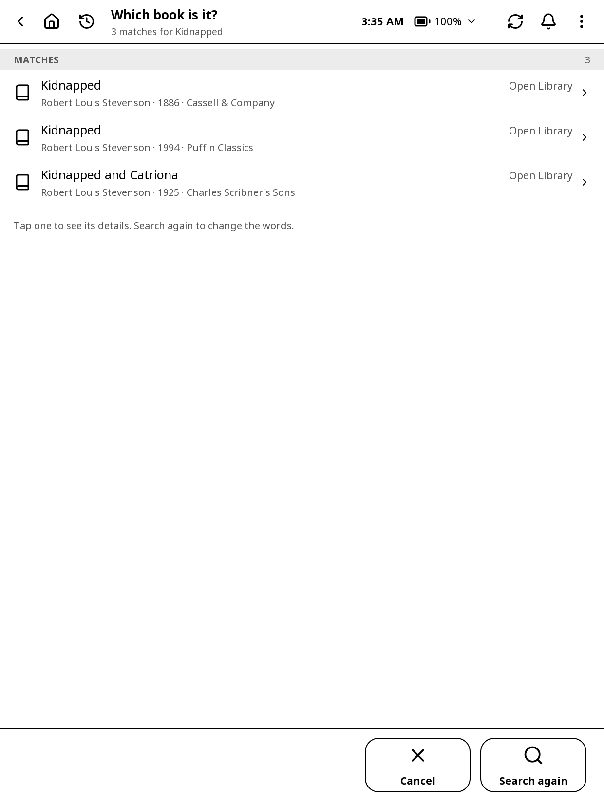

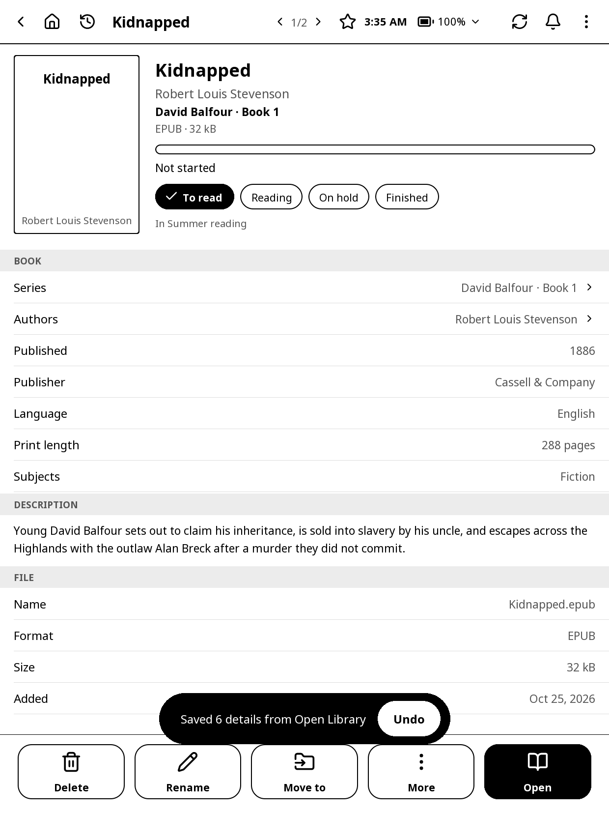

## Folders

**Folders** opens the Home folder: **Up one folder**, then its folders, its books (the file name, the title and author, the size and how far read) and other files. With **Lock home folder** on (KOReader's setting), it and the folder picker don't go above the Home folder.

- **Tap** a folder to open it; a book to open it in the reader; another file for its menu.
- **Hold** a folder for **Open**, **Add to favorite folders**, **Move to…**, **Copy to…**, **Rename**, **Set as Home folder** and **Delete**.
- In the title bar: **Search**, **sort**, **New folder** and **Select**.

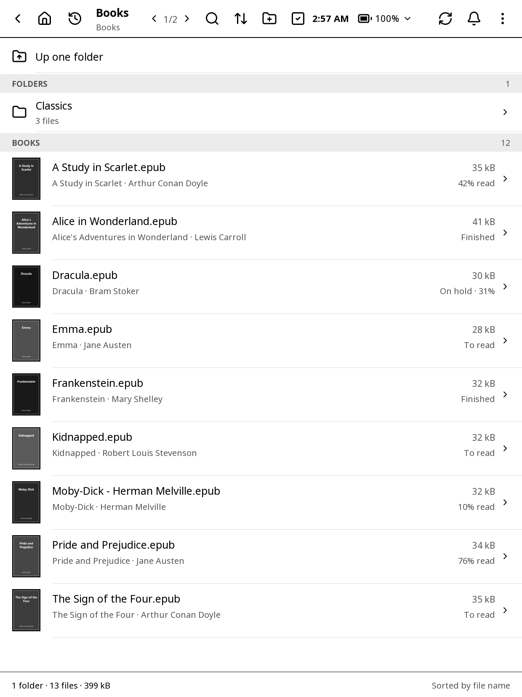

### Select, Move to and Copy to

- **Select** (the tick in the title bar, or **⋮ > Select** on any page of books) puts a box by each folder and book. Tick them, then a button at the bottom: **Delete**, **Status** (Reading, On hold, Finished, or Reset reading progress), **Collection** (into one, a new one, or out of one they're all in), **More** (**Copy to…** and **Find details online**) or **Move to**. The tick in the title bar selects all, or none. Back leaves Select.
- **Move to** and **Copy to** open a folder picker: open folders, then **Move here** (or **Copy here**). **New folder** makes one there first.
- A book's progress, highlights, history and collections go with it, as in KOReader's file browser. A copy keeps its own; a name that's taken gets " (2)".

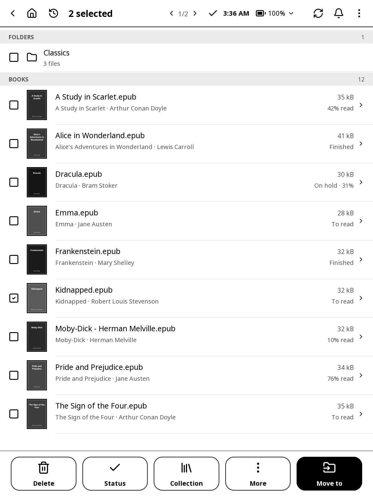

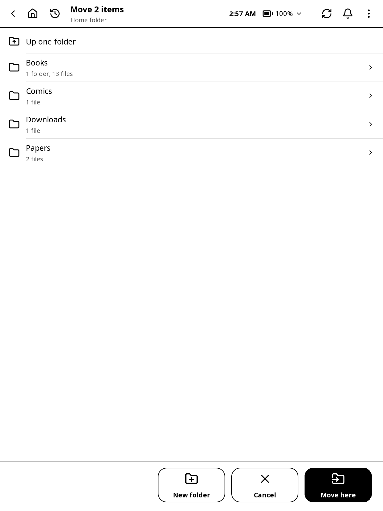

### Delete and Undo

Delete is at once, with **Undo** at the bottom for a few seconds. Undo puts everything back where it was, with its progress and collections. Without the launcher, Delete asks first instead.

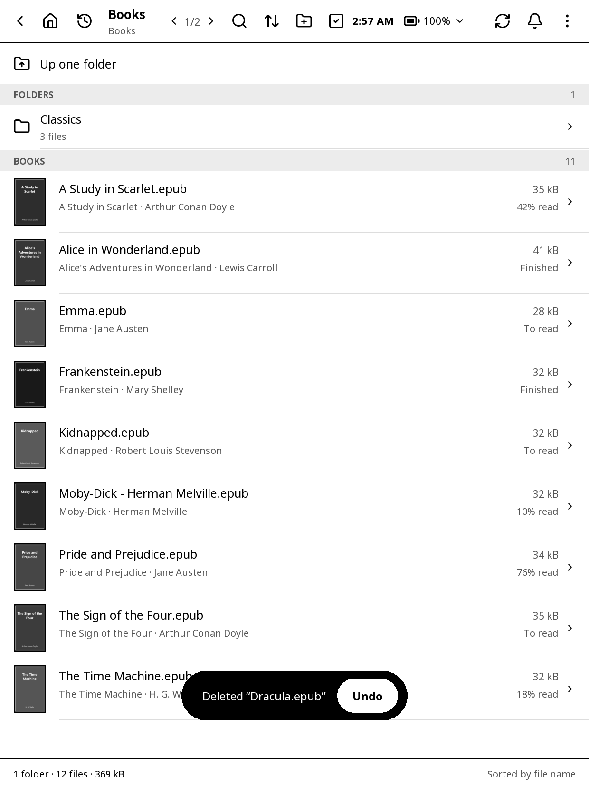

### Rename

**Rename** opens a box with the name (and the pen, to write it). For a book, **FROM THE BOOK** offers names from its title and author, such as "Moby-Dick – Herman Melville.epub".

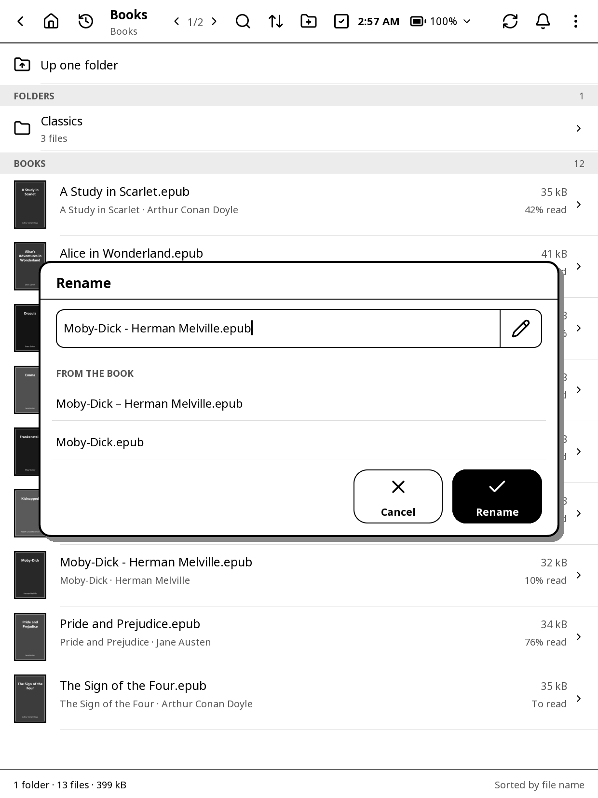

## Search

The magnifier searches titles, authors, series and file names (books), authors, collections, and other files and folders by name. Tap a result to open it.

The launcher's search finds books too, and the Library adds its authors, series and collections there.

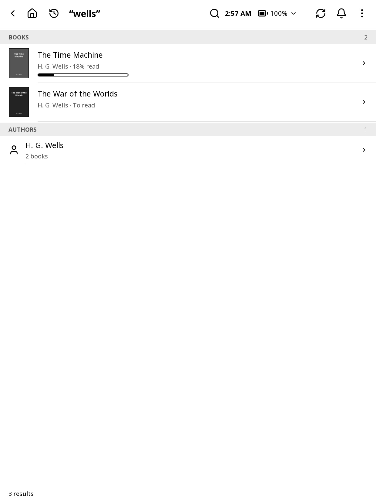

## Settings

**⋮ > Settings**, or the launcher's **Settings > Library**:

- **Show books as**: **Covers** or **List**.
- **Open on**: **Home**, or **Where you left off**.
- **Show hidden files**: names starting with a dot, in Folders.
- **Home folder**: KOReader's Home folder. To change it, hold a folder in Folders, then **Set as Home folder**.
- **Browse books with**: **Library**, or **KOReader's file browser** (what Back from a book and the launcher's Library tile open).

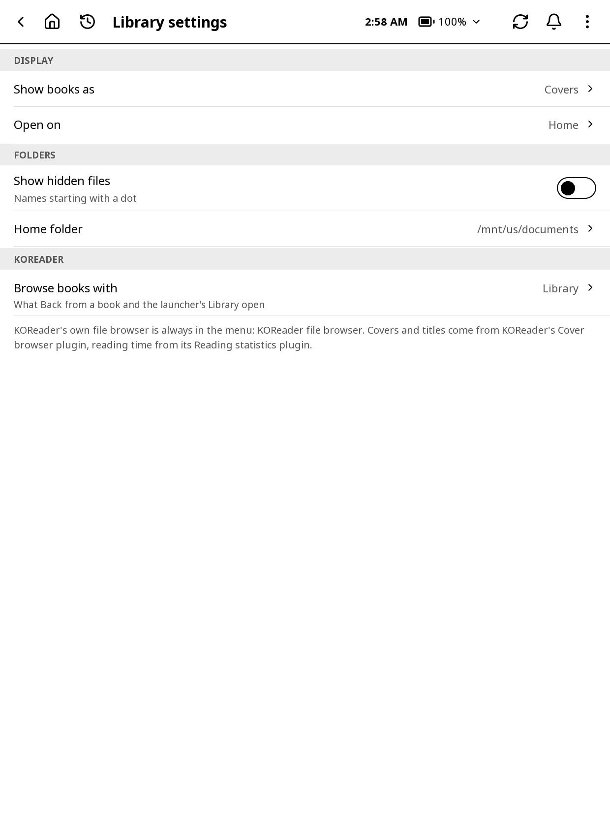

## Where it comes from

- Covers, titles, authors, series and descriptions: KOReader's **Cover browser** plugin, which reads each book once in the background (books it hasn't read yet show a plain cover with the title until then). Leave it on in KOReader's plugins.
- Status and progress: each book's KOReader settings. History: KOReader's history. Collections and favorite folders: KOReader's own.
- Reading time, first read, days and pace: KOReader's **Reading statistics** plugin.
- Publisher, date, subjects and ISBN: the EPUB itself, or what **Find details online** saved for it (from Open Library or Google Books).
