# Notes

Notes turns the Kindle Scribe into a handwritten notebook. You write with the pen on ruled, grid, dotted or blank pages (or on the pages of a PDF), keep notebooks in folders, search them, tidy your handwriting, send them to OneNote and turn them into typed text with AI.

Notes reads the pen directly, so a hand resting on the screen doesn't write or turn pages. Fingers only work the buttons and menus; the pen writes.

Crossword books are solved in the Crosswords app, which has its own chapter.

## Getting started

### Opening Notes

- From the launcher, tap the **Notes** tile.
- Or open KOReader's menu and choose **Tools > Notes**.
- Or set a gesture: **Settings > Taps and gestures > Gesture manager**, pick a gesture, then **General > Notes**.
- Or search from the launcher: notebooks are found by name (and by words on pages Notes' own search has already looked at). Notes is also in Recent apps once you've used it.

Notes opens on the notebook list. If **Open the last notebook when Notes opens** is on (Settings > Notebook list), the notebook you used last opens straight away.

### Making a notebook

1. Tap **+ New notebook** at the top of the list.
2. Type a name (or tap the pen at the end of the box and write it), or leave it blank to name it by the date and time (for example "Oct 21, 2:47 PM").
3. Under **Paper**, tap the one you want: **Blank**, **Narrow**, **Wide**, **Grid** or **Dots** (each drawn as it looks). The other templates (checklist, tasks, Cornell notes, week planner, music staves and more) can be picked later from the page's menu.
4. Tap **Create**.

Other choices in the same box:

- **From a PDF…** makes a notebook from a PDF on the Kindle: each PDF page becomes a page you can write on.
- **Your template…** starts the notebook with one of your own templates.

A new notebook goes into the folder you have open. Portrait or landscape follows the way the Kindle is held.

### Naming notebooks

- To rename a notebook, hold it in the list and tap **Rename**, or use **⋯ > Rename notebook** inside it.
- **Suggest** in the Rename box asks the AI to read the first written page and suggest a short name.
- **Suggest names (AI)** (Settings > New notebooks): when you close a notebook still named by its date, the AI reads its first page and offers a name a moment later (you can carry on meanwhile). Tap **Rename** to take it or **Keep** to leave it.
- **Add the date to names** (Settings > New notebooks): **Before the name** gives "Oct 21 – Meeting", **After the name** gives "Meeting – Oct 21". It applies to names you type for new notebooks, and when a notebook still named by date gets its first real name.

### Saving and closing

Notes saves as you write; there is no Save button to remember. To leave a notebook, tap the open book near the top of the toolbar (back to the notebook list), or ⌂ above it (back to the launcher).

If you'd rather decide each time, set **When closing** (Settings > Writing) to **Ask**. Closing a notebook you changed then offers **Save**, **Rename…** or **Don't save** (puts it back as it was when you opened it; a brand-new notebook is removed). **Close** leaves the notebook open.

A notebook reopens at the page you left it on, and its undo steps are kept while KOReader is running (for the last two notebooks you closed).

## The notebook list

### Covers or a list

The notebook list shows each notebook's first page as a cover, with folders as tiles. To see a plain list instead, go to **Settings > Notebook list > Show notebooks as** and pick **List**.

The title bar is the same as in the other apps: **‹** (back up a folder, or out of Notes), ⌂ (the launcher), Recent apps, then the folder's name. On the right are the time and battery (tap them, or the ▾ beside them, for the drop-down panel with the light, Wi-Fi and Night mode), ⟳ (refresh the screen), the bell (notifications) and **⋮**, which has **Open on the web page**, **Recent apps**, **Light**, **Night mode**, **Refresh screen** and, last, **Settings**.

The buttons under the title bar are:

- **+ New notebook**
- New folder (folder icon)
- **Today's page** (at the top level)
- **Crosswords** (when the Crosswords app is installed; it opens that app)
- **OneNote** (when you're signed in to OneNote)
- Search (magnifier icon, at the top level)
- Sort (up-and-down arrows icon)

If they don't all fit, the rest go behind **More…**. When there are more notebooks than fit, swipe left or right to turn the pages, or tap the arrows by the page number in the title bar. A swipe in from the left edge of the screen goes back, as **‹** does.

Tap a notebook to open it. Hold a notebook for its options: **Rename**, **Duplicate**, **Move to…**, **Pin to top**, **Lock…**, **Send to OneNote now**, **Add to launcher** (a tile for it on the launcher), **Select** and **Delete**.

### Sort

Tap the Sort button at the top of the list and pick **Name**, **Date created**, **Date modified** or **My order**. Folders are sorted the same way: by name, by when the folder was made, or by its most recently changed notebook (for My order, folders stay in name order).

- **My order** is your own order: **Settings > Notebook list > Reorder notebooks…** lets you move notebooks up and down. If you haven't made an order yet, picking My order opens it.
- **Default sort** (Settings > Notebook list) is the sort Notes starts with. **Last used** keeps whatever you picked last; or choose one sort to always start with.

### Folders

- Tap the New folder button and type a name. Folders can hold other folders.
- Tap a folder to open it; tap **‹** at the top (or swipe in from the left edge) to go back up. New notebooks go into the folder you have open.
- Hold a folder to rename, move or delete it, or to choose its **Cover…**: Automatic (the notebooks changed last inside it), a plain folder, an icon (house, briefcase, school, travel and others) or one of its notebooks.
- Deleting a folder that has notebooks in it asks whether they are deleted too or moved up a level. Tap **Undo** at the bottom of the screen in the next few seconds to put everything back.

### Selecting several

Hold a notebook or folder and tap **Select**. Tick the ones you want, then tap the "selected: what to do…" row at the top to move, duplicate, send to OneNote or delete them together. **Done selecting** goes back to the normal list.

### Pinned and recent notebooks

- **Pin to top** (hold a notebook) keeps it at the top of its folder.
- The notebooks you opened last are in a **Recent** folder, first in the list. Its cover shows them; tap it to see them, and **‹ Notes** to go back. **Recent notebooks** (Settings > Notebook list) chooses **As a folder**, **At the top** (above the other notebooks) or **Off**.

### Locked notebooks

Hold a notebook and tap **Lock…** to set a PIN (**Remove lock** takes it off). Notes asks for the PIN when the notebook is opened, but not again for two minutes. A locked notebook shows a lock instead of its cover. It is left out of search, OneNote's automatic sending and the web page. A forgotten PIN can't be recovered.

### Trash

Deleting a notebook (hold it, then **Delete**) moves it to the trash straight away; tap **Undo** at the bottom of the screen in the next few seconds to put it back. The trash is at the end of the notebook list. Tap a notebook there to restore it (it goes back to its folder) or delete it for good; **Empty trash** deletes them all. Deleting for good asks first, and notebooks in the trash are deleted for good after 30 days.

### Search

Tap the Search button and type a word. Notes finds it in:

- typed text (text boxes and text downloaded from OneNote) and notebook names, straight away;
- handwriting that has been read by the AI (with **⋯ > Convert page to text**, or from an earlier search).

Tap a result to open that page. If some pages haven't been read yet, the last row offers to read them with AI. Locked notebooks are never searched.

The launcher's search finds notebooks too: by name, and by words on pages that Notes' search has already looked at.

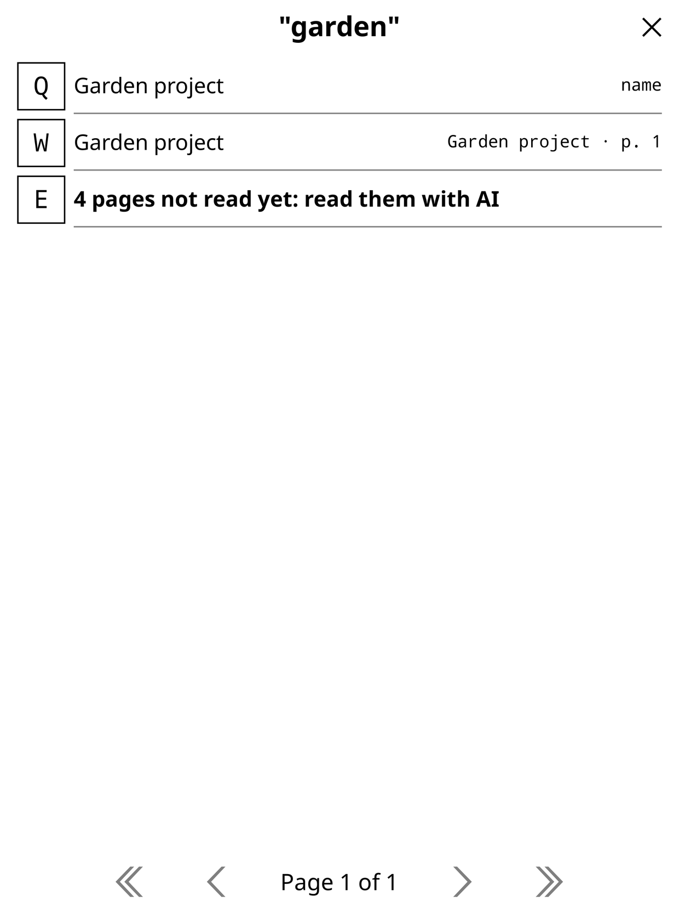

### Today's page

Tap **Today's page** to open today's page in a notebook called **Journal**. The first time, Notes makes the Journal; each day gets a new page with the date at the top. You can also give it a gesture: **General > Notes: today's page**.

## Writing

### The toolbar

The toolbar runs down the left edge (or the right: **Settings > Toolbar > Side**). From the top:

- ⌂: the notebook is saved and closed, and the launcher shows;
- the open book: back to the notebook list;
- **Pen**, **Highlighter**, **Eraser**, **Lasso**;
- **Add** (Shapes, Text and Insert, in one button);
- **Zoom window**;
- **Undo** and **Redo**;
- **Tidy** (tidy handwriting);
- any action buttons you added;
- your favorite pens;
- the time and battery;
- page up, the page number, page down;
- all pages (the grid button), **+** (add a page) and **⋯** (the menu);
- the fold button folds the toolbar into a small tab on the edge. Tap the tab to bring it back;
- at the very bottom, always there: ⟳ (refresh the screen), the bell (notifications) and ⚙ (Notes' settings).

Tap a tool to use it, and tap it again for its panel (tips, sizes and options). Tapping anywhere outside a panel closes it.

### Toolbar groups

A group is one toolbar button that opens a short list. **Add** holds Shapes, Text and Insert; **Tidy** holds the tidying actions. The group's button shows the tool you're using from it. To change a tool's options, tap the group and then tap that tool again in the list.

To change the groups, go to **Settings > Toolbar > Groups…**, pick a group, and tap **Remove** or **Add** beside each tool or action. Anything taken out of a group gets its own toolbar button again.

### Your own toolbar

**Settings > Toolbar > Toolbar buttons…** lists everything the toolbar can show: the tools, the Add and Tidy groups, and the actions from the ⋯ menu (**Send to OneNote**, **Ask AI**, **Convert page to text**, **Add page to To Do**, **Bookmark page**, **Date and time**, **Export**, **Light**, **Night mode** and others). Refresh, notifications and Settings are always at the bottom of the toolbar, so they aren't in this list.

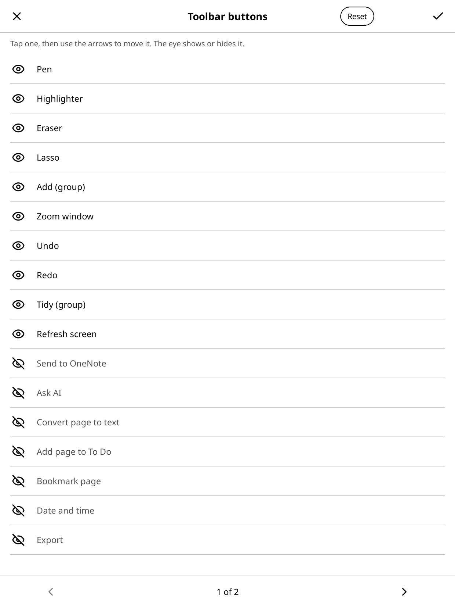

1. Tap a button's name, then use the arrows to move it to the top, up, down or to the bottom.
2. Tap the eye beside a button to show or hide it.
3. Tap ✓ to keep the changes, or ✕ to leave the toolbar as it was. Undo takes back the last change, and **Reset** puts back the toolbar as it was to start with.

Hidden tools are not lost: they are at the top of the **⋯** menu, under the page templates. The actions are in the ⋯ menu anyway.

- **All pages button** and **Add page button** (Settings > Toolbar) take those two off the bottom of the toolbar; they are then in the ⋯ menu too.
- **Groups…** changes what is in the Add and Tidy groups.
- **Start with toolbar hidden** opens notebooks with the toolbar folded.

### Pen

Tap **Pen**, then tap it again for its panel:

- **Tips**: **Ballpoint**, **Fineliner** (an even line), **Fountain** and **Brush** (the line widens as you press; the brush more strongly), **Calligraphy** (a slanted nib: thick and thin by direction), **Marker**, **Pencil**, **Mech. pencil** (grey lines) and **Shader** (a wide soft grey that goes under the ink).
- **Shade**: **Black**, **Dark grey** or **Light grey**. For the pencils: **Normal**, **Darker** or **Lighter**.
- **Size**: five sizes, with a sample stroke below.
- **Add to favorites (toolbar)** puts this pen (tip, size and shade) on the toolbar, up to three. Tap a favorite to write with it. Clear them in Settings > Writing > **Favorite pens**.

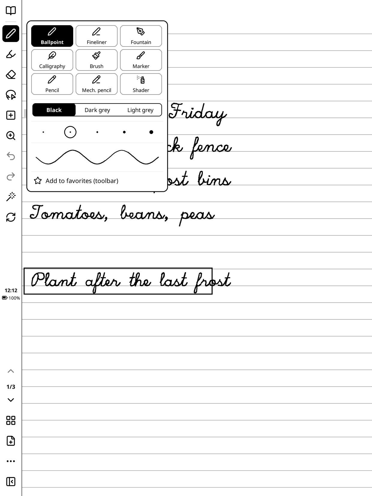

**Starting pen** (Settings > Writing) chooses whether notebooks open with the pen you used last or one of your favorites.

### Pen pressure

The line follows how hard you press. **Pen pressure** in Settings > Writing sets how hard you need to press: **Soft** (a light touch already writes wide), **Normal** or **Firm** (press harder for a wide line). **⋯ > Pen pressure** turns pressure off for one notebook, so every line is the same width.

### Highlighter

Five widths of grey, drawn under the ink so writing stays readable. Tap **Highlighter** again to pick a width.

### Eraser

Tap **Eraser** again for its panel:

- five sizes (pressing harder erases a bigger spot);
- **Partial** (only the ink under the eraser) or **Whole stroke** (any stroke it touches goes);
- **Highlighter only**: only highlighting is erased; ink, text boxes and pictures stay;
- **Clear page**.

The pen's eraser end, or its side button, erases whatever tool is picked. The eraser also removes text boxes, pictures and tape it passes over; one Undo brings them back.

### Undo and redo

- Tap **Undo** or **Redo** on the toolbar.
- Tap the screen with two fingers to undo; hold two fingers to redo. (Turn this off in Settings > Writing > **Two-finger tap to undo (hold to redo)**.)
- **Undo history**: hold **Undo** on the toolbar to see the last steps (writing, erasing, highlighting and so on), each with its page and how long ago. Tap one to go back to just before it. Redo brings the steps back.

### Turning pages

- The arrows on the toolbar turn pages; **+** adds a page after this one.
- Swipe up with a finger for the next page and down for the page before. **Turn pages with a finger** (Settings > Writing) switches this to left and right swipes, or turns it off.
- Swipes are ignored while the pen is near the screen and for a moment after, so a resting palm doesn't turn the page.

### Pen side button

**Pen side button** (Settings > Writing) chooses what holding the side button does: **Eraser**, **Lasso**, **Highlighter**, **Ruler (straight lines)** or **Nothing**.

### Tips

- Stroke smoothing (Settings > Writing) evens out shaky lines: **Light** for handwriting, **Strong** for drawings and long curves.
- If the screen keeps faint marks from earlier writing, tap ⟳ at the bottom of the toolbar; **Full refresh** (Settings > Display) sets how often Notes clears them by itself.

## The lasso

Tap **Lasso** and circle ink, text boxes, pictures or tape with the pen to select them.

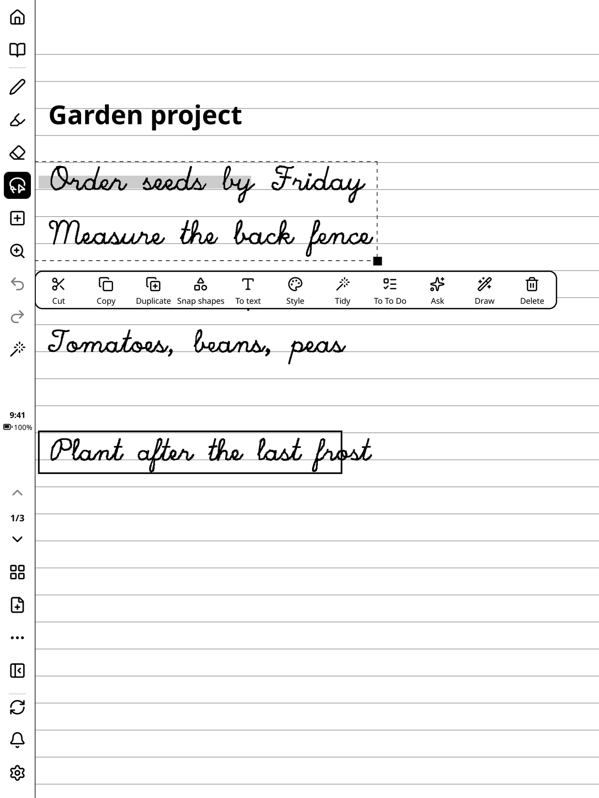

- Drag inside the selection to move it; drag the square at its corner to resize it.
- The bar under the selection has:
  - **Cut**, **Copy** and **Duplicate**;
  - **Snap shapes**: rough lines, circles and boxes become clean ones;
  - **To text**: reads the handwriting with AI. The text can be copied, saved, or put back with **Replace** (the typed text goes where the writing was);
  - **Style**: change the selected ink's pen, thickness, shade or line;
  - **Tidy**: tidy the handwriting in the selection (see Tidy handwriting);
  - **To To Do**: add the to-do items in the selection to To Do;
  - **Ask**: ask the AI about the selection;
  - **Draw**: have the AI redraw it or draw next to it;
  - **Delete**.
- With something cut or copied, tap the page with the lasso and tap **Paste**. Text copied in another app (a To Do task, an AI answer, SSH) pastes the same way, as a text box; the typed text of text boxes you cut or copy here pastes in other apps' boxes too (hold the box, **Paste**).

## Shapes and snapping

### Shapes

Open **Add > Shapes** and pick a line, arrow, rectangle, ellipse, triangle, diamond, star or table (set its rows and columns in the panel). Drag from corner to corner with the pen; the shape uses the pen's tip and size. In the same panel, **Fill** (none, light or dark grey) and **Line** (solid, dashed or dotted).

Shapes are ordinary ink: the eraser and lasso work on them.

### Snapping your own drawing

Draw a rough line, circle, ellipse, rectangle or triangle and hold the pen still at the end for half a second: it becomes a clean shape. One Undo brings your own drawing back.

- **Shape recognition (hold the pen)** (Settings > Shapes) turns this on or off.
- **Snap lines to 0°, 45°, 90°** makes lines that are nearly level, upright or diagonal exactly so.
- **Snap line ends to ink** joins the ends of lines and arrows to ink nearby.
- With the pen side button set to **Ruler (straight lines)**, holding the button while you draw makes straight lines.

## Text, pictures, tape and links

### Text boxes

Open **Add > Text** and tap the page to type a text box (drag across the page first to set its width). The panel sets the size (four sizes), bold or italic, sans or serif, and left, centre or right alignment for new boxes. In the box where you type, **Bold**, **Italic**, **Sans** (or **Serif**) and the alignment under the text switch the style of this one; the pen at the end of the box writes the text by hand. Tap a text box to edit it, or to **Delete** it. You can write over text boxes; move or resize them with the lasso.

### Pictures

**Add > Insert > Picture…** puts a picture from the Kindle in the middle of the page, selected so you can move or resize it. A photo larger than the screen is made screen-sized when it's added, so pages with photos stay quick to draw.

### Tape (for studying)

**Add > Insert > Tape**: drag over something to hide it under grey tape. Tap the tape to lift it, and tap again to put it back. The Insert panel can also lift or put back all the tape on the page at once.

### Links between pages

**Add > Insert > Link to a page…** puts an underlined link on the page, to a page in this notebook or another one. Tap the link to go there; move it with the lasso.

A page that other pages link to gets **⋯ > Linked from**, which lists those pages; tap one to go there.

### Date and time

**Date and time** (⋯ > Date and time, or a toolbar button from Settings > Toolbar > Toolbar buttons…): tap where it goes, and a stamp like "Wed, Oct 21 · 3:42 PM" is typed there.

## Tidy handwriting

Tidy straightens your writing without changing your letters. Use it on the whole page from the **Tidy** button (or **⋯ > Tidy handwriting**), or on part of a page by selecting it with the lasso and tapping **Tidy**.

The Tidy button's list has:

- **Tidy handwriting**: all four of the steps below at once.
- **Level lines**: takes out the tilt and drift of each line and sits its words on the ruled line.
- **Upright letters**: takes out the slant.
- **Even size**: brings words that are much bigger or smaller than the rest of the line closer to its size.
- **Even spacing**: makes the gaps between words even.

Highlighting, shapes and large drawings are left as they are. One Undo puts everything back.

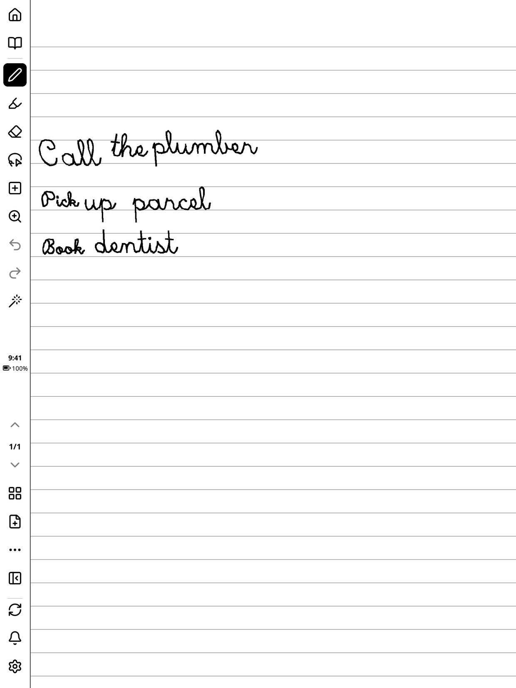

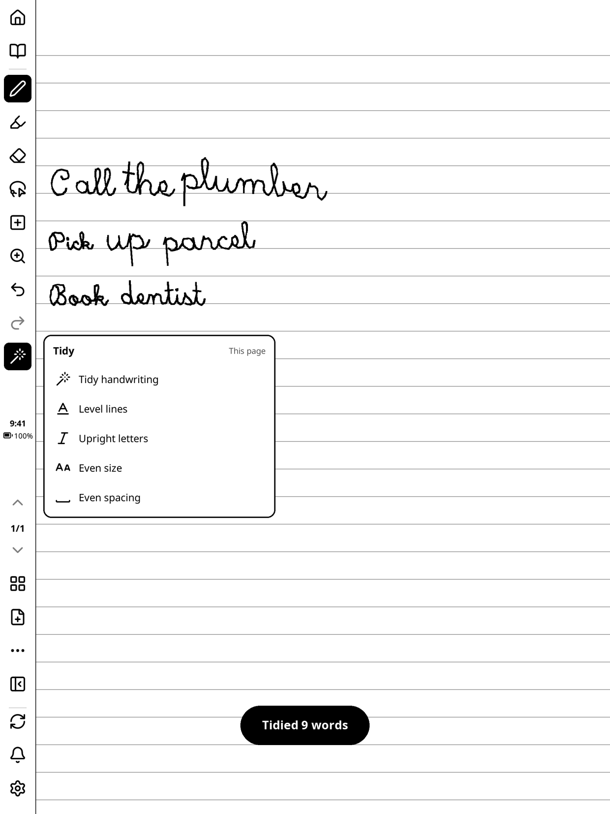

### Tips

- Tidy works best on ruled pages, where it can set writing on the lines.
- Try **Level lines** and **Upright letters** first: they make the biggest difference and change your writing the least.

## Zoom window

Tap **Zoom window** to write large in a strip at the bottom of the screen; your writing lands small in the dashed box on the page.

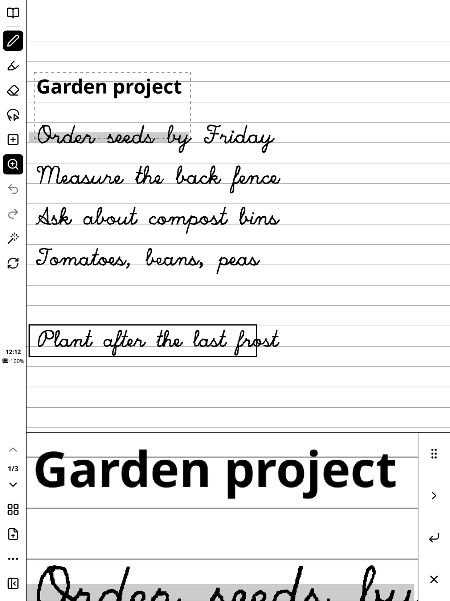

- Writing near the end of the strip moves the box on along the line.
- The strip's buttons move the box on, start the next line, or close the zoom.
- Tap the page to move the box there.
- Drag the strip's grip (top of its buttons) with the pen or a finger to move the strip up or down the screen; it stays where you put it.

Many people's handwriting is much neater this way.

## Pages

### All pages

Tap the page number, or the grid button, to see every page as a thumbnail.

- Tap a page to go there.
- Hold a page to bookmark, copy, move or delete it.
- The star in the title bar shows only bookmarked pages (tap it again for all); **⋯ > Bookmark page** marks the page you're on (★ by its number).
- The tick-list button (**Select**) ticks several pages to bookmark, move, copy, move to another notebook or delete them together.
- **⋯ > Reorder pages** moves pages up and down.
- Deleted pages are kept for 30 days: the bin in the title bar (with how many) restores them, or deletes them for good.
- **‹** goes back to the page; **⌂** to the launcher.

### Page templates

The top of the ⋯ menu shows the page templates: **Blank**, **Narrow** ruled, **Margin** (ruled with a margin), **Wide** ruled, **Grid**, **Dots**, **Isometric** dots, **Hexagons**, **Checklist**, **Tasks** (tasks and subtasks), **Cornell** notes, **Week** planner, **Month** calendar and **Music** staves.

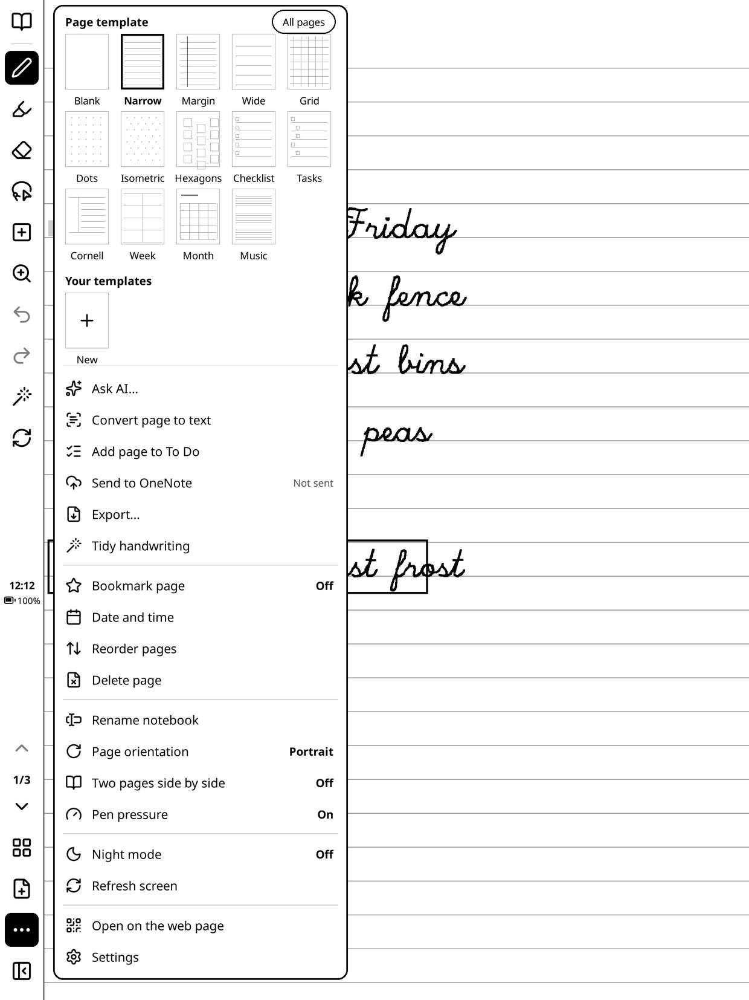

Tap **All pages** beside the title to switch to **This page**, so a template applies only to the page you're on. **Template lines** (Settings > Display) makes template lines **Light**, **Medium** or **Dark**.

### Your own templates

Under **Your templates** in the ⋯ menu, tap **+** to save this page (with its writing) or a picture as a template. Tap a template to use it; tap it again to delete it. **+ New notebook > Your template…** starts a notebook with one.

### Checklists and tasks

On the **Checklist** and **Tasks** templates, tap a printed box (pen or finger) to tick it, and again to untick it. A mark drawn over an empty box (a tick, a cross) becomes a tick too. On the Tasks template, writing that starts indented makes that line a subtask, and its box moves in.

A checklist page added to To Do (**⋯ > Add page to To Do**) stays linked: ticking a box on the page ticks the task in To Do, and a task ticked in To Do is ticked on the page.

### Month calendar and the Journal

On a **Month** calendar page, tap a day's number to open that day's page in the Journal notebook (made if it isn't there yet, and placed among the other days in date order). Days that already have a Journal page show their number in black.

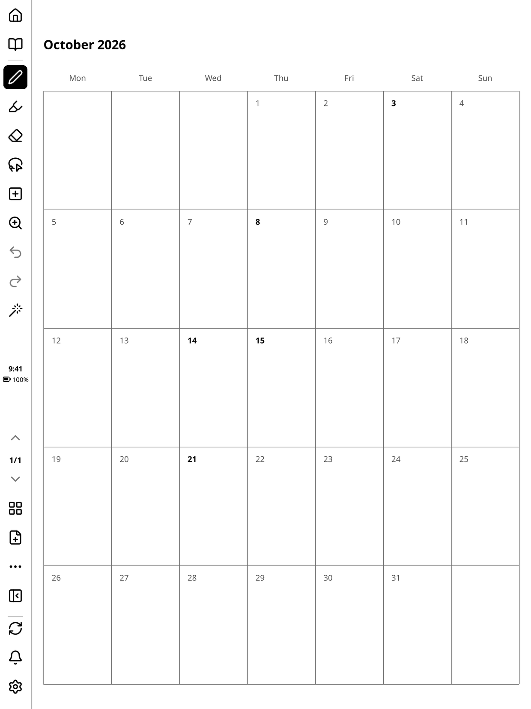

### Page header

**Page header (date and page number)** (Settings > Display) shows the page's date and number in small type at the top right of each page.

## Orientation and two pages side by side

### Portrait and landscape

A notebook is portrait or landscape. New notebooks follow the way the Kindle is held. **⋯ > Page orientation** changes it: **Portrait**, **Landscape**, **Inverted portrait** or **Inverted landscape**. The writing stays where it is. Opening a notebook turns the Kindle to match, and closing it turns the Kindle back.

### Two pages side by side

**⋯ > Two pages side by side** shows a portrait notebook two pages at a time, with the Kindle on its side, like an open notebook: pages 1–2, then 3–4, and so on. The arrows turn two pages at a time.

- Turning the Kindle on its side does the same, and turning it back upright shows one page. **Two pages when turned on its side** (Settings > Writing) turns this off.
- The pen, highlighter and eraser work on either page. For the lasso, text and the other tools, turn **Two pages side by side** off.

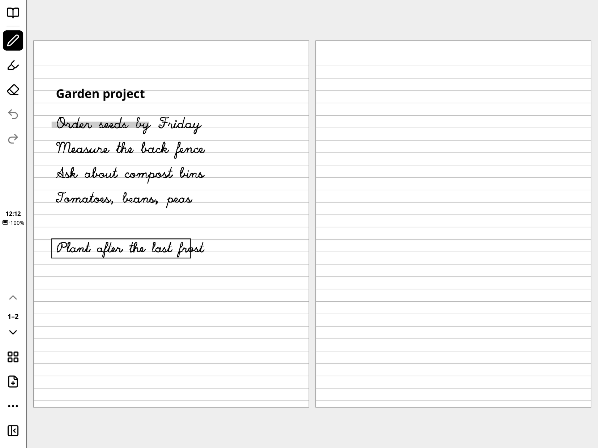

## Quick note

Set a gesture to **General > Notes: quick note** (Settings > Taps and gestures > Gesture manager). From anywhere (a book, a menu, To Do) the gesture opens a writing pad over the lower part of the screen, with what you were looking at faded above it.

- Write with the pen, highlighter, eraser and lasso; Undo and Redo work as usual, and **⟳** refreshes the screen.
- What you were looking at shows faded above the pad (a picture of it, to write about). Drag the handle on the pad's top edge to make the pad shorter (more of the screen) or taller; it stays there next time. Beside the handle: **👁 Peek** (the whole screen as it was, until you tap), **⇅ Swap** (the pad on top and the picture below, or back; it stays that way next time), **🗑 Discard** (the note thrown away, after asking) and **✓ Save**. The toolbar starts folded to a tab at the side; tap it for the pens, the eraser, the lasso, Undo and Redo, which has the same buttons too. Settings > Toolbar > **Quick note buttons by the handle** hides the ones by the handle.
- Tap **✓** at the top of the toolbar (or use the gesture again) when you're done. What you wrote goes on a new page of the **Quick Notes** notebook, with the date and time at the top. (It was called Inbox before; an Inbox from an earlier version is renamed.)
- If you didn't write anything, nothing is kept.

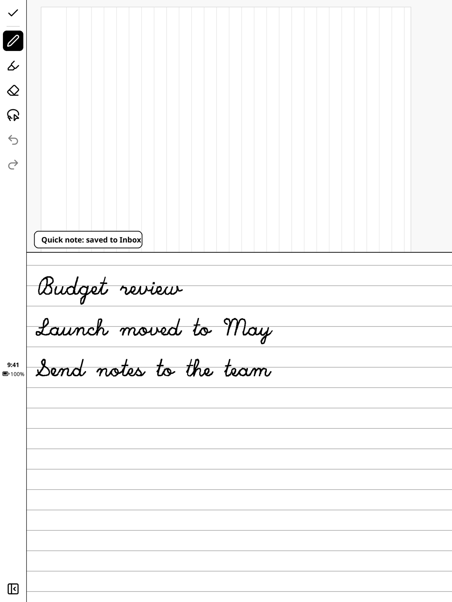

## Writing on a book's pages

You can write on the pages of PDFs and other fixed-page books while reading them in KOReader.

1. Open the book and go to the page.
2. Tap **Write on this page** in the reader's menu (Tools), or use a gesture set to **Notes: write on this page**.
3. Write with the pen; the eraser, lasso and zoom work too. The toolbar's arrows turn the book's pages.
4. Tap the top button (or use the gesture again) to go back to reading.

The writing is kept with the book and stays in place when you zoom in or out. It shows whenever that page does, in page or continuous view.

## PDFs as notebooks

**+ New notebook > From a PDF…** picks a PDF on the Kindle (copy it over by USB first, anywhere on the Kindle). Each PDF page becomes a page you can write on. Pages you add are blank paper. Landscape PDFs make a landscape notebook.

**⋯ > Export… > The PDF with my writing added (annotations)** saves a copy of the PDF with your writing as PDF annotations, which other PDF apps show and can edit.

The PDF page fills the screen, so the toolbar may cover a little of its left edge; fold the toolbar to see all of it.

## AI features

Several features use AI to read your handwriting or answer questions: Convert page to text, To text, search of handwriting, Ask AI, Make PDF, Draw, Add to To Do and Suggest name.

The AI services are set up in the launcher's **Settings > AI**, shared with the Crosswords app: the AI chapter has the details (the services and their keys, which AI does each job, Try a prompt, and what each feature sends). Notes' **Settings > Integrations > AI settings…** opens it.

Until an AI service is set up, Notes leaves these features out: no AI buttons or menu items show, and Notes' settings have one row, **AI services: Not set up**, that opens the AI settings. Once any service is set up, they all appear.

### Convert page to text

**⋯ > Convert page to text** reads the page's handwriting. The text can be copied or saved as a file. Pages that have been read are remembered, so search finds their words afterwards. Use the lasso's **To text** for part of a page.

### Ask AI and Make PDF

**⋯ > Ask AI…** (or the lasso's **Ask** for a selection): type a request in the box, or tap the pen at its end to write it by hand in a strip at the bottom of the page. Your last five requests and some examples are listed under it; tap one to ask it straight away (**More examples…** shows the rest).

- **Answer** shows the AI's answer. **Copy** and **Save** keep it (Save puts a text file in koreader/notes/export); **Done** closes it.
- **Make PDF** has the AI rewrite the note as a clean document (headings, lists, checkboxes, bold and italics) and saves it as a PDF, which you can open or write on as a new notebook.

### Draw with AI

Select with the lasso and tap **Draw**. Type what you want (or tap the pen to write it), or pick an example such as "Redraw this neatly", "Make this a flowchart" or "Turn this into a table". The AI draws simple line art: diagrams, flowcharts, tables, grids, simple charts and sketches, with short labels.

- **Replace** swaps your drawing for the AI's; **Beside** puts the AI's next to yours.
- Lasso an empty area to have it draw something new there, such as a habit tracker or a title box: that box has one button, **Draw**.

The result is ordinary ink and text boxes that you can erase, move or undo.

### Add to To Do

**⋯ > Add page to To Do** (or the lasso's **To To Do**) reads the to-do items on the page and shows them before they're added. On the checklist and tasks templates, a printed box starts a task and an indented box a subtask; ticked boxes are added as done.

- Tap the list name to choose which To Do list they go into.
- Tap a task to tick or untick it and its steps, or to set its due date and reminder.
- Dates written beside a task are read too: "Fri" or "10/30" is the due date, "9am" a reminder, "Fri 9am" both, "remind Mon 7pm" only a reminder. Turn this off with **Dates written beside tasks (To Do)** in Notes' **Settings > Integrations**.

You need the To Do plugin, signed in.

## OneNote

### Signing in

OneNote uses the Kindle's one Microsoft account, the same as To Do: one App ID and one sign-in for both, in the launcher's **Settings > Microsoft** (the setup chapter says how to make the App ID, once, for free). If you already signed in there for To Do, sign in again once so the same sign-in covers OneNote too: **Settings > Microsoft** shows **Sign in again to allow** next to Notes (OneNote) until you do.

Then on the Kindle:

1. Go to Notes' **Settings > Integrations > OneNote…** and tap **Microsoft account**: it opens **Settings > Microsoft**. Tap **Sign in**, then on a phone or computer open the address shown and enter the code (or tap **QR code** and scan it).
2. Back in OneNote's settings, pick the OneNote notebook to send to, or make a new one.

A OneNote sign-in from before this moved to the shared account by itself. Without the launcher, OneNote's settings have their own App ID and sign-in, as before.

### Sending notebooks to OneNote

- **⋯ > Send to OneNote** sends the notebook you're in. Hold a notebook in the list for **Send to OneNote now**, or use **Send all now** in the OneNote settings.
- Sending happens in the background: you can keep writing or reading, and a notice says when it's done (for example "OneNote: 2 new, 1 changed, 0 removed").
- Each notebook becomes a OneNote section, and each page a OneNote page holding the page as a picture (OneNote can search handwriting in pictures). Changed pages are updated and deleted pages removed; nothing comes back from OneNote.
- **Send automatically when Wi-Fi is on** sends a notebook when you close it, and everything when Wi-Fi comes on (Notes never turns Wi-Fi on itself). If that automatic send fails, a line in the bell says so and opens OneNote's settings; it goes away after the next good send.
- **Notebooks sent: Ones I pick** sends only the notebooks you mark: hold a notebook in the list and tap **Sent to OneNote by itself** to switch it.
- **Typed text of each page (read by AI)** adds the page's text under each page sent.

### Choosing where a notebook goes

Notebooks go to the OneNote notebook picked in the OneNote settings, each as a section of its own name. To send one somewhere else, hold it in the notebook list and tap **OneNote: Default…**:

1. Pick a OneNote notebook (or **Default** to go back to the usual one).
2. Pick a section: one already there, **New section…**, or **A section named** after the notebook.

Hold a **folder** to do the same for every notebook in it, including ones added later. A notebook's own choice comes before its folder's. The hold menu shows where each one goes, for example **OneNote: Work › Meetings**.

Notes only changes or removes the pages it sent, so a section you already use keeps your own pages. Pages sent into a shared section are titled with the notebook's name ("Meeting notes – Page 1"). After you change where a notebook goes, it is sent again to the new place; the copy already in OneNote stays where it was.

### Reading OneNote

Once signed in, tap **OneNote** in the notebook list (or **Browse OneNote** in the OneNote settings) to see your OneNote notebooks, sections and pages. **‹** goes back up a level.

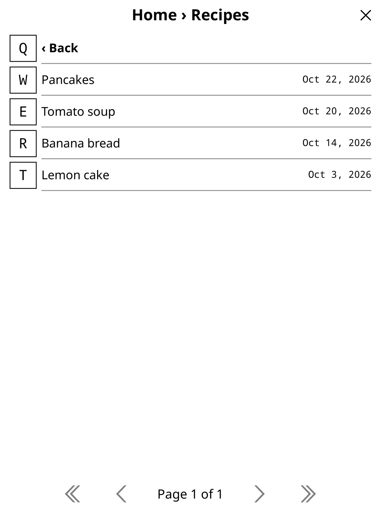

- **Open** shows a page to read: typed text, lists, tables and pictures.
- **Download to edit** copies a page into Notes, into a notebook named after the OneNote notebook: handwriting as ink, typed text as text boxes and pictures as pictures. OneNote isn't changed.
- A page you've downloaded before shows "In Notes" and **Open copy in Notes**.

### Replace in OneNote

On a page downloaded from OneNote, **⋯ > Replace in OneNote** puts your edited version back in OneNote in place of the original page, in the same section. OneNote doesn't let apps add handwriting, so your pages go in as pictures (you can still write over them in OneNote). Notes asks before replacing.

## Export

**⋯ > Export…** offers:

- **This page as a picture (PNG)** or **All pages as pictures (PNG)**;
- **The notebook as a PDF** (each page as a picture);
- **The PDF with my writing added (annotations)**, for a notebook made from a PDF;
- **This page as text (AI)** or **The notebook as text (AI)** (pages read before aren't read again).

Exports are saved in the **notes/export** folder inside the koreader folder on the Kindle.

## Open on the web page

With the Web server plugin installed, **⋯ > Open on the web page** in a notebook shows a QR code. Scan it with your phone's camera and that notebook opens on the web page, where you can look through its pages and download them. In the notebook list, **⋮ > Open on the web page** opens the Notes page. The web server is started if it isn't running.

The Notes tab's **Settings** has the same settings as on the Kindle, in the same words, including the toolbar's buttons. Pages deleted on the web page are kept for 30 days like those deleted on the Kindle: restore them from the bin in a notebook.

## Settings

Open Notes' settings from **⋮ > Settings** in the notebook list, ⚙ at the bottom of a notebook's toolbar, or the launcher's Settings list. They are full pages, like the other apps' settings: tap a row to switch it on or off or to pick from a list, and swipe left or right (or tap the arrows in the title bar) for the next page.

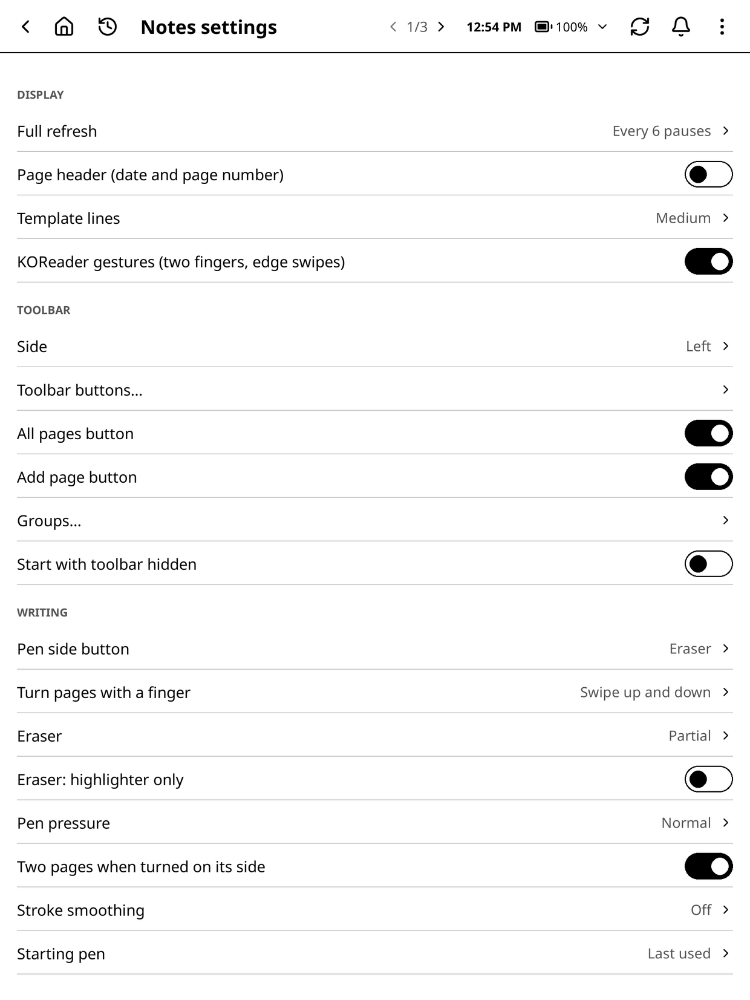

### Display

- **Full refresh**: Every 6 pauses, Every 3 pauses, Every pause or Never.
- **Page header (date and page number)**.
- **Template lines**: Light, Medium or Dark.
- **KOReader gestures (two fingers, edge swipes)**.
- **Swipes change the light**: off to start with, so KOReader's brighter, dimmer and warmth swipes along the edge are ignored in notebooks and crosswords (a hand brushing the edge while you write set them off). Turn it on to use them here too.

Light and Night mode are KOReader's own: use the drop-down panel (tap the time and battery) or **⋮**. The time and battery always show; whether the time is 12- or 24-hour follows KOReader's own setting (Settings > Time and date).

### Toolbar

- **Side**: left or right edge.
- **Toolbar buttons…**: the order of the buttons, which ones show (the eye) and Reset.
- **All pages button** and **Add page button**.
- **Groups…**: what's in the Add and Tidy groups.
- **Start with toolbar hidden**.

### Writing

- **Pen side button**: Eraser, Lasso, Highlighter, Ruler (straight lines) or Nothing.
- **Turn pages with a finger**: Swipe up and down, Swipe left and right, or Off.
- **Eraser**: Partial or Whole stroke. **Eraser: highlighter only**.
- **Pen pressure**: Soft, Normal or Firm.
- **Two pages when turned on its side**.
- **Stroke smoothing**: Off, Light or Strong.
- **Starting pen**: Last used, or one of your favorites. **Favorite pens** (tap to clear).
- **Two-finger tap to undo (hold to redo)**.
- **When closing**: Save automatically, or Ask.

### Shapes

- **Shape recognition (hold the pen)**.
- **Snap lines to 0°, 45°, 90°**.
- **Snap line ends to ink**.

### New notebooks

- **Template**: the template for new notebooks.
- **Pen pressure**: on or off for new notebooks.
- **Add the date to names**: Off, Before the name or After the name.
- **Suggest names (AI)**.

### Notebook list

- **Sort by** and **Default sort**.
- **Recent notebooks**: As a folder, At the top or Off.
- **Open the last notebook when Notes opens**.
- **Show notebooks as**: Covers or List.
- **Reorder notebooks…** (My order).

### Integrations

- **AI**: all of Notes' AI jobs to one AI, picked from the list.
- **Dates written beside tasks (To Do)**: whether Add to To Do reads dates written beside the tasks.
- **Read all pages now**: reads every page not read yet, so search finds its handwriting.
- **OneNote…**: your Microsoft account (Settings > Microsoft), the OneNote notebook, sending options and Browse OneNote.
- **AI settings…**: the launcher's **Settings > AI** (see the AI chapter).

## Gestures

### KOReader gestures in Notes

The gestures you set up in KOReader's Gesture manager also work inside Notes, as long as they can't be a resting palm: two-finger taps and swipes, pinch, spread, rotate, edge swipes and multiswipes. For example, an edge swipe can open a QuickMenu. Edge swipes that change the light are left out unless **Swipes change the light** is on in Settings (two-finger ones still work). One-finger taps and swipes on the page don't trigger them. Turn this off with **KOReader gestures** in Settings > Display.

### Notes actions for gestures

In **Settings > Taps and gestures > Gesture manager**, pick a gesture, then **General**:

- **Notes**: open Notes.
- **Notes: today's page**.
- **Notes: quick note**.
- **Notes: write on this page** (in the reader, for PDFs and other fixed-page books).
