# SSH

SSH connects the Kindle to your other devices (a PC, a NAS, a Raspberry Pi) so you can run commands on them and read what they print. Save a device once, with a key or a password, then run a saved command with one tap, type your own, or open a live session.

It uses KOReader's own SSH program (`dbclient`, which comes with KOReader for Kindle). Everything is kept on the Kindle in KOReader's settings folder (`koreader/settings`).

## Opening it

- The **SSH** tile on the launcher. Its line says how many hosts are saved.
- **Settings (gear) > Network > SSH** in KOReader's menu.
- A quick button on the launcher or in the control center: **Settings > Launcher > Quick buttons > Add a button > SSH commands…**, then a host's saved command (a tap runs it and shows the output) or a host's **Status** (it shows the host's stats, such as "NAS · up 12 days · 71 % disk"; a tap reads them again). A hold opens its host in SSH.
- A gesture: **Settings > Taps and gestures > Gesture manager**, pick a gesture, then **General > SSH** (opens it) or **SSH: run a saved command** (pick which; it runs straight away and shows the output).

SSH's pages have the apps' title bar (‹ Back, ⌂, recent apps, the time and battery, ⟳, 🔔 and ⋮) and a swipe right from the left edge goes back. SSH's own items in **⋮** are **Add host**, **Run on several hosts**, **Keys**, **Command list** and **History**, and **Settings** last. The launcher's search finds your hosts (they open their page) and their saved commands (they open in the host's command box, to check before you run them).

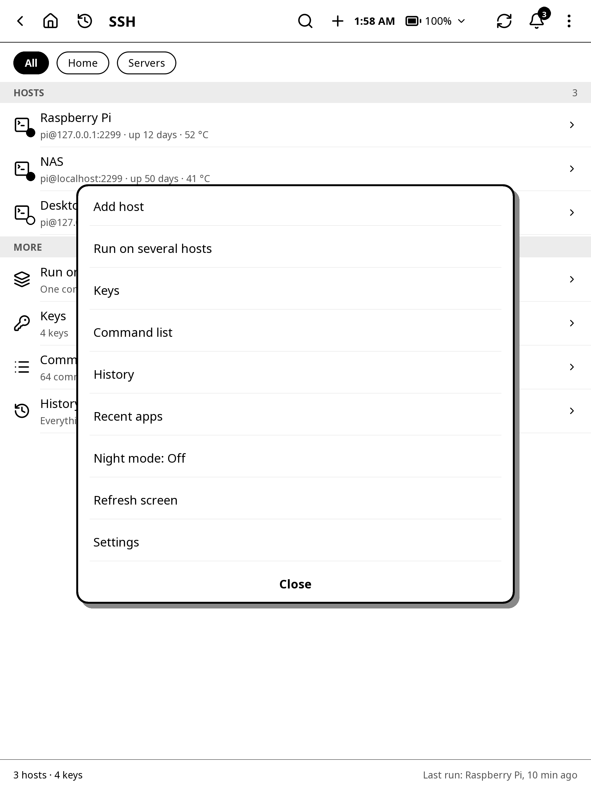

## Adding a host

1. Tap **Add host**.
2. Type your user name on the device and its address, as `user@address`: for example `pi@192.168.1.20` or `admin@nas.local`. Add `:port` when it isn't 22 (`admin@nas.local:2222`). **Name** gives it a name of your own (for example "Raspberry Pi"); without one it shows the address. Tap **Next**. (Without the launcher, the Kindle asks for **Name**, **Address**, **User** and **Port** one under the other instead.)
3. Choose how to sign in:
   - **Key**: a key on the Kindle (see Keys below). The safest choice, and you never type a password.
   - **Password**: saved on the Kindle, in KOReader's settings folder.
   - **Ask for password**: the Kindle asks every time you connect.

The device needs an SSH server: on Linux and a Raspberry Pi it is usually there (`sudo apt install openssh-server`); on Windows, add **OpenSSH Server** in **Settings > System > Optional features**; on a Mac, turn on **Remote Login** in **System Settings > General > Sharing**.

You can also add and edit hosts on the web page (see below), which is easier with a computer keyboard.

### The host's system

Each host has a **System** (in **Edit host**): Debian/Ubuntu, Raspberry Pi OS, Fedora/RHEL, Arch, openSUSE, Alpine, Other Linux, Windows, macOS, FreeBSD, pfSense, TrueNAS, TrueNAS CORE, Proxmox VE or ReadyNAS OS. It starts as **Detect automatically**: the first time the Kindle connects, it reads `/etc/os-release` on the device (or sees a Mac, Windows, FreeBSD, pfSense, TrueNAS, Proxmox or ReadyNAS) and shows **Auto: Debian/Ubuntu**, for example. Set it by hand when it guesses wrong. **Commands** then shows the commands for that system first (see below).

## Trusting a host

The first time the Kindle connects to a host, it shows the host's key fingerprint and asks **Trust this host?** Tap **Trust**. The Kindle remembers the key, and next time it connects without asking.

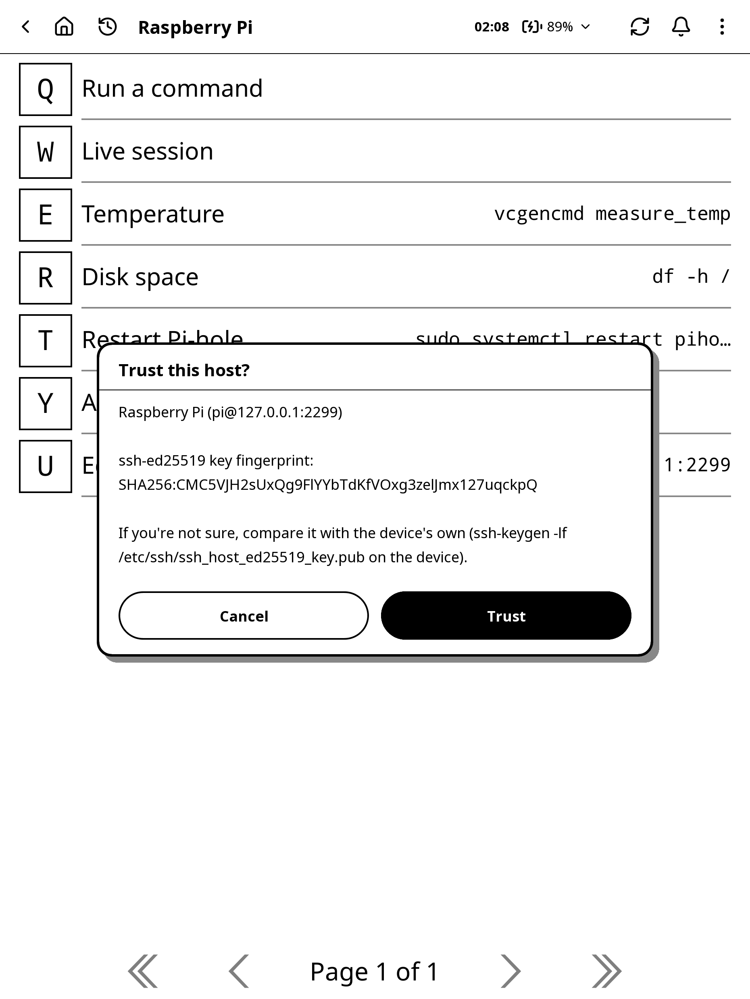

If a host's key changes later (it was reinstalled, or got a new address), the Kindle says **The host key of … has changed** and doesn't connect. If you know why it changed, tap **Trust new key**. If you don't, tap **Cancel**: someone could be pretending to be your device.

**Edit host > Forget host key** removes a saved key, so the Kindle asks again next time.

## The SSH page

The SSH page lists your hosts. Each one shows a dot when SSH last checked it: filled when the host answered, a ring when it didn't (the check only knocks on its SSH port, without signing in). Its second line has its address and, once its status has been read, two of its stats, such as "up 3 days · 52 °C" (turn that off in **SSH settings**). Below the hosts: **Run on several hosts**, **Keys**, **Command list** and **History**. **+** in the title bar adds a host and 🔍 searches History. The line at the bottom says how many hosts and keys there are and what ran last.

**Groups**: give hosts groups (Home, Servers…) in **Edit host > Groups**. The SSH page then shows them as chips at the top: tap one to show only that group's hosts, or **All**. In **Run on several hosts**, a group's chip ticks all its hosts at once.

## A host's page

Tap a host to open its page. Its first line is its address, its system, how it signs in, and whether its host key is trusted.

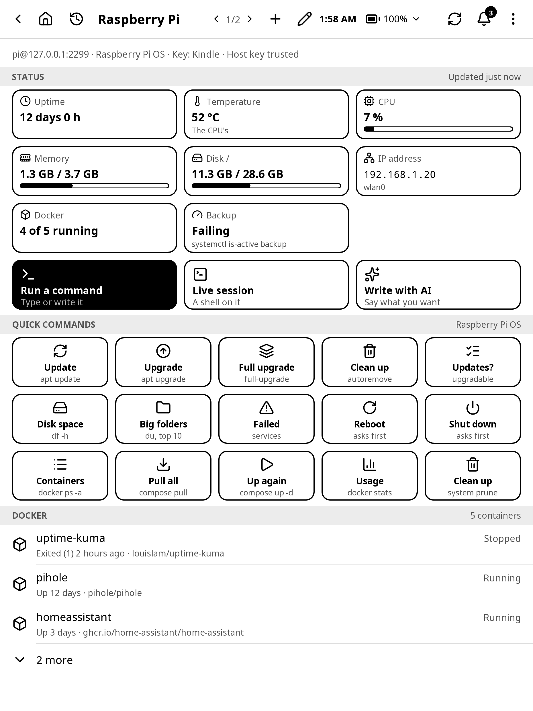

- **Status**: tiles with what the host is doing now: uptime, temperature, CPU, memory, disk, IP address, and more if you choose (see **Stats and alerts**). It's read when the page opens (when the Kindle is on Wi-Fi and the host needs nothing asked) and with ⟳. "Updated 2 min ago" says when. A host that asks for its password, or whose host key isn't trusted yet, waits for ⟳. Tap the **Docker** or **Services** tile for their pages.
- **Run a command**, **Live session** and **Write with AI** (with an AI set up).
- **Quick commands**: the usual ones for the host's system, a tap each (see **Quick commands**).
- **Docker**: when the host has Docker, its containers, stopped ones first (see **Docker**).
- **Services**: failed services, and the ones you show here (see **Services**).
- **Your system's own sections**, when the host has them (each can be turned off in **Stats and alerts**):
  - **TrueNAS**: **Alerts**, **Apps** with their version and updates (Update, Get the newer image, Start, Stop, Redeploy, Open a shell, Logs), **VMs and containers** (Start, Stop, Restart; Open a shell in a container), **SMB shares**, **Rsync tasks** (Run now), **Snapshot tasks** (Take a snapshot now) and **Replication** (Run now).
  - **Proxmox**: **VMs and containers** with each one's CPU, memory and disk (Start, Shut down, Reboot, Stop, Back up now, **Open a shell** in a container or a VM's console, **Run a command in it** (a VM needs the QEMU guest agent), **Memory** and **CPU cores**), **Storage**, **Backups**, the **Node** (CPU, memory, version, cluster and quorum) and **Failed tasks**.
  - **ReadyNAS**: its **SMB shares**.
  - **Pools and disks** (ZFS, ReadyNAS volumes, SMART): each pool's health, space and last scrub; each disk's model, size and temperature.
  - **Updates and logs** (Debian, Arch and others): updates waiting (**Update everything**), the package cache (**Empty it**), errors since it started, and the log size (**Remove logs older than 2 weeks**).
  - **Raspberry Pi**: low voltage or throttling, now or since it started, and **Camera**, **I2C**, **SPI**, **SSH**, **VNC** and **Serial port** to turn on or off (raspi-config's own; some after a restart).
  - **pfSense**: firewall states, DHCP leases, gateways, VPNs, each interface's traffic, and **Check for updates**.
  - **3D printer** (Klipper with Moonraker on the printer): the file, progress, nozzle and bed, with **Pause**, **Resume** and **Cancel the print**.
- **Saved commands**: tap one to run it; hold for more. **+** in the title bar adds one.
- **Recent**: the last commands you ran here, with when. **All recent commands** has the last 10.
- **Files** and **Stats and alerts**.
- **Wake**: when the host doesn't answer and its MAC address is known, a **Wake** tile sends Wake on LAN (see **Wake on LAN**).

The pencil in the title bar is **Edit host**: name, address, user, port, system, sign-in and password; **PIN**; **Groups**; **Stats and alerts** and **Quick commands**; **MAC address** and **Wake it now**; **Forget host key** and **Delete host**.

**PIN** (optional, off until you set one): **Set a PIN** (4 to 8 digits) in **Edit host**. The host then asks for it before its page or a live session opens, and before its saved commands run from a gesture or the launcher; once typed, it's open for 5 minutes. After 5 wrong tries, wait a minute. **Remove PIN** turns it off.

**Run a command**: type a command and tap **Run**. **Commands** pastes one from your lists (see below), and **Save** keeps the command on this host. With handwriting set up (**Settings > AI**), tap the pen at the end of the box to write the command instead; without the launcher, it's **Write it**. Names and the AI's question boxes have the pen too; addresses, user names, ports and passwords don't, as they need exact values.

**Add saved command**: the command in the box (or written with the pen), **Name** and **System** to set its name and system (shown under the title), then **Save**. Editing a saved command looks the same, with **Delete**.

**Commands with blanks**: a command can have blanks in braces, such as `sudo systemctl restart {service}` or `docker logs {container}`. When it runs, SSH asks for each blank, offering what fits from the host: its services, its containers, the compose folder.

## Stats and alerts

**Stats and alerts** (at the bottom of a host's page, or a tap on **STATUS**) chooses what the host shows and when you hear about it.

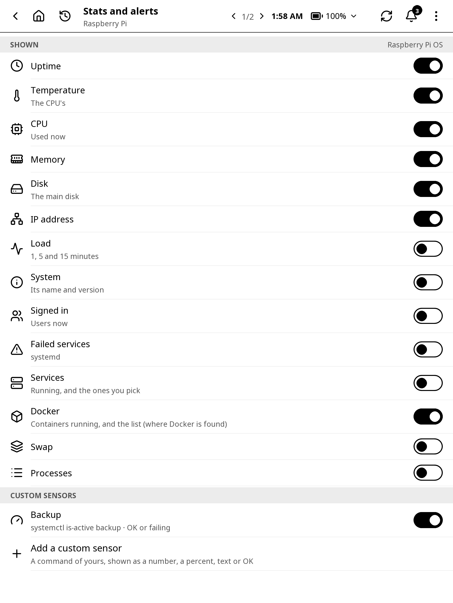

- **Shown**: a switch for each stat the host's system can give: Uptime, Temperature, CPU, Memory, Disk, IP address, Load, System, Signed in, Failed services, Services, Docker, Swap, Processes. A PC often has no temperature: a stat on by default that the host can't give is left out; one you turn on shows "Not available".
- **Custom sensors**: **Add a custom sensor**: a name, a command of yours, and what it gives: **A number** (with a unit, such as °C or GB), **A percent** (with a bar), **Text** (its first line), or **OK or failing** (whether the command succeeds). It shows as a tile with the others. Hold one to edit or delete it. (Linux and Mac; not Windows.)
- **Checks**: **Check it**: how often SSH reads this host's status by itself, or **Like every host** (**SSH settings > Check hosts**, every 15 minutes at first). Checks run while the Kindle is awake and already on Wi-Fi; they never turn Wi-Fi on. **Read when its page opens** can be turned off.
- **Alerts**: a notification (🔔) when something needs a look: **Disk full**, **Memory used**, **CPU busy** and **Temperature** over a limit you pick, **A service failed**, **A container stopped**, and limits on your custom sensors. It comes once when it starts and goes when it's over.
- **Custom alerts**: **Add a custom alert**: any stat or custom sensor, a test (**above**, **below**, **is**, **isn't**, **contains**) and a value. For example "IP address isn't 192.168.1.20", "Load (1 minute) above 4" or "Backup is Failing".
- **Docker**: **Compose folder**: the folder with your `docker-compose.yml`, for **Pull all** and **Up again**.

## Quick commands

A host's page has the usual commands for its system as buttons. For Debian, Ubuntu and Raspberry Pi OS: **Update** (apt update), **Upgrade**, **Full upgrade**, **Clean up** (autoremove), **Updates?** (what can be upgraded), **Disk space**, **Big folders**, **Failed** (services), **Reboot** and **Shut down**. Arch, Fedora, openSUSE, Alpine, macOS and Windows get their own (pacman and yay, dnf, zypper, apk, Homebrew, winget), and so does FreeBSD (freebsd-update, pkg). With Docker, its own come too.

**pfSense**: **Updates?** (pfSense-upgrade -c), **Upgrade** (asks first, then runs in a live session, as it takes a while and restarts the firewall), **Firewall** (pfctl -si), **Rules**, **Reload rules**, **Web GUI** (restarts the web interface), **Routes**, **Disk space**, **Ports**, **Top**, **Reboot** and **Shut down**. Sign in as admin (or root): pfSense has no sudo. A live session on pfSense opens its console menu; type 8 for its shell. A command sent to a live session (Upgrade, **Run in a live session**) picks 8 for you.

**TrueNAS** (SCALE or Community Edition; sign in as admin): **Pools** (zpool status -x), **Pool space**, **Datasets**, **Alerts** (TrueNAS's own, with sudo), then Linux's. **Scrub** ({pool}) is in **Choose quick commands**. Updates come from TrueNAS's web page: apt is turned off there. **TrueNAS CORE** (FreeBSD; root) has the same, with FreeBSD's.

**Proxmox VE** (root): **Update**, **Updates?**, **Upgrade** (apt dist-upgrade, in a live session, as it can ask about config files), **VMs** (qm list), **Containers** (pct list), **Storage**, **Version**, then Linux's without sudo. **Start VM** and **Stop VM** ({vmid}) are in **Choose quick commands**.

**ReadyNAS OS** (root): **RAID** (/proc/mdstat), **Volumes** (btrfs), **Disk health** (SMART of each disk), then Linux's without sudo. Updates come from its web page.

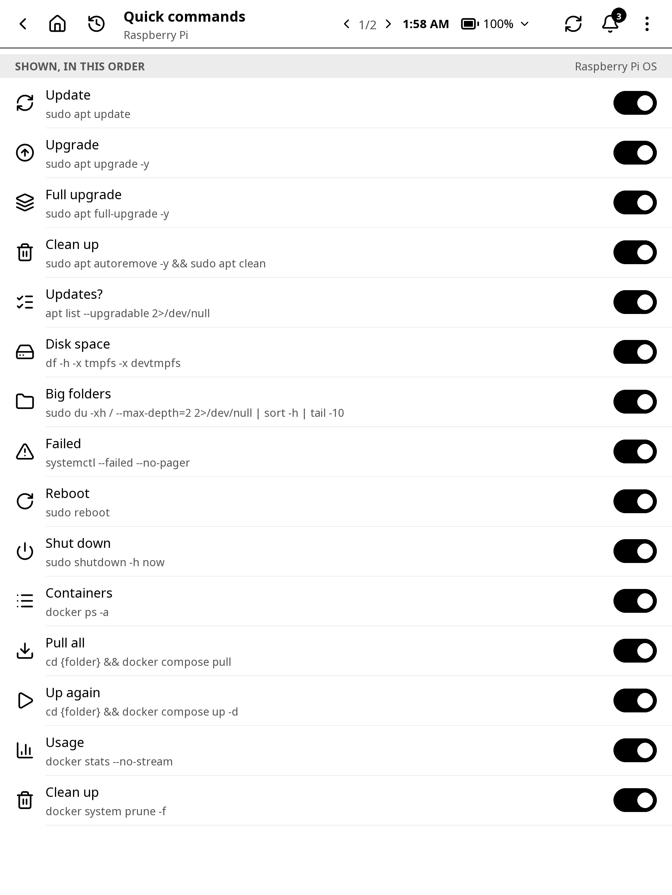

- A tap runs it. One with sudo opens in a live session, where sudo can ask for its password. **Reboot**, **Shut down** and Docker's **Clean up** ask first.
- Hold one for **Run**, **Edit and run**, **Save as command** and **Choose quick commands**.
- **Quick commands** (from a hold, or **Edit host**): tap a row to show or hide it, hold to move it up or down. **New quick command** makes your own: a short name, a command, and an icon. **Add one of your commands** takes one from the host's saved commands or the command list. **Back to the usual ones** undoes your changes.

## Docker

When a host has Docker, its page has a **Docker** section: its containers with their state (stopped ones first), and **N more** for the rest. The **Docker** page has them all, with **Containers**, **Pull all**, **Up again**, **Usage** (CPU and memory of each) and **Clean up** (removes stopped containers and unused images).

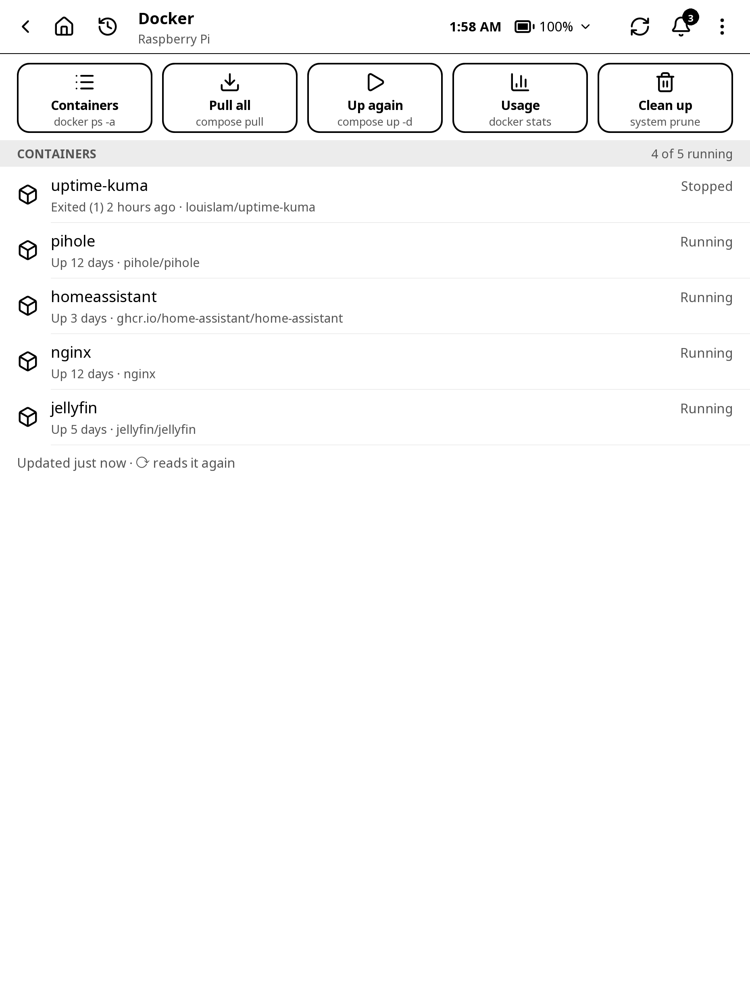

Tap a container for **Start**, **Restart**, **Stop**, **Logs** (the last 100 lines), **Explain with AI** (it reads the logs) and **Live session in it** (a shell inside the container). When Docker needs sudo on the host, SSH says so, and its commands open in a live session.

## Services

On a Linux host with systemd, the **Services** section shows failed services, and the ones you show there. **All services** lists every one, with **All**, **Running** and **Failed** at the top. Tap one for **Start**, **Restart**, **Stop**, **Status**, **Logs** (the last 100 lines) and **Show on the host's page**. Start, Restart and Stop use sudo, so they open in a live session.

## Files

**Files** browses the host's folders, starting in your home folder (⌂ in the title bar goes back there). Tap a folder to open it, **Up one folder** to go back. Tap a file for:

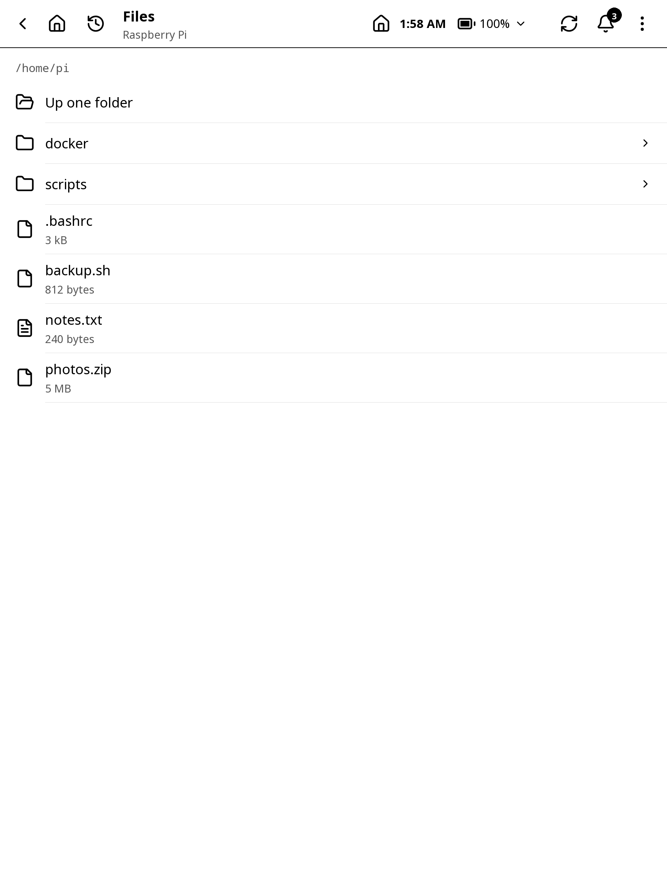

- **Edit**: the file in the Kindle's text editor (up to 1 MB). **Save** writes it back to the host. A file only root can change is saved with sudo: SSH asks for the sudo password (a saved SSH password is filled in), or uses none when sudo allows it. The editor has the apps' title bar, and **Line**, **Find**, **Keyboard**, **Close** and **Save** at the bottom. Hold the text to **Copy**, **Select** (tap the start, hold the end: then **Copy** or **Delete**) and **Paste**.
- **Read it**: the file (its first 300 KB) in the output page.
- **Copy to the Kindle**: books (EPUB, PDF, MOBI…) go to the Kindle's books folder, other files to its Downloads folder.
- **Explain with AI** (a text file, with an AI set up): its last 300 lines.
- **Copy its path**.

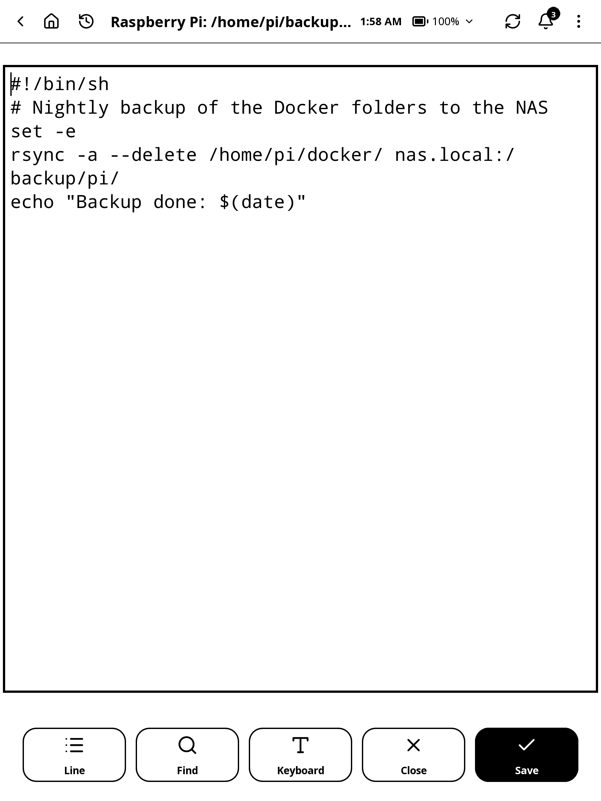

## Wake on LAN

A PC or NAS that's off or asleep can be woken from the Kindle, when its network card allows it (Wake on LAN on in its BIOS or settings). SSH reads its MAC address with its status, or you can type it in **Edit host > MAC address**. Then **Wake** (on its page when it doesn't answer, in **Edit host**, or a hold on the host) sends the wake-up packet on your Wi-Fi.

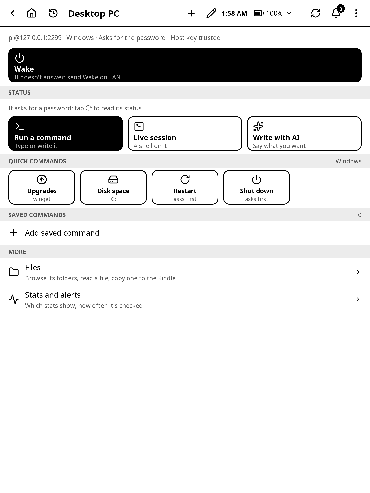

## History

**History** (on the SSH page, or 🔍) has everything you ran, on every host, newest first, with where and when. 🔍 searches it (a command, or a host's name). Tap one to open it in that host's command box; hold for **Run again**, **Run on another host**, **Save** and **Copy text**.

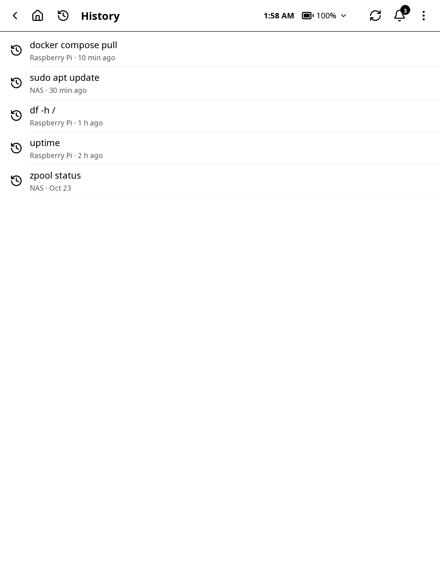

## SSH settings

**⋮ > Settings** (or the launcher's **Settings > SSH**): **Check hosts** (how often every host's status is read: off, or every 5, 15, 30 or 60 minutes, or every 3 hours), **Stats under each host** on the SSH page, **Dark terminal**, **Text size** (the live session's text, 10 to 24; the next session opens with it), and **AI settings**.

## Running a command

While a command runs, the Kindle shows **Running on …**; tap **Stop** to stop it. Commands stop by themselves after 5 minutes. The Kindle keeps working meanwhile: the connection runs in the background.

The output opens in a pop-up over the host's page, in a monospace font whose size follows **SSH settings > Text size**. Drag the pop-up by its title bar; tap ✕ or outside it to close it. Its buttons: **Copy all**, **Explain** and **Summarize** (with an AI set up), **Run again**, **Live session** (a live session on the same host) and **Full screen** (the output on a full page, with **Find**). Hold a quick command and pick **Run full screen** to go straight to the full page. Output from several hosts at once opens on the full page. Colour codes are removed. If the command failed, the end says why: **Exit status 1**, **Can't sign in** (check the user name, password or key), or **Can't connect** (check the address, and that the device is on).

A long output is in pages: swipe, or tap either side of ‹ n/m ›. The buttons at the bottom:

- **Find**: type a word; it shows where it is. **Find** again with the same word goes to the next one.
- **Copy all** copies the whole output to KOReader's clipboard.
- **Explain** and **Summarize** (with an AI set up): see **AI help** below.
- **Run again** runs the same command again.

Long-press a word to copy it, or long-press and drag to copy a part. ✕ or the Back key closes the page. (Without the launcher, the output page is KOReader's, with **Find**, **⇱** and **⇲** to jump to the top and bottom, and **Close**.)

Commands that use `sudo` usually ask for a password, which a command run this way can't answer. Use them in a live session, or set up passwordless sudo on the device. When a run stops because sudo wanted a password, SSH says **sudo needs a password** and offers **Run in a live session**: the same command, typed into a live session, where sudo can ask for it.

A command that takes a minute or more is also kept in **Notifications** (🔔): "Command finished on NAS: sudo apt full-upgrade -y", or "Command failed on …" (one per host: the next one, or opening that host's output, takes it away). Tap it to see the output again.

## Commands

**Commands** in the command box (and in a live session) lists, in order:

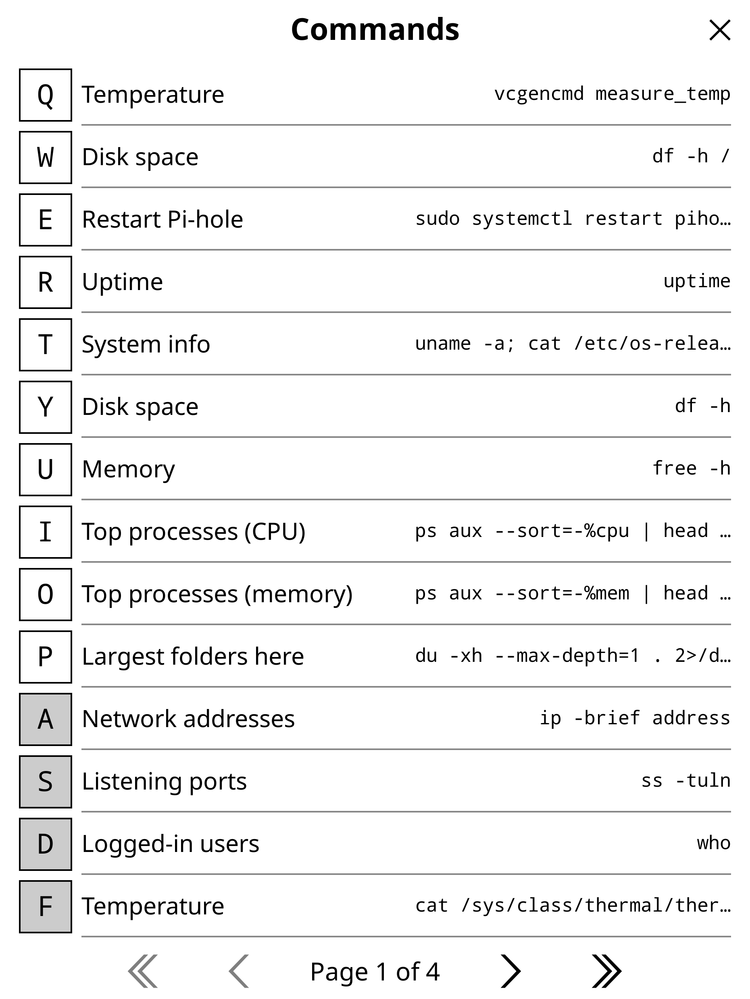

- **Show**: which of the command list's commands are shown. It starts on the host's system (**This host: Debian/Ubuntu**); tap it for **All**, **Custom** (your own commands) or another system.
- **Paste**: what's on KOReader's clipboard (from **Copy text**, **Copy all** or elsewhere in KOReader).
- This host's saved commands, then its recent commands.
- The **Command list**'s commands that fit (those for the system, for any Linux, and for any system; a Raspberry Pi also gets the Debian ones).

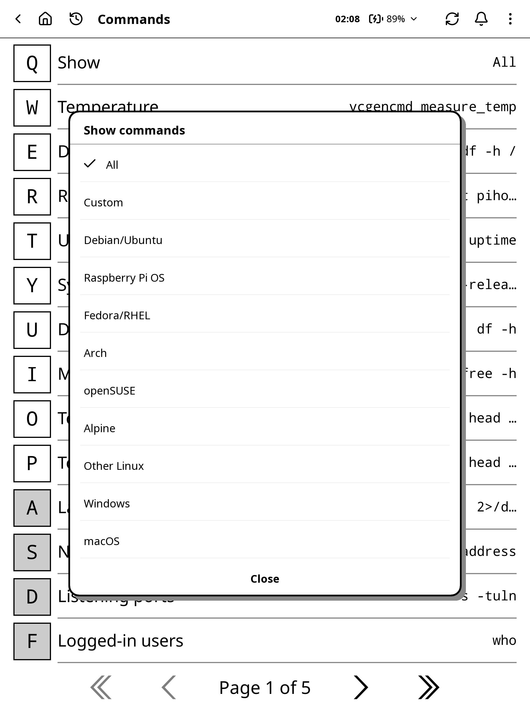

Tapping one pastes it where you type, so you can change it before you run it.

### The command list

**Command list** (on the SSH page) comes with over 100 built-in commands:

- **Any Linux**: Uptime, System info, Disk space, Memory, Top processes (CPU and memory), Largest folders here, Network addresses, Listening ports, Logged-in users, Temperature, Failed services, Service status, Restart a service, Recent errors, Restart, Shut down.
- **Docker** (containers, disk use, Compose status and update) and **ZFS** (pool status and space, for TrueNAS and others).
- **Debian/Ubuntu**: apt update, updates, update and upgrade, install a package, search packages, clean up, restart needed?
- **Arch**: updates, sync package lists, upgrade, install a package, search packages, package info, explicitly installed, orphan packages, clean package cache, and with **yay** (the AUR helper): updates, upgrade, search and clean cache.
- **Fedora/RHEL**, **openSUSE** and **Alpine**: updates, upgrade, clean up and (Fedora) restart needed?
- **Flatpak** and **Snap** updates, **Raspberry Pi** temperature and throttling.
- **Windows** (system info, running programs, disk space, restart, shut down) and **macOS** (updates, battery, restart).
- **FreeBSD**: packages to upgrade, upgrade packages, system updates, enabled services, listening ports, memory, restart.
- **TrueNAS**: pool status, datasets, snapshots, alerts, start a scrub; **TrueNAS CORE**: pool status, datasets, alerts.
- **Proxmox**: version, VMs, containers, storage, cluster, start a VM, shut down a VM, update and upgrade.
- **ReadyNAS**: RAID status, volumes, volume space.
- **pfSense**: check for updates, firewall info, firewall rules, states, routes, interfaces, listening ports, reload the firewall rules, restart the web interface, restart.

Each command belongs to a system (or to any Linux, or to any system). **Show** at the top filters the list: **All**, **Custom** (your own) or one system.

Tap a command to edit it: its name, the command, and **System** (which system it's for). **Add command** adds your own; it starts with the system shown. **Restore built-in commands** puts back any built-in ones you deleted.

## Long-press menus

Long-press almost anything for more:

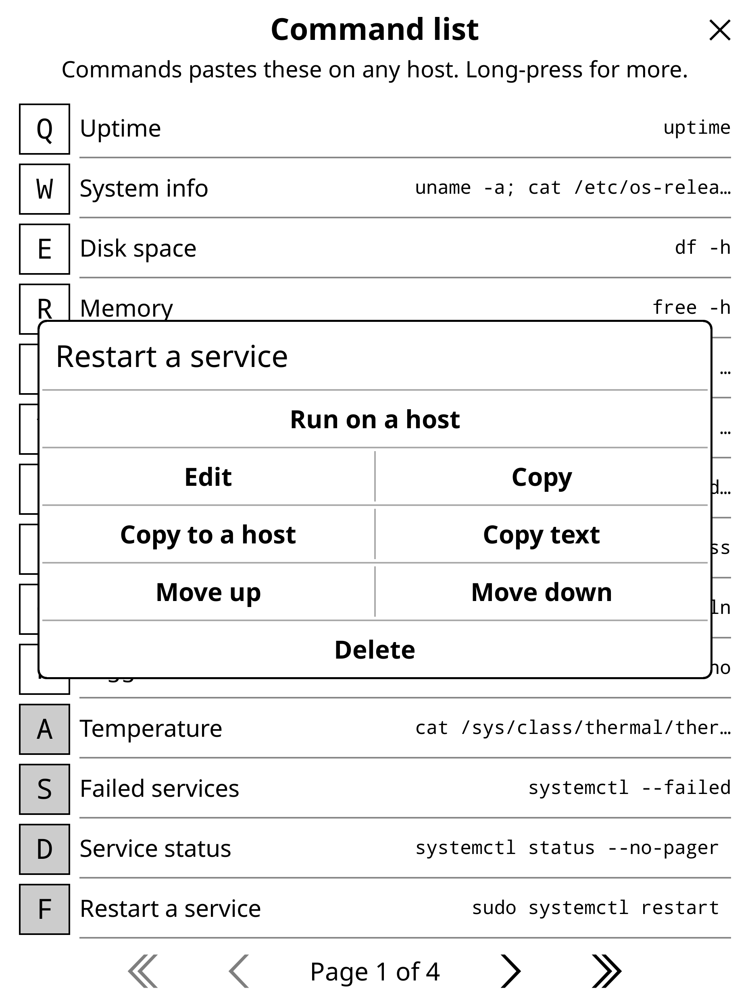

- **A command** (in a host's saved commands, or in the command list): **Run** and **Edit and run** (opens it in the command box) on a host's command, **Run on a host** (choose the host; it opens in its command box) on the command list's, then **Edit**, **Copy** (a copy below it, to change first), **Copy to a host** (into a host's saved commands, to change first), **Copy text**, **Move up**, **Move down**, **Delete**.
- **A host** (on the SSH page): **Run a command**, **Live session**, **Wake** (with its MAC address), **Edit host**, **Copy host** (a copy with its saved commands, opened to change), **Copy address**, **Move up**, **Move down**, **Delete host**.
- **A recent command**: **Run**, **Edit and run**, **Save as command**, **Copy text**, **Remove from recent**.
- **A key**: **Show public key**, **Copy public key**, **Rename**, **Delete**.

Deleting a host, a command or a key happens at once, and **Undo** at the bottom of the screen puts it back for a few seconds. (Without the launcher, the Kindle asks **Delete …?** first instead.)

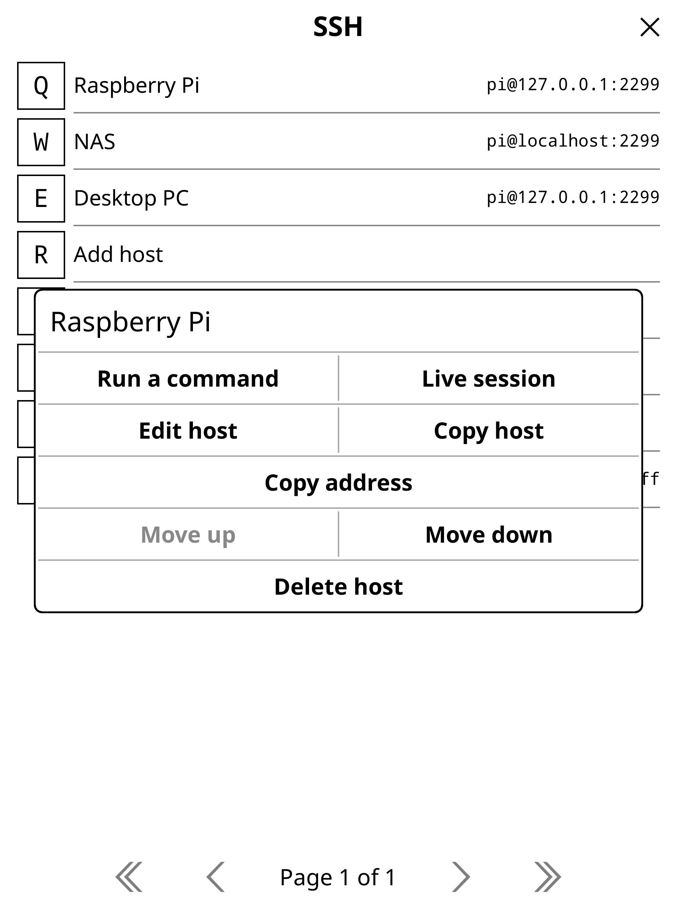

## Live session

**Live session** opens a shell on the device, like a terminal on a computer. Type with KOReader's keyboard; Enter sends the line. It has the apps' title bar: ‹ and ⌂ ask **Disconnect?** first.

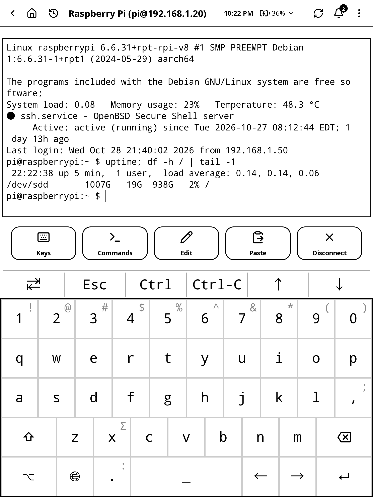

- **↹** (Tab, to complete names), **Esc**, **Ctrl** (then a letter, for example Ctrl then D; it stays black until the letter, or tap it again to let go), **Ctrl-C** (stops what's running).
- **⇧** and **⇩** move up and down the screen; hold them to scroll.
- **Keys**: keys and combinations by what they do, sent at once: Stop what's running (Ctrl-C), Log out (Ctrl-D), Clear the screen, Search earlier commands, ↑ The command before, ←, →, Start and End of the line, Quit a pager (q), nano's Save, Exit, Find, Cut and Paste, and vi's Save and quit and Quit without saving.
- **Commands** pastes a command (or the clipboard).
- **Edit**: a file's path (or **Files** to find it), then **Edit** opens it in the Kindle's text editor (see **Files**). Back in the session when you close it.
- **AI** (with an AI set up): tap it for the session's AI chat (see below). Hold it for **AI for this**: which AI service, and which of its models, the chat uses.
- The **moon** turns the terminal dark (white on black), and the **sun** turns it light again. The Kindle remembers your choice, and command output pages follow it too. SSH's lists keep the normal look; KOReader's **Night mode** (in ⋮) is the one for everything.
- **Copy text**: hold on a word to select it, or hold and drag over a part. It's copied to KOReader's clipboard at once, and shows with **Paste** (types it at the prompt), **Copy all** (the whole screen), **Done** and, with an AI set up, **Ask AI** (see below). What you copy pastes into the apps' text boxes too: hold the text in a box for **Paste**, **Copy all** and **Clear**.
- **✕** asks **Disconnect?** (the keyboard hides while it asks, and comes back on **Cancel**). Typing `exit` also ends the session (**[Session ended]**).

Programs that draw the whole screen (top, nano, htop) don't draw well on the Kindle: it is a simple terminal. Use `top -bn1 | head -20` instead of `top`, for example, and **Edit** instead of nano (when nano starts anyway, SSH says so; **Keys** has its keys, by name, to save and leave).

### The AI chat

With an AI set up, **AI** in a live session opens a chat about the session. Its top shows the session's last lines as they come; below is the conversation. Each question goes with what the terminal shows now and the conversation so far, so "Why did that fail?" or "What next?" works without copying anything. After you run something, the next question sees its output.

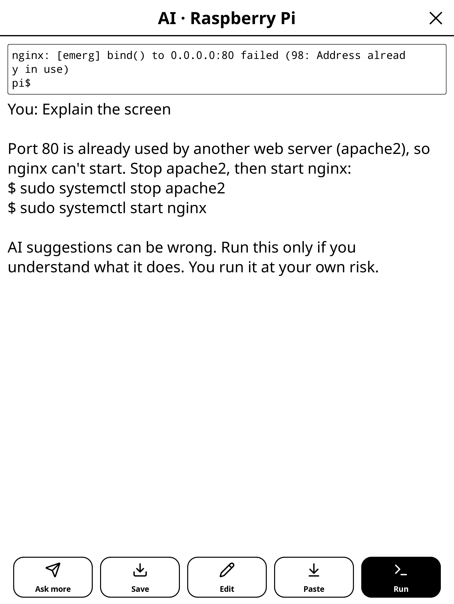

- To start: **Explain** (what the screen shows, and what to try if something failed), **Summarize**, **How do I…** (a question of your own, such as "How do I check disk space?"), **AI settings** and **Ask AI**.
- **Ask AI** (**Ask more** after an answer): a question of your own. Type it, or tap the pen to write it by hand; the examples fill the box for you. **Answer** sends it.
- Hold any AI button (**Explain**, **Summarize**, **Ask AI**, **Answer**…) for **AI for this**: the service and model for it, with the models loaded from the service.
- **Ask AI on a selection**: select a part of the terminal (an error, a line of output; see **Copy text** above), then **Ask AI**. The question goes with that part first, and only the terminal's last 20 lines around it. Its examples: **What does this mean?**, **Why did this fail?**, **How do I fix it?**. The answer goes into the chat, under "About …".
- Commands the AI suggests show as `$ …`, with:
  - **Run**: asks **Run in this session?** with a reminder that AI suggestions can be wrong, then types the command in with Enter, back in the session. sudo asks for its password there, as usual. Run a command only if you understand what it does; you run it at your own risk.
  - **Paste**: puts the command on the prompt line without pressing Enter. Check it, then press Enter yourself.
  - **Edit**: change the command first, then **Run** or **Paste**.
  - **Save**: keeps it as one of the host's saved commands.

  With several commands, each of these asks which one.
- ✕ (or the Back key, or a swipe in from the left edge) goes back to the session; **AI** opens the chat again where it was. A long conversation is in pages: swipe, or tap either side of ‹ n/m ›.

Nothing is typed without your tap, and Enter only with **Run** after you confirm. Passwords, keys and tokens in what the terminal shows are blanked before it's sent. The conversation lasts as long as the session: disconnecting ends it, and nothing of it is kept. How much of the terminal goes with each question (the last 50 lines by default) and the request's wording are in **Settings > AI > Advanced > SSH: Live session chat**.

## Run on several hosts

**Run on several hosts** (on the SSH page): tick the hosts (✓), tap **Run a command**, and type or paste the command. It runs on all of them at once, and the output page has a part for each host.

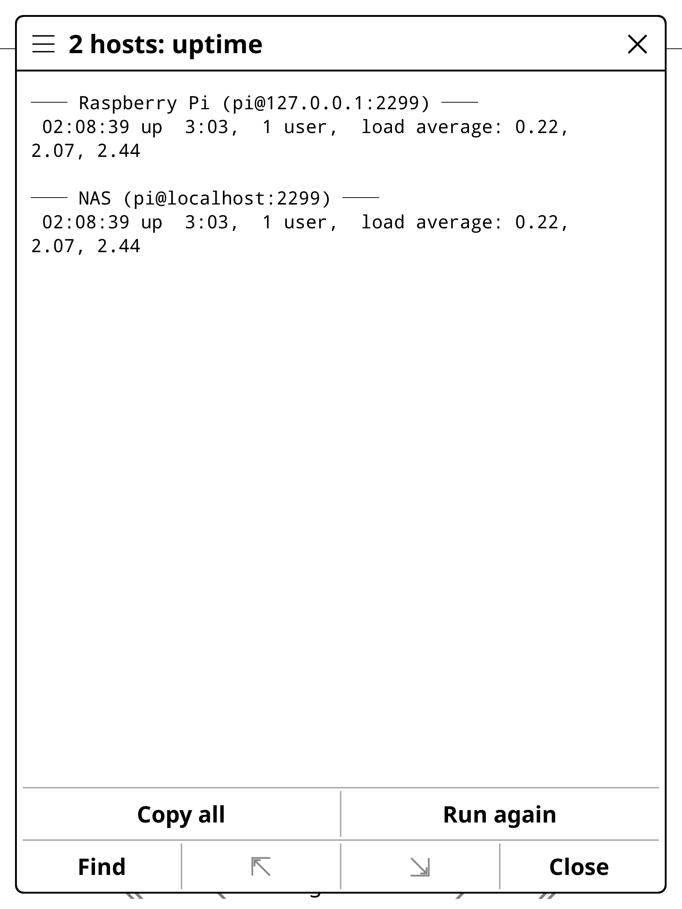

## AI help

With an AI set up (**Settings > AI**), SSH can explain what a command printed, summarize long output, and write a command from a description. Without one, these buttons don't show.

- On an output page, **Explain** says what the output or error means and what to try next, and **Summarize** cuts long output (logs, `docker ps`, `df -h`) down to what matters.
- On a host's page, **Write with AI**: describe what you want ("How do I check disk space?"). The AI gets the host's system (set by hand, or detected), so the command fits it.
- In a live session, **AI**: a chat that sees what the session shows (see **The AI chat** above).

The answer opens in a page; a long one turns with ‹ › or a swipe. Commands the AI suggests show as `$ …`, with:

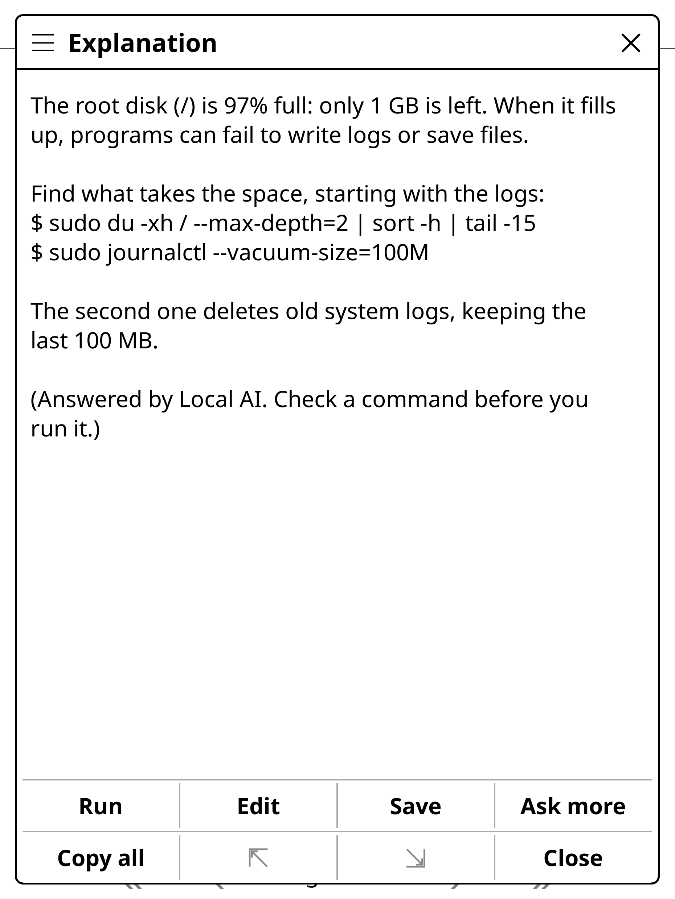

- **Run**: it offers **Run in a live session** (opens one, or uses the open one, and types the command there) and **Run once** (in the background, with the output page; with sudo, only on a device with passwordless sudo, so **Run in a live session** comes first). Each asks first, with a reminder that AI suggestions can be wrong. Run a command only if you understand what it does; you run it at your own risk.
- **Edit**: opens the command in the command box, so you can change it before you run it.
- **Save**: keeps it as a saved command: **On** the host, or **In the command list (every host)**. You can change its name and system first.
- **Ask more**: a follow-up about the same output ("That didn't work; it says …").

Nothing runs by itself: a command is typed or run only after you tap **Run** and confirm. The AI never types anything itself.

Before anything is sent, SSH blanks what looks like a secret as [hidden]: private keys, passwords and tokens in the output (`password=…`, `API_TOKEN=…`, `Bearer …`), and your saved passwords. Only the last 200 lines are sent by default. To change how much is sent, or the wording of each request, use **Settings > AI > Advanced** (**SSH: Explain output**, **SSH: Summarize output**, **SSH: Write a command**; **Preview** shows what is sent). To choose which AI does it, use **Settings > AI > Which AI does each job > SSH**: your own local AI keeps everything at home, or pick a public one (Claude, Gemini and others).

## Keys

A key lets the Kindle sign in without a password. **Keys** (on the SSH page) lists them.

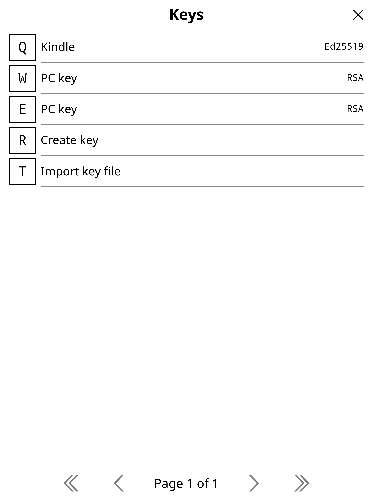

- **Create key** makes a new Ed25519 key on the Kindle. The page that opens shows its **public key** (one line starting with `ssh-ed25519`).
- **Import key file** uses a key you already have: copy the private key file (for example `id_ed25519` from your computer's `.ssh` folder) to the Kindle over USB, then pick it. The Kindle keeps its own copy and offers to delete the file you copied. Ed25519, RSA and ECDSA keys work. A key with a passphrase doesn't: remove the passphrase from a copy first (`ssh-keygen -p -N "" -f copy` on the computer).

To use a key with a device, add its public key to `~/.ssh/authorized_keys` on that device. The easiest way is the web page: **Copy public key**, then on the device run `nano ~/.ssh/authorized_keys`, paste it on a new line, and save. Each key's public key is also in `koreader/settings/sshclient/keys/<key>.pub`. On Windows, use `C:\Users\<you>\.ssh\authorized_keys`, or `C:\ProgramData\ssh\administrators_authorized_keys` for an administrator.

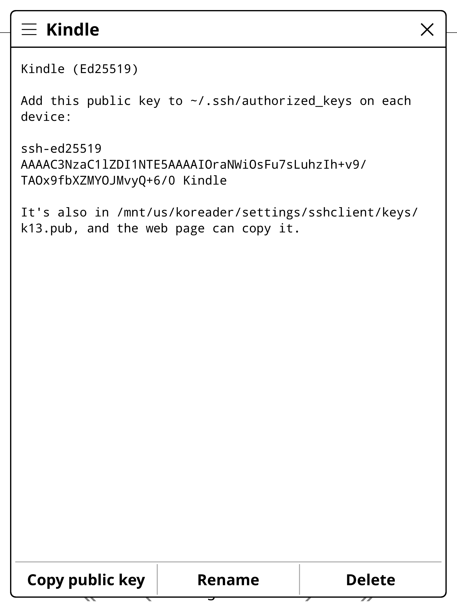

## On the web page

The web page (Web server) has an **SSH** tab, handy for setting things up with a computer keyboard:

- **Hosts**: each with its system ("Debian/Ubuntu (detected)"). **Add host** and **Edit** (name, address, user, port, **System** (Detect automatically, or one), sign in with a key, a saved password, or asking each time; **Forget host key**, **Delete host**). A saved password is sent to the Kindle but never shown again. **Commands** edits a host's saved commands: **Add command**, **Add from command list** (a copy to change), each command's system, ⧉ (copy), ↑ ↓ (move) and ✕ (remove).
- **Keys**: **Upload key file** (a private key from the computer), **Paste key** (paste the private key's text, including its BEGIN and END lines), **Create key** (made on the Kindle; its public key is copied for you), **Show** (the public key, hidden until you ask), **Copy public key**, **Rename**, **Delete**. Private keys are never shown or sent to the page.
- **Import ~/.ssh/config** (under Hosts): paste your computer's `~/.ssh/config` (or a part of it). Each `Host` becomes a host, with its address (`HostName`), user and port; hosts already saved and patterns (`Host *`) are skipped. New hosts sign in with your first key, or ask for a password when there's none. Key files aren't copied: add them under **Keys**.
- **Command list**: **Show** (All, Custom, or one system), then edit, copy, reorder and remove commands and set each one's system, **Save**, and **Restore built-in commands**.

- **AI help** (with an AI set up): paste a command's output, or tap **Use the last output on the Kindle**, then **Explain** or **Summarize**. Or describe a command and tap **Write a command**. Suggested commands have **Copy** and **Save on host** (or **Save in command list**), and **Ask more** asks a follow-up. Secrets are blanked on the Kindle before anything is sent.

Commands run on the Kindle, not from the web page.

## Good to know

- The Kindle needs Wi-Fi to connect; it turns Wi-Fi on if it's off. Devices at home are reached on your home Wi-Fi; outside, only devices you can reach from the internet (for example over a VPN).
- Nothing runs while the Kindle sleeps, checks and alerts included.
- The web page's backup has your hosts, commands and trusted host keys. Saved passwords and private keys are in it only when you tick Include keys and sign-ins.
- Passwords and private keys stay on the Kindle, in `koreader/settings`. Anyone with your Kindle and a USB cable can read them, so prefer keys, and use a key just for the Kindle that you can remove from `authorized_keys` if you lose it.
