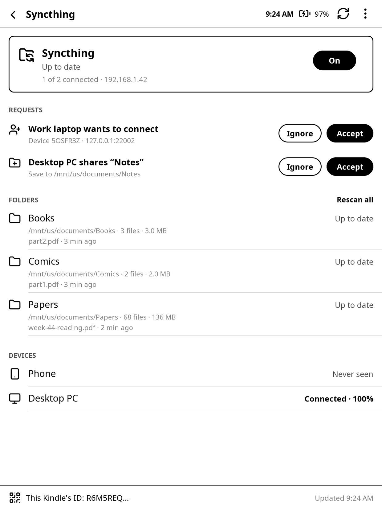
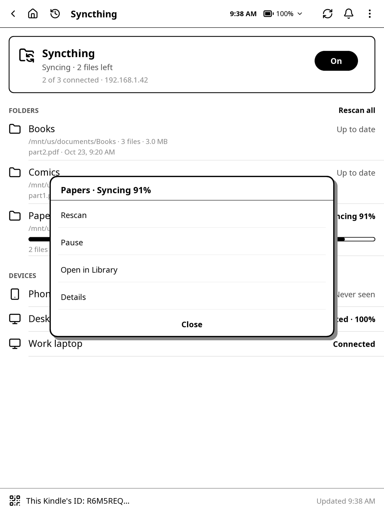
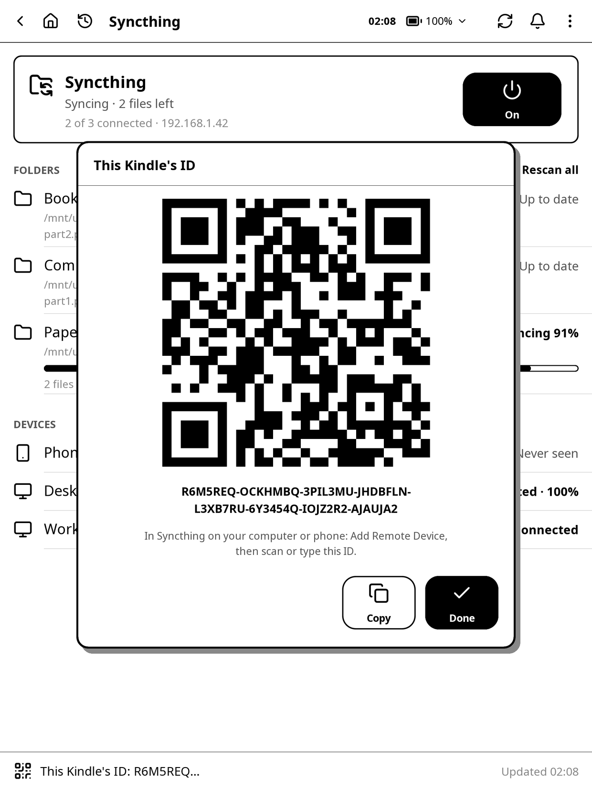
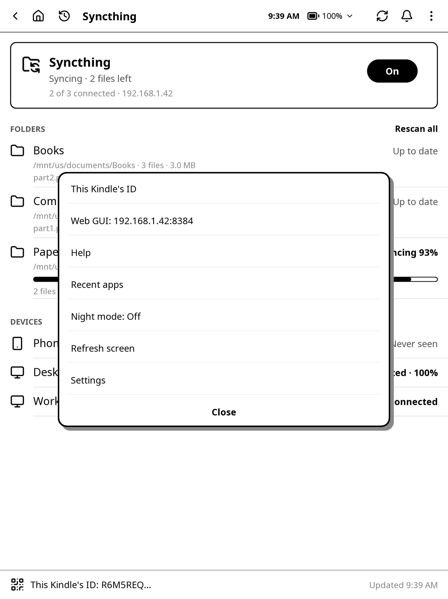
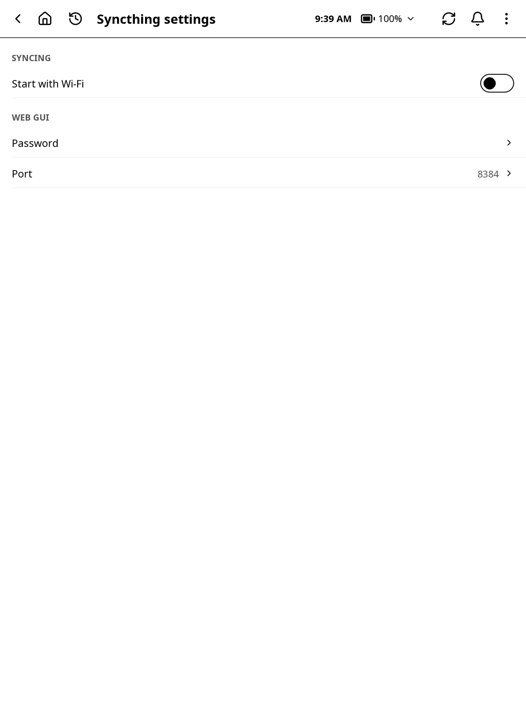

# Syncthing

Syncthing keeps folders on the Kindle in sync with your computer or phone, directly over Wi-Fi: no account and no cloud. Put a book or a PDF in a shared folder on your computer and it shows up on the Kindle a few seconds later; change something on the Kindle and it goes back the other way.

This plugin is based on **koreader-syncthing** by jasonchoimtt (github.com/jasonchoimtt/koreader-syncthing, AGPL-3.0), with its own app, a launcher tile and a web page tab added. Syncthing itself is made by the Syncthing project (syncthing.net).

## Opening it

- The **Syncthing** tile on the launcher. Its line says what Syncthing is doing: **On · Up to date**, **On · Syncing · 3 files left**, or **Off**.
- A **Syncthing** quick button on the launcher (add it in **Settings > Launcher > Quick buttons > Add a button > Syncthing…**, or on the web page's Launcher tab): tap it to turn Syncthing on or off (it is black while on), hold it to open the app.
- **Settings (gear) > Network > Syncthing** in KOReader's menu.
- A gesture: **Settings > Taps and gestures > Gesture manager**, pick a gesture, then **General > Syncthing** (opens the app) or **Turn Syncthing on or off**.
- The launcher's **recent apps**, its **search** (it finds Syncthing's folders by name or path and its devices by name; tap a result to open that folder's or device's menu) and its **Settings** list (**Syncthing** opens Syncthing's settings).
- **Set up your Kindle** in the launcher has a Syncthing step: **Show this Kindle's ID** turns Syncthing on and shows the ID, ready to add from your computer or phone.

The title bar is the same as in the other apps:

- At the left: **‹** goes back (from Syncthing's own page, to the launcher), the house goes to the launcher, and the clock with an arrow shows the recent apps. Then the title.
- At the right: the time and battery (tap them, or the small **▾**, for the control center: light, Wi-Fi, night mode and more), **⟳** (reads the status again and redraws the screen; the app also reads it by itself every few seconds while it is open), the bell (notifications, with how many are new) and **⋮**.
- When a list has more than one page, **‹ 1/2 ›** shows in the bar; tap its halves to turn pages.

A swipe in from the left edge of the screen goes back, as in the other apps; other swipes turn pages.

While Syncthing runs, its icon (folders with arrows) shows by the clock in every app, and the bell has a **Syncthing is on** notification that opens the app. Both go away when it turns off.

New requests and folders with errors also show in the shared notifications (the bell), so you see them from the other apps too. Tap one to open Syncthing; it goes away once the request is accepted or ignored, or the error is fixed.

## Setting it up

You need Syncthing on the other device too: **syncthing.net** for a computer, or Syncthing-Fork on Android.

1. Tap the power button (**Off**) at the right of the Syncthing box to turn it **On** (it turns black). The first start takes a few seconds (**Starting…**).
2. Tap **This Kindle's ID** at the bottom. The Kindle shows its ID as a QR code.
3. In Syncthing on your computer or phone, choose **Add Remote Device** and scan the code or type the ID.
4. On the Kindle, the computer shows up under **Requests**: "Desktop PC wants to connect". Tap **Accept** and give it a name (it suggests the computer's own name).
5. On the computer, share a folder with the Kindle (in the folder's **Sharing** tab, tick the Kindle).
6. On the Kindle, the folder shows up under **Requests**: "Desktop PC shares “Papers”". Tap **Accept** and check where it goes. It starts in your home folder (for example `/mnt/us/documents/Papers`), so it shows in the Library. Tap **Add**.

The folder syncs straight away.

**Not set up?** Nothing else on the Kindle needs Syncthing: it stays off (the tile says **Off**) until you turn it on. Copy books using the web server feature instead; if you prefer a physical connection, exit KOReader and connect your Kindle via USB. **Set up your Kindle** in the launcher can skip this step; set up Syncthing any time later from the app.

**Ignore** on a request means Syncthing won't ask about that device or folder again. **Undo** at the bottom of the screen takes it back for a few seconds; to change your mind later, use Syncthing's own web page (see the menu below).

## The app

- **The Syncthing box**: what Syncthing is doing ("Up to date", "Syncing · 2 files left", "Scanning Books", "Errors in Papers", "No devices connected"), how many devices are connected, and the Kindle's address on the Wi-Fi. The power button (**On** / **Off**) starts or stops it.
- **REQUESTS**: only when a device wants to connect or shares a folder (see above).
- **FOLDERS**: each folder with its state: **Up to date**, **Syncing 42%** (with a progress bar and what's left), **Scanning**, **Paused**, or **Out of sync** (some files couldn't be synced: see **Details**). Under the name: where it is, how many files and how big, and the last file that changed. **Rescan all** looks for changes in every folder now (Syncthing also does that by itself every hour, and sooner for changes made on the Kindle).
- **DEVICES**: your other devices: **Connected** (with how much of what you share it has, such as "Connected · 100%"), **Paused**, or when it was last seen.
- **At the bottom**: **This Kindle's ID**, and when the status was last read.

When Syncthing is off, the folders and devices still show, so you can see what will sync.

### Tapping a folder

- **Rescan**: look for changes in this folder now.
- **Pause** / **Resume**: stop syncing this folder for now.
- **Open in Library**: the folder in KOReader's file browser.
- **Details**: where it is, its files and size on the Kindle and in all, errors, when it was last scanned, the devices it's shared with, and its folder ID, with **Copy** (the text), **Open** (in the Library) and **Done**.

### Tapping a device

- **Pause** / **Resume**: stop syncing with this device for now.
- **Details**: its device ID, its address and Syncthing version while connected, what it still needs, and when it was last seen, with **Copy** (its device ID), **Pause** (or **Resume**) and **Done**.

### This Kindle's ID

The QR code and the full ID, to add the Kindle from Syncthing on another device. **Copy** puts the ID on the clipboard (to paste it in another app on the Kindle); **Done**, or a tap outside the box, closes it.

## The menu

- **This Kindle's ID**: as at the bottom of the screen.
- **Web GUI**: the address of Syncthing's own web page (such as `192.168.1.42:8384`), for settings that aren't in the app: folder types (Send Only, Receive Only), ignore patterns, versioning, ignored devices and folders, and more. Open it in a browser on the same Wi-Fi. The user name is `syncthing`; set a password first. **Copy** copies the address; **Password** sets the password.
- **Help**: a short version of the setup above, with **Copy** and **Kindle ID** (the QR code).
- **Sync now, then turn off**, at the top: turns Syncthing on if it is off, and turns it off again once every folder is up to date with the connected devices (or after 30 minutes). While it waits, the Syncthing box says **Turns off when up to date**; turning Syncthing off by hand cancels it. A notification says **Syncthing turned off: everything is up to date** (or **still not up to date after 30 minutes**).
- **Recent apps**, **Light**, **Night mode** and **Refresh screen**, as in the other apps.
- **Settings**, always last: a full page like the other apps' settings (**‹** goes back to the app). The same page opens from the launcher's **Settings** list, under **Syncthing** (then **‹** goes back there):

  - **Start with Wi-Fi** (a switch): when on, Syncthing starts by itself whenever the Kindle's Wi-Fi connects, and stops before Wi-Fi goes off. If you turn Syncthing off by hand, it stays off until Wi-Fi connects again.
  - **Turn off when up to date** (a switch): when on, every time Syncthing is on it turns itself off once all folders are up to date with the connected devices, or after 30 minutes. It checks about every 30 seconds while it waits. It doesn't turn off with no folders or no connected device until the 30 minutes are up.
  - **Password** (under WEB GUI): sets that password (Syncthing must be on). It shows **Set** or **Not set**.
  - **Port**: the web GUI's port, 8384 unless something else uses it. Change it while Syncthing is off.

## On the web page

The web page (see the Web server chapter) has a **Syncthing** tab with the same things, handy with a keyboard:

- **Turn on** / **Turn off**, **Rescan all**, **Sync now, then turn off**, and the switches **Start with Wi-Fi** and **Turn off when up to date**.
- **Web GUI password** (**Set** or **Not set**, with **Set password**; the password is never shown) and **Port** (**Change**, while Syncthing is off), as in the Kindle's settings.
- **This Kindle's ID** with **Copy**, to paste into Syncthing on your computer.
- **Requests** with **Accept** (a name for a device; for a folder, where it goes on the Kindle) and **Ignore**.
- **Folders** with their state and a progress bar while syncing, **Rescan** and **Pause** / **Resume**.
- **Devices** with their state and **Pause** / **Resume**.
- A link to Syncthing's own web page (user name `syncthing`).

While Syncthing is on, the tab updates itself every 5 seconds. The web page's **Dashboard** tab also shows Syncthing's state and any requests.

## Good to know

- **Nothing syncs while the Kindle sleeps**: Wi-Fi is off then. Leave the Kindle awake (on the launcher or in a book) with Wi-Fi on while a big folder syncs.
- **Battery**: Syncthing uses some battery while it runs. **Start with Wi-Fi** keeps it off whenever Wi-Fi is off.
- **Leaving KOReader** doesn't stop Syncthing. Turn it off first if you don't want it running behind the Kindle's own home screen.
- **Same Wi-Fi**: the Kindle finds your devices on the same Wi-Fi by itself. Elsewhere it can still connect through Syncthing's relays, more slowly.
- **Files open in KOReader**: if a book changes on the computer while it is open on the Kindle, close and open it again to see the new version.
- This Syncthing app took the place of the earlier Syncthing plugin: the Kindle kept its device ID, its folders and its devices.
