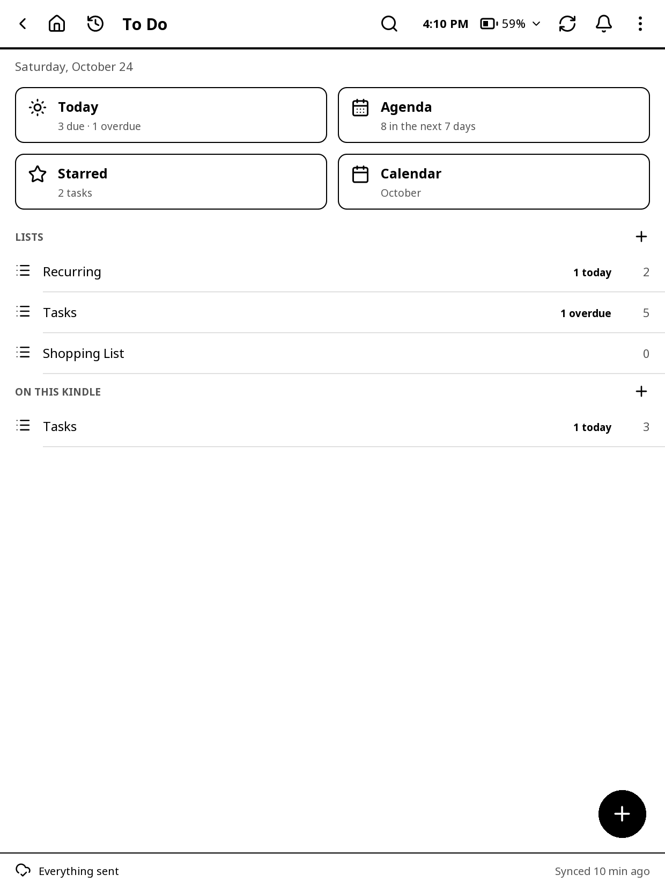
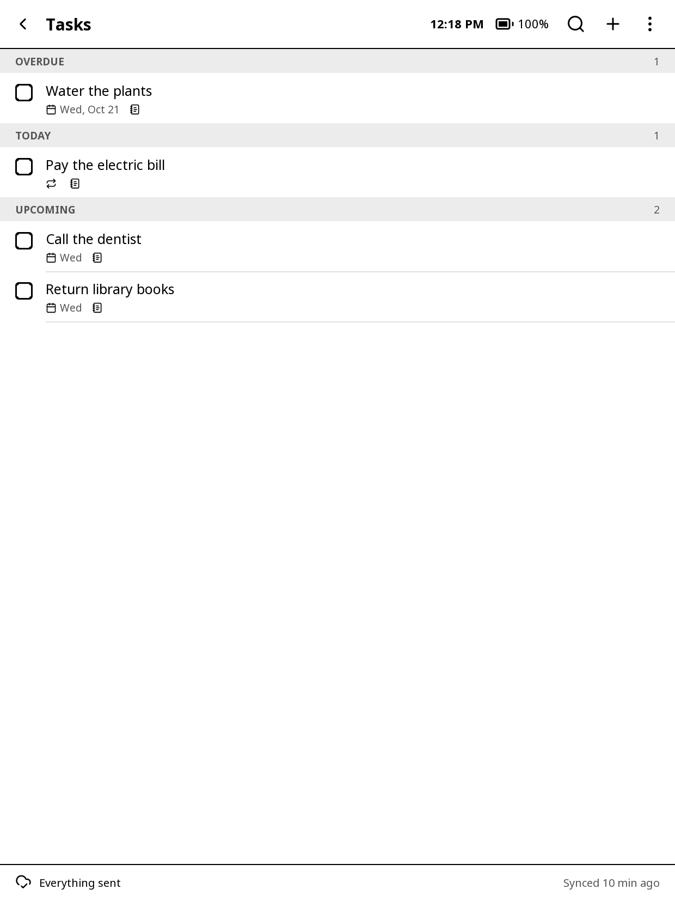
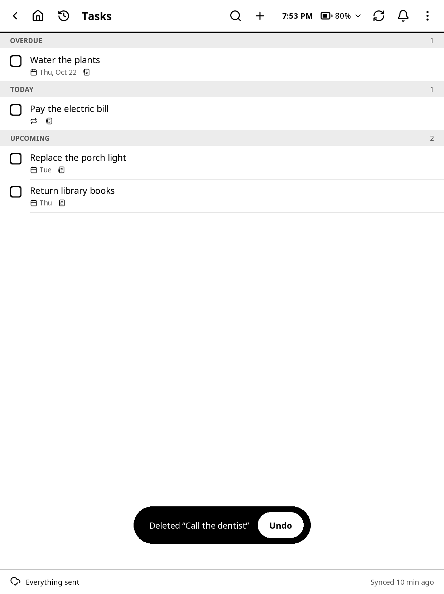
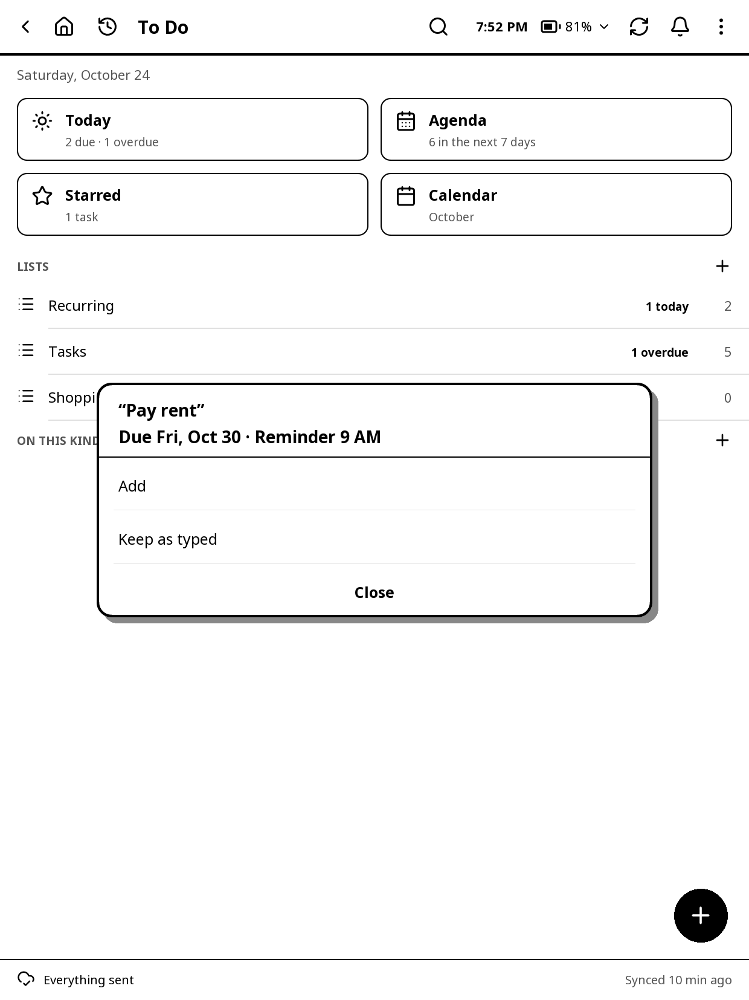

# To Do

Your Microsoft To Do lists on the Kindle: Today, an Agenda, Starred, a calendar and every list. Everything works without Wi-Fi; your changes are sent to To Do the next time it syncs. It also works with no Microsoft account at all, with lists kept on this Kindle (see **Lists on this Kindle** below).

## Lists on this Kindle

Lists that stay on the Kindle and are never sent to Microsoft. They do everything To Do's lists do: due dates, reminders, repeats, stars, steps, notes, the sleep screen, the launcher's tile and At a glance.

- **Without signing in**, To Do opens straight to Home with a list called **Tasks** under **ON THIS KINDLE**. **Sign in to Microsoft To Do** is at the bottom whenever you want it.
- **Signed in**, your To Do lists are under **LISTS** and the Kindle's under **ON THIS KINDLE**. Each heading's **+** makes a new list there.
- **A repeating task** makes its next one when you tick it off, as To Do does.
- **Ticked-off tasks** show until the end of the day, then leave the list.
- **Deleting** a task or list offers **Undo**; deleted ones also wait under **Deleted** (the last 30) to put back.
- **To Microsoft To Do**: **Move to list** on a task's page moves it into one of your To Do lists (steps, star, dates and repeat go with it). Hold a list > **Move to Microsoft To Do** moves the whole list, after asking.
- **Signing out** keeps the lists on this Kindle.
- **Turn them off** in Settings > **Lists on this Kindle**. They're hidden, not deleted: turn it back on and they're there.

## Opening it and signing in

Open it from the launcher's **To Do** tile, **Tools > To Do**, or a gesture: **To Do**, **To Do: Today**, **New To Do task** (adds a task from anywhere) or **To Do: sync**.

The first time:

1. Tap **Sign in to Microsoft To Do** (with the launcher, this is the shared Microsoft account's sign-in, the same as **Settings > Microsoft**).
2. The Kindle shows a web address and a short code. On your phone or computer, open the address (or scan **QR code**) and enter the code, then sign in to Microsoft there. Your password never goes through the Kindle.
3. "Signed in as" and your account, and the first sync starts.

The code box closes only with **Cancel**. If Wi-Fi drops while you sign in, it stops with "Lost the connection to Microsoft. Check Wi-Fi and try signing in again."; a code left too long says "The code ran out. Try signing in again."

> To Do needs an **App ID** from Microsoft before you sign in: a free app you register once (Notes' OneNote can share it). Setting up the services has the steps; on the Kindle, **Set up your Kindle > To Do > How to get an App ID** has them in short, with a QR code of the guide's page for your phone. Set it in the launcher's **Settings > Microsoft** (one App ID for To Do and OneNote), on the web page, or in **Set up your Kindle**; if it's missing, the sign-in says so.

## Home

- **The tiles**: **Today** (due today and overdue), **Agenda** (the next 7 days), **Starred**, **Calendar** (this month), and **Search** (off to start with; turn it on in Settings). Tap one to open it; hold one for **Open** or **Add to launcher**.
- **LISTS**: every list with its open tasks, and in bold how many are overdue or due today. The pinned list comes first. **+** next to LISTS makes a new list. **ON THIS KINDLE** below has the lists kept on the Kindle only, with its own **+**.
- **The round +** at the bottom right adds a task to your default list.
- **The bar at the bottom** says how many changes wait to be sent and when it last synced, such as "Everything sent · Synced 5 min ago" ("On this Kindle only" when not signed in). Tap it for the Sync screen.
- At the top, the bar every app has (see "Finding your way around" in Getting started), with **search**, **refresh** (syncs now) and **⋮** (**Sync now**, **Open on the web page**, **Recent apps**, Light, Night mode, Refresh screen and **Settings**). **Open on the web page** starts the web server and shows a QR code for the web page's To Do tab.
- Reminders and sync problems also go to **the bell** (Notifications); tap a reminder there for its pop-up again, or hold it to open its task. A reminder leaves the list once its task is done, deleted or moved to another day or time; a sync problem stays until a sync goes through.

### Holding a list

Hold a list on Home for:

- **Open** and **New task**
- **Pin to top**
- **Add to launcher**
- **Set as default list**
- **Hide list**: hidden lists stay out of Today, the Agenda, the calendar and the sleep screen
- **Rename** and **Delete list**

A deleted list goes at once, with **Undo** for a few seconds, and waits under **Deleted lists** on Home until the next sync, so **Put back** can still undo it.

## Lists and tasks

A list shows its tasks grouped **OVERDUE**, **TODAY**, **UPCOMING** and **NO DUE DATE** (or as one list: **⋮ > Group by due date**). Starred tasks come first within each day (**Starred first**).

A list's (or a view's) **⋮** has **Starred first: On/Off**, **Group by due date: On/Off** (in a list), **List options…** (as holding the list), **Sync now**, **Open on the web page** (a QR code for this list on the web page), **Refresh screen** and **Settings**. On a task's page, **⋮** opens the task's quick actions.

Each task shows its due day, reminder time, repeat, steps ("2/5"), a notes mark, and a star.

- **Tap the box** to tick a task off. "Done: …" confirms it. It stays crossed out until the next sync; tap again before then to undo.
- **Tap the star** to star or unstar it.
- **Tap the task** to open it (or its quick actions; see **Tap action** in Settings).
- **Hold the task** for quick actions:
  - **Done** / **Not done**
  - **Star**
  - **Due today**
  - **Tomorrow**
  - **Pick a date…**, or **Skip to current** for a repeating task
  - **Postpone…**: by 1, 2, 3, 7, 14 or 30 days, or a date
  - **Move to list**
  - **Delete**
  - **Open**

A deleted task goes at once, with **Undo** for a few seconds, and waits under **Deleted** at the end of its list until the next sync, with **Put back**.

## Adding a task

Tap **+** (on Home, in a list or in a view). The **Add to** box opens with the keyboard. Type the task, or tap the pen at the end of the box to write it by hand. Under it are switches, black when on:

- **Today**, **Tomorrow** or **Pick date**: when it's due. Tap again to clear.
- **Reminder**: a time on the due day.
- **Repeat**: **Daily**, **Weekdays**, **Weekly on (day)**, **Every 2 weeks**, **Monthly on day (n)** or **Yearly**.
- **Star**.
- **List**: which list it goes in.
- **Add** (or the keyboard's Enter), or **Cancel**.

A date or time in what you type or write ("Call the vet Friday 9am") is offered when you tap **Add**, the same as below. Without the launcher, KOReader's own box has the same buttons, and **Write it** when Notes can read handwriting.

Adding from Today makes it due today; adding from Starred stars it; holding a day in the calendar makes it due that day.

### Dates in plain words

Type the date and time with the task, and To Do understands them:

- "Pay rent Friday 9am"
- "Call the vet tomorrow at 3:30pm"
- "Dentist on Oct 24"
- "Water the plants in 3 days"

Before adding, it shows what it understood: "Pay rent", **Due Fri, Oct 23 · Reminder 9 AM**. Tap **Add**, or **Keep as typed** if it guessed wrong (for example a task really called "Sun lamp").

It understands:

- **Days**: today, tonight, tomorrow, the days of the week (Mon or Monday, this Friday, next Friday, on Friday).
- **Later**: next week (the start of next week), in 3 days, in 2 weeks.
- **Dates**: 10/24, 10/24/2026, Oct 24, October 24th, 24 Oct, Oct 24, 2026. A date that has passed means next year.
- **Times**: 9am, 9:30pm, 9 a.m., noon, midnight, or "at 17:30".
- A time alone means today, or tomorrow once that time has passed.

The same works when you rename a task: **Rename and set date** or **Keep as typed**.

## A task's page

- **The box** ticks it off; **the star** stars it.
- **The title**: tap to rename it.
- **Due**: **Today**, **Tomorrow**, **Next week**, **Pick a date…** or **No due date**. Changing the due date moves the reminder with it. Hold to clear.
- **Reminder**: a time on the due day, or **Another day…**, or **No reminder**. Reminders ring on your phone (To Do keeps them), and also on the Kindle while KOReader is open (Settings > **Reminder alerts**).
- **Repeat**: the presets, or **Custom…** (every 1 to 99 days, weeks, months or years), or **Remove repeat**.
- **Skip to current** (a repeating task): moves it to the first day it falls on from today.
- **Postpone**: by your usual number of days. Hold it to choose.
- **Due today**.
- **Remove repeat**: it stops repeating, its due date is cleared, and a note with the old date is added.
- **Open in Notes**: when the task was made from a Notes page, this goes back to that page.
- **STEPS**: tap a step's circle to tick it; tap the step to rename or delete it; **Add step**.
- **NOTES**: tap to read and edit the task's notes.
- At the bottom: **Move to list**, **Hide on sleep** (keeps this task off the sleep screen) and **Delete** (at once, with **Undo** for a few seconds; until the next sync it also waits under Deleted at the end of its list).

## Today, Agenda, Starred, Calendar, Search

- **Today**: what's overdue and what's due today.
- **Agenda**: overdue, today, then each of the next 6 days, by reminder time.
- **Starred**: starred tasks from every list.
- **Calendar**: the month, with a dot for each task due that day (a hollow dot is overdue). Repeating tasks show on the days they will fall on; tasks that repeat every day or two are listed once instead. Tap a day for its tasks; hold a day to add a task due then. Swipe or use the arrows for other months.
- **Search**: titles, notes and steps in every list, including done tasks.

## Split view

Turned on its side, To Do can show a column on the left with Home's tiles and lists, and the open list or view on the right (Settings > **Split view (landscape)**). Tap something in the column to open it on the right.

## Syncing

Every change shows at once on the Kindle and waits to be sent. Syncing sends the waiting changes, in order, then downloads everything. It runs in the background, so you can keep reading and tapping while it works; changes you make meanwhile go in the next sync.

- **Sync**: the sync icon, the Sync screen, the gesture, or the launcher's **Sync To Do** quick button (it shows how many changes wait; hold it for the Sync screen). KOReader asks to turn Wi-Fi on if it's off. "Syncing To Do…" shows while it works.
- **Background sync**: every 15, 30 (to start with), 60 or 120 minutes while KOReader is open and Wi-Fi is already on, and when Wi-Fi comes on if the last sync is older than that or changes are waiting. It never turns Wi-Fi on.
- **Sync changes immediately**: when Wi-Fi is on, changes go a few seconds after you make them. **Send changes** sets how long after your last change: 2, 4 (the usual), 10 or 30 seconds, or a minute. Deleted tasks wait for the next full sync, so you can still put them back.
- A sync asked for while another runs follows it. One that gets no answer for 5 minutes stops with "To Do took too long to answer"; your changes stay waiting for the next.

The **Sync screen** (tap the bar at the bottom) lists the **CHANGES TO SEND**, and has:

- **Sync now**
- **Download only**: downloads without sending.
- **Preview changes**: says what To Do has new, changed or done since the last sync, without changing anything.
- **Reset to To Do**: throws away the Kindle's unsent changes and downloads To Do's copy again.
- **Catch up overdue repeats**: moves every overdue repeating task to its next day from today, after showing where each goes.

If To Do refuses a change (say, a task already deleted on your phone), it's left out and listed, not retried forever.

## The sleep screen

With **Sleep screen** set to **To Do tasks**, the sleeping Kindle shows the day and date, how many are due and overdue, and the tasks. **Sleep screen content** chooses:

- **Today + Up next**: overdue, today and the next days.
- **Today**: overdue and today.
- **Starred**.
- **Pinned list**.

Done tasks, tasks hidden on sleep and hidden lists are left out.

## Settings

**⋮ > Settings** on any screen (on a task's page: **⋮**, then **Settings** at the bottom). The settings are on full pages; swipe or tap the arrows next to the page number.

### Display

- **Week starts on**: **Sunday** or **Monday** (also where "next week" starts).
- **Split view (landscape)**.
- **Full refresh**: how often the screen flashes clean (every 6 or 3 changes, every change, or never). It also flashes when rows come or go and after a menu closes.

### Home

- **Home tiles** and **Lists**: order them and choose which show. Tap one, then the arrows (to top, up, down, to bottom); the eye shows or hides it; **Undo** puts back the last move. The web page's To Do tab draws the Home tiles to drag into order.
- **Show hidden lists**, **Pinned list** and **Default list**.
- **Lists on this Kindle**: on to start with; off hides them (see "Lists on this Kindle").

### Tasks

- **Starred on top**.
- **Group by due date**.
- **Tap action**: **Open task** or **Quick actions**.
- **Postpone by**: the usual number of days (1 to 60).

- **Reminder alerts**: reminders pop up on the Kindle while KOReader is open, with **Snooze**, **Open** and **Done**. **Snooze** brings it back in 15 or 30 minutes, 1 or 3 hours, tomorrow at 9 AM, or **Custom…** (type a number, then **Minutes**, **Hours** or **Days**), on the Kindle only (To Do's reminder on your phone stays as it was). A reminder you don't answer stays in Notifications. Ones missed in the last two hours (while asleep) show when it wakes.

### Sync, sleep screen and account

- **Background sync**, **Sync changes immediately**, **Send changes** and **Download only**.
- **Sleep screen**: opens the launcher's settings at **Sleep**, where the sleep screen is chosen for every app. **Sleep screen content** (below) stays here.
- **Microsoft account**: who is signed in; tap it for **Settings > Microsoft** (the App ID, **Sign in**, **Sign out**). Signing out there signs out To Do and OneNote, and removes your To Do lists kept on the Kindle and any unsent changes; lists on this Kindle stay. (Without the launcher, To Do has its own **Sign out** and **App ID** here.)
- **Test connection**: tries To Do itself, and says whether it works or what went wrong (such as a sign-in that ran out). The Microsoft account's own **Test connection** tries Microsoft's sign-in.

### Tips

- The **Flagged emails** list from Outlook shows in Starred and its own list, but stays out of Today, the Agenda and the calendar.
- Hold a Home tile and choose **Add to launcher** to put Today or a list on the launcher, with its own count.
- The web page's To Do tab has the same lists with a keyboard, plus CSV import and export.
- Swipe in from the left edge to go back; other swipes turn pages (on the calendar, its months).
- Your KOReader gestures for the light, warmth, refresh, night mode, Wi-Fi and a screenshot, and the other apps' actions (Launcher, Notes, Home Assistant, Web server, Wikipedia, Syncthing, SSH), work on To Do's screens too. Library and book actions don't.
