# Web server

The web server puts a web page on the Kindle that you open on a phone or computer on the same Wi-Fi. It manages everything in this guide with a keyboard and a big screen: files, the launcher, Home Assistant, To Do, Notes and crosswords, plus updates and backups.

## Starting it

1. On the Kindle: **Tools > Web server > Start web server**, the launcher's **Web server** tile or quick button, **Web server** in the control center (tap the time and battery in any app), or a gesture (**General > Toggle web server**).
2. KOReader asks to turn Wi-Fi on if it's off.
3. The Kindle shows the address, such as `http://192.168.1.50:8080`. Type it in your phone or computer's browser, or tap **QR code** and scan it with your phone (the box also has **Stop** and **Close**). The quick button just turns it on or off; hold it for the address.

While it runs, **Notifications** (the bell) has a **Web server** notification at the top with its address (tap it for the address and QR code), and the launcher shows a globe by the clock. Both go when it stops.

Or from an app: **⋮ > Open on the web page** in To Do, Notes, the crosswords, Home Assistant, the launcher and Wikipedia starts the web server if needed and shows a QR code that opens that same place on the web page (after signing in, if there's a password).

The page works while the web server runs and the Kindle is awake.

The **Tools > Web server** menu (the same settings are in the launcher's **Settings > Web server**, as a settings page):

- **Start web server** / **Stop web server**. While it runs, the menu's own name shows the address: **Web server: http://…**.
- **Show address**: the address and QR code again.
- **Keep Kindle awake while running**: on to start with, so it doesn't go to sleep while you use the page. If you put the Kindle to sleep yourself (the power button or the cover), the web server stops; when it wakes, a note says so. Start it again when you need it.
- **Stop after unused**: **15 min**, **30 min** (to start with), **1 hour** or **Never**; it stops by itself when no browser has used it for that long.
- **HTTPS (encrypted)**: off to start with. On, the page and everything on it (the password too) is encrypted, at **https://…**. An old **http://** address is sent on to it. See [HTTPS](#https).
- **Certificate**: which certificate HTTPS uses and until when. **Use the Kindle's own**, **Use yours** or **Make a new one**.
- **Password: On / Off**: set a password (4 characters or more). Browsers then ask for it. **Remove password** takes it off.
- **Undo a plugin update**: go back to a plugin's version before its last update.
- **Port**: 8080 to start with.

It also stops when Wi-Fi is turned off.

> Anyone on your Wi-Fi can open the page while the web server runs, unless you set a password. Without HTTPS the connection isn't encrypted, so start it when you need it and stop it after.

### HTTPS

With **HTTPS** on, the Kindle makes a certificate of its own the first time. No browser knows it, so each one warns once: choose **Advanced > Proceed** (the words vary by browser). After that the page is encrypted. The certificate lasts about a year and the Kindle makes a new one a month before it ends; browsers warn once more then.

To have no warning, use a certificate of yours for a name your network knows (from your own certificate authority, or a service such as Let's Encrypt, for a name your router or DNS points at the Kindle). On the page, **System > HTTPS**: paste the certificate (and its chain, if it has one) and its key, or pick their files, then **Save and apply**. The key must have no passphrase. The Kindle checks that they match and haven't ended before using them, and the address it shows is then at the certificate's name. Do this with the page already on HTTPS (the Kindle's own), so the key doesn't cross your Wi-Fi unencrypted.

Yours is never replaced by the Kindle. If it ends, or can't be read, the web server starts on plain HTTP and the Kindle says why. On the Kindle, **Tools > Web server > HTTPS** turns HTTPS off, and **Certificate** switches back to the Kindle's own. Turned off, the page works over plain HTTP again straight away (browsers aren't told to insist on HTTPS).

Both certificates and their keys go in a backup only with **Include keys and sign-ins** (System > Backup). Without it, a restored Kindle makes a new certificate of its own (browsers warn once more), and yours is pasted again.

## The page

Tabs along the top: **Home**, **Dashboard**, **Files**, **Reading**, **Launcher**, **Home Assistant**, **To Do**, **Notes**, **Crosswords**, **Wikipedia**, **Syncthing**, **SSH**, **Fonts**, **KOReader** and **System**. A tab is left out when its app isn't installed, and you can reorder or hide tabs (**System > Tabs**). The page follows your phone or computer's light or dark mode. Lists you can order have the same controls everywhere: drag the **⠿** handle, or **⤒** (to the top), **↑**, **↓** and **⤓** (to the bottom), and **↶ Undo**.

### Signing in, and the page as an app

With a password set, the page asks for it once per browser. Leave **Stay signed in** ticked and that browser stays signed in for 90 days, even after KOReader restarts or the plugins update. Changing the password signs every browser out.

To keep the page on your phone like an app, open it and use **Add to Home Screen** (Safari's share menu, or Chrome's ⋮ menu). It gets its own Kindle icon and opens full screen.

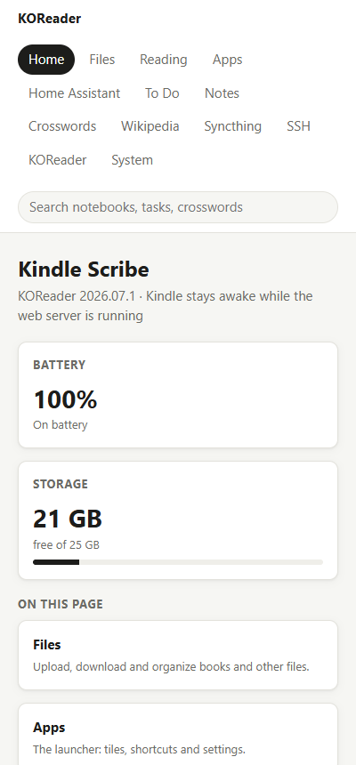

### Keyboard shortcuts

On a computer:

- **/** jumps to the search box.
- **1** to **9** open the first nine tabs shown, in order.
- **Esc** closes a box, or leaves a text field.
- **?** lists the shortcuts.

### Search

The search box at the top, beside the title, searches everything at once. Type at least two letters and press Enter:

- **Books**: titles, authors and file names. A result opens the book's folder on the Files tab.
- **Wikipedia**: saved articles, by title. A result opens the Wikipedia tab.
- **Notebooks**: their names, typed text and handwriting. Each result says the page, and whether it was found in handwriting or in the name.
- **To Do**: task titles, notes and steps (not tasks marked private).
- **Crosswords**: puzzle names and clues, such as "12 Across: …".
- **On this page**: the page's own tabs, cards and settings by name ("labels" finds the Launcher tab's **Button labels**, "backup" the backup cards).

Tap a result to open it: a notebook in the Notes tab, a task's list in the To Do tab, a card or setting on its tab, scrolled to and outlined for a moment.

## Home

- **The Kindle**: its model, KOReader's version, the **Battery** and the **Storage** left.
- **Notifications**: the Kindle's notifications (its bell), newest first. **Open on Kindle** does what a tap does there (and takes it out of the list), **Remove** takes one out, and **Clear all** asks first, as on the Kindle. The card isn't there without the launcher.
- **On this page**: a card for each tab, **Dashboard** first.
- **Kindle**: the Kindle's own controls:
  - **Light** (a slider and on or off) and **Warmth**.
  - **Night mode**.
  - **Refresh screen**.
  - **Turn off Wi-Fi** (the page stops working until Wi-Fi is back).
  - **Sleep**.
  - **Restart KOReader**.
- **Kindle screen**: **Show the screen** shows exactly what the Kindle shows right now, such as the dashboard. It's also a remote:
  - Click the picture to tap the Kindle at that spot (or choose **Click holds** to hold there instead).
  - **Swipe left**, **Swipe right**, **Swipe up** and **Swipe down** swipe across the Kindle; swipe left turns to the next page in a book.
  - **Live** takes a new picture every few seconds.
- **Send to the Kindle**: type something and send it to **The box open on the Kindle** (typed in where its cursor is, as with its keyboard; tick **Then press Enter** to search, add or save at once), as a task to a To Do list (the first line is the title, the rest its notes), or as **Notes: a new page**.
- **Sleep screen**: which app draws the sleep screen, and **Sleep screen updates**.

Updating plugins, backups and the password are on the **System** tab.

## Dashboard

Your own page, made of parts from the other tabs, for what you use most. It's saved on the Kindle, so every phone or computer sees the same one.

- **Add a part…** picks one: **A To Do list** (its open tasks, ticked off or starred here, and a box to add one), **Home Assistant: Quick tiles** or **a room** (tiles dark when on; a tap switches one, asking first where the Kindle asks), **Recent notebooks**, **Today's crossword** (**Open on Kindle**), **Saved Wikipedia articles**, **Syncthing status**, **An SSH command** (**Run on the Kindle**: it runs there and the output shows there), **Recent files**, **A favorite folder** (KOReader's Home folder or a folder shortcut), **Kindle controls** and **Kindle screen (remote)**.
- **Edit** lists the parts: drag them or use the arrows to change the order, and **✕** removes one. **Done** goes back.
- Parts for an app that isn't installed are left out.

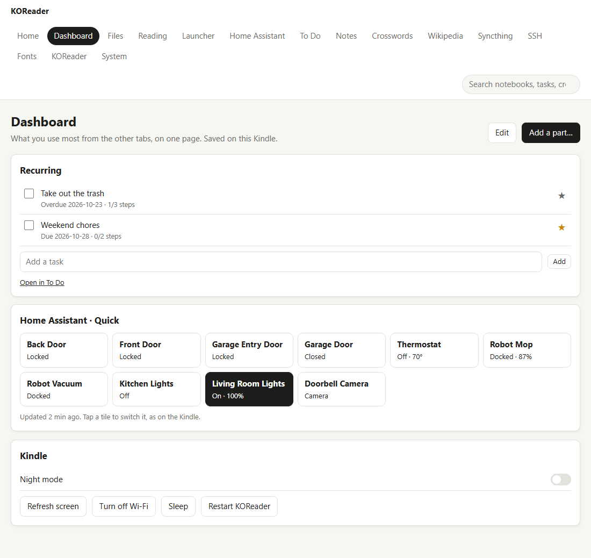

## Files

The Kindle's storage. It opens in the folder you looked at last (the documents folder the first time).

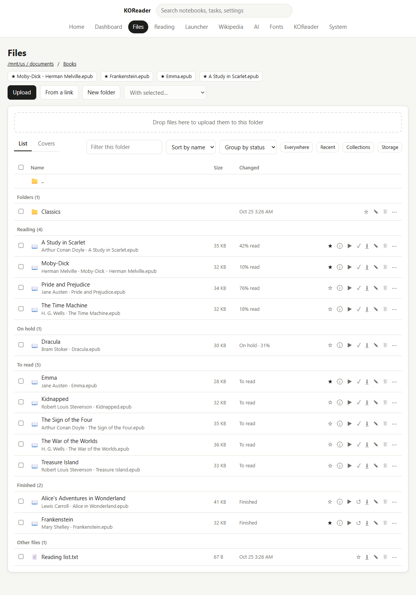

- **Home folder** and your favorite folders, under the folder's name: a click goes straight there. The Home folder is the one set in KOReader (or on the KOReader tab). Favorite files follow, marked ★: a click opens the file's folder with that file picked out.
- **☆ Favorites**: the star beside a folder or file adds it to your favorites (★); click again to take it off. A favorite folder is a KOReader folder shortcut, and a favorite file goes in KOReader's **Favorites** collection, so they show on the Kindle too, and stars set on the Kindle show here.
- **List** or **Covers**: the list shows names, sizes and dates; **Covers** shows each book's cover, title, author and how far you've read, like a bookshelf. Titles and covers come from KOReader; for a book it hasn't read yet, they appear a few seconds after you open the folder.
- **Sort by** name (or title), date or size, and **Filter this folder** to find a book by its name, title or author.
- **Group by** author, series or status (Reading, On hold, To read, Finished), as the Library groups books on the Kindle. Folders come first and other files last.
- **Library settings**: the Library's settings, as on the Kindle: **Show books as**, **Open on**, **Home starts with**, **Show hidden files** and **Browse books with**. A change takes effect on the Kindle at once.
- **Everywhere** (or Enter in the filter box) searches every folder by name, title and author. A result opens its folder with the file picked out. **← Back to this folder** returns to the list.
- **Recent**: the newest files in every folder, such as what you just uploaded.
- **Collections**: KOReader's collections, as on the Kindle, each with its files (**✕** takes one out).
- **Storage**: the free space, and the biggest folders and files.
- **Upload to Home folder** sends books straight to the Home folder, from any folder; **Upload here** (or dropping files on the page) puts them in the folder you're in. Several files at once; a file with the same name is replaced.
- **From a link**: paste a web link to a book (or any file) and the Kindle downloads it into this folder, in the background. The page says when it's saved.
- **New folder**.
- Click a name to open it (pictures, PDFs and text open in the browser; other files download).
- Each file and folder has **Download** (files), **Rename**, **Delete** and **⋯**:
  - **Delete** happens straight away, with **Undo** for a few seconds, as in the Library on the Kindle. Once Undo has gone, it's gone for good.
  - **⋯** has **Move to…**, **Copy to…** and **Add to a collection…**, and for a book **Reading**, **On hold** or **Finished** (✓ marks the one it has).
  - **Move to…** and **Copy to…** show your folders: open one, or **Up one folder**, then **Move here** (**Copy here**). **New folder** makes one on the way. A copy whose name is taken there gets " (2)", and a copied book keeps its progress, highlights and notes.
- Books also have:
  - **▶ Open on the Kindle**: the Kindle opens the book straight away.
  - **✓ Mark as finished** (or **↺ Mark as reading**), as KOReader's own. Under each book: how far you've read ("42% read"), **To read** (never opened), **On hold** or **Finished**.
  - **ⓘ Details**, as the book's page in the Library: the cover, title, author, how far you've read and about how long is left, and **Reading**, **On hold** and **Finished** to change it. **Reading**: first read, last read, time reading, days reading it, pace (pages an hour), pages read, highlights and notes. **Book**: series, authors, published, publisher, language, pages, subjects and ISBN. The description. **File**: name, format, size, added, folder and collections. From there: **Open on the Kindle**, **Highlights and notes**, **Add to a collection…**, **Move to…**, **Copy to…**, **Rename from details** (renames the file "Title – Author") and **Delete**.
  - **Highlights and notes**: every highlight and note, chapter by chapter, with **Download as Markdown** or **Download as text**.
- **Drag** files onto a folder, a folder name in the path at the top, or **..** to move them there. Ticked files move together.
- Tick several and use **With selected…**: **Download** (one zip), **Move to…**, **Copy to…**, **Mark as reading**, **Mark as on hold**, **Mark as finished**, **Add to a collection…** (ticks for each collection, or name a new one), **Rename from book details** (shows the new names first) or **Delete** (with Undo).

Moving, renaming and deleting work as on the Kindle: a book's reading progress, highlights, history and collections go with it, and a favorite folder follows when it's moved. The Kindle's library and the Library app update by themselves after each change.

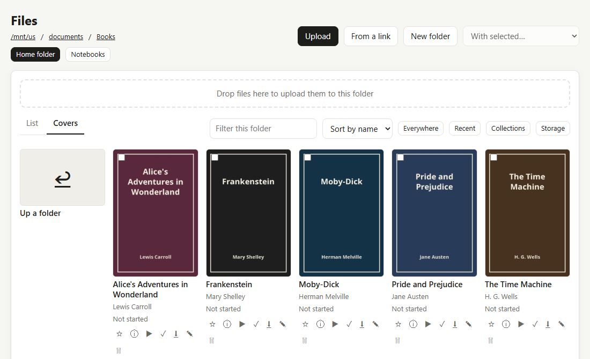

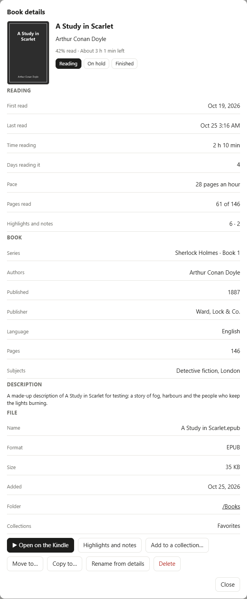

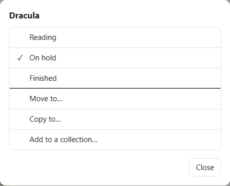

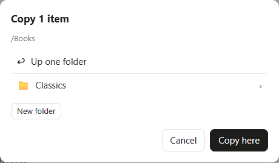

## Reading

From KOReader's reading statistics (the Reading statistics plugin must be on). Wikipedia's articles are left out unless **Count Wikipedia articles** is on (the same switch as on the Kindle); OneNote pages read from Notes never count.

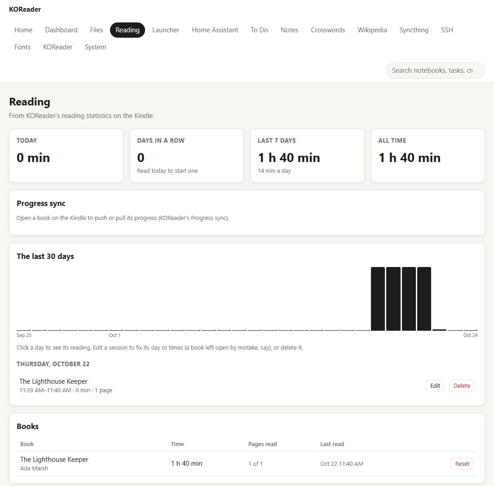

- **Today**: how long you've read today.
- **Days in a row**: your reading streak.
- **Last 7 days** and **All time**.
- **Progress sync**: for the book open on the Kindle, **Push progress from this device** and **Pull progress from other devices** (KOReader's Progress sync, such as with a CrossInk reader), and **Auto sync**. The messages show on the Kindle.
- **The last 30 days**: a bar for each day (point at one for its date and time). Click a day to see its reading, book by book, with times. Each has:
  - **Edit**: change its day, start or end. Moving keeps it as it was; an earlier end cuts the time after it (a book left open by mistake becomes the minutes you really read); a later end stretches each page's time to fit. It can't overlap other reading.
  - **Delete**: takes it out of the statistics.
- **Books**: each book you've read, with the time spent, the pages read and when you last read it. **Reset** takes all of a book's reading out of the statistics.

The Kindle's **Reading statistics** tile has the same fixes (each book's page lists its sessions), with Undo. Editing and deleting sessions here uses the launcher's code, so the launcher must be installed.

> On the Kindle, KOReader's **Tools > Reading statistics > Settings** has **Max read time per page**: a page left open longer than that counts only that long, so a book left open overnight doesn't add hours.

## Launcher

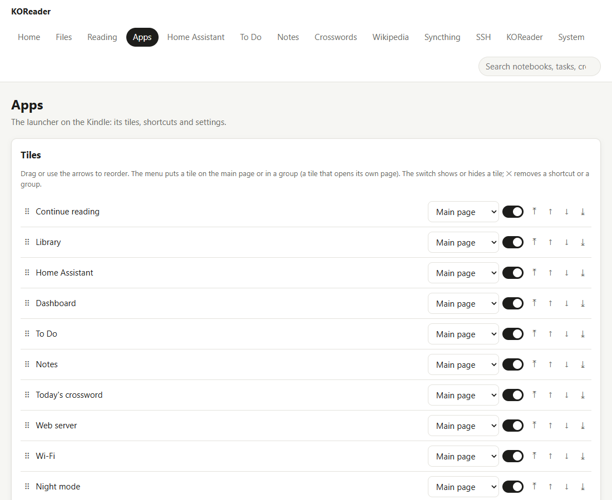

- **Home screen**: drawn as the launcher shows them, in its layout and columns: the **Main page**, each group's page, and **Hidden**. Drag a tile to reorder it, into a group or to Hidden; or tap one for **Move up**, **Move down** and **To** a page, with **Rename**, **Icon** and **Delete group** for a group and **Remove** for a shortcut. **New group** adds one. (Every visual editor here works the same way: drag with a mouse, or tap for the menu on a phone.)
- **Add shortcut**: a Home Assistant screen or room, a To Do view or list, a notebook, a Notes folder, or a KOReader action.
- **Display**: **Layout** (**Tiles**, **Bold tiles**, **Compact**, **List**, **Icons**), **Columns**, **Clock** (**Large** or **Small**), **24-hour clock** (KOReader's own, for every app), **Button labels** (the pop-ups' buttons, in every app, and each app on its own), **Page bar** (**Numbered parts**, **Parts and Next** or **Words**, at the foot of every app's pages), **At a glance**, **Recent books**, **Recent notebooks**, **Recent crosswords** and **Recent items** (**Separate rows** or **One row**).
- **Quick buttons**: drawn as on the Kindle, in sections: **On the home screen** (the two rows under the clock, then More), **Only in the control center** (the rest) and **Always in the control center** (the built-ins every control center has; click one to add it to yours). Drag one to reorder, between sections, or into a group's box to put it there; click one for **Remove**, **Move** (to a group), **Out of the group** or **Rename** (a group). Pick a built-in or a shortcut and **Add**, or **New group**. **Show on the home screen** turns the rows under the clock on or off.
- **Widgets sleep screen**: its parts as cards, top to bottom (the clock, your book, To Do today, Home Assistant's alerts, the latest notifications), dragged into order or to **Off**.
- **Weather**: **Weather from** (Automatic, Home Assistant, Open-Meteo or Off), **Place** (**Set** or **Change**: type your town or city, then pick it from the matches; the page looks it up with Open-Meteo's free place search) and **Units** (°F or °C). The Kindle loads the forecast when its Wi-Fi is on. **Test connection** tries Open-Meteo (and the US weather alerts) from the Kindle.
- **Start**: **Open at startup**.
- **Wi-Fi**: **Turn off when idle**.

## Home Assistant

Inner tabs:

- **Connection**: the **Internal URL** and **External URL** (**Test connection** tries each on its own from the Kindle); **Sign in with Home Assistant** (its own sign-in page, two-step codes included); or a pasted long-lived token.
- **Devices**: every device by room, with search and **All**, **Shown** and **Hidden** filters. Each has a box for whether it shows on the Kindle and a **★** to make it a Quick tile. **Show all** and **Hide all** act on what the filter shows.
- **Order**: Home drawn as it looks: its sections top to bottom, the shortcut buttons, the Quick tiles and the rooms, each dragged into order or to **Hidden** (or tapped for a menu; **Remove from Quick** for a Quick tile). Then the dashboard's sections, tiles and scenes, cameras, security cameras and **Sleep screen alerts** (**Add…** to pick one).
- **Routines**: make and change routines with a keyboard: a name, then steps (a device and what to do), **Run**, **Delete**.
- **Settings**: the same as on the Kindle: display (with **Start screen**), dashboard (with **Doorbell alerts**: **Ring and motion**, **Ring only** or **Off**), **Weather**, **Keep turned off in On now**, **Wake alerts**, what asks first, camera placeholders and the update interval.
- **Backup**: **Export** saves the Home Assistant settings (not the sign-in) to a file; **Import** puts them back.

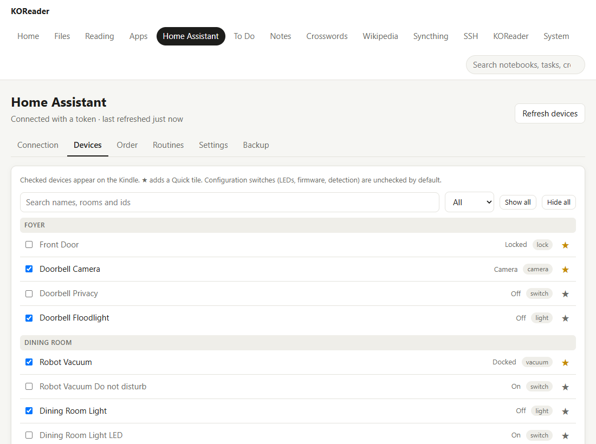

## To Do

The top says when it last synced and how many changes are waiting; **Sync now** and **Download only** are there.

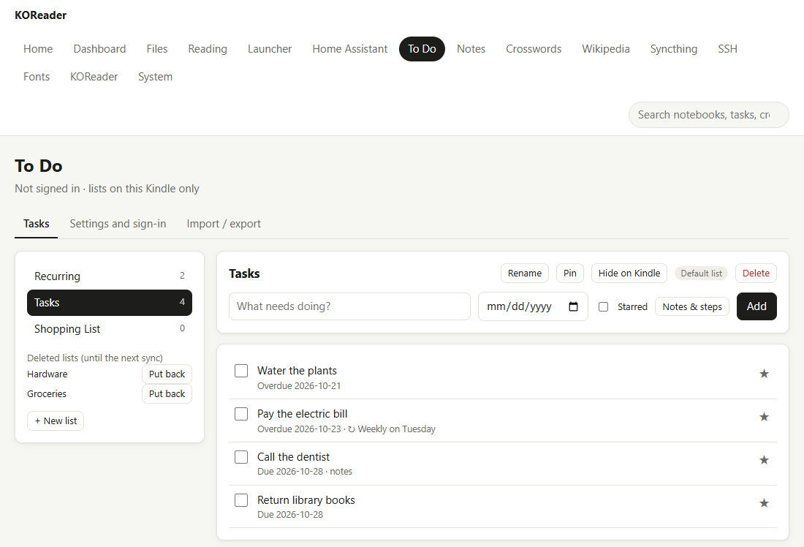

- **Tasks**: your lists on the left (with **+ New list**, and **Rename**, **Pin**, **Hide on Kindle**, **Make default**, **Delete** for the open list). Add a task with its due date, **Starred**, and **Notes & steps**. Dates in plain words work here too: type "Pay rent Friday 9am" and the page shows what it understood before adding (**Add** or **Keep as typed**). Drag a task onto another list on the left to move it there. Tick tasks off, star them, or click one to change its title, due date, list, notes, steps and **Private** (hidden on the sleep screen and Home, and from search). **Show completed** and **Put back** for deleted ones. A repeating task shows its repeat (↻) with **Skip to current** and **Remove repeat**; repeats are set on the Kindle.
- **Settings and sign-in**: **Home tiles** drawn as To Do's Home has them (Today, Agenda, Starred, Calendar, Search), dragged into order or to **Hidden**; most of the Kindle's settings (the lists' order, the pinned and default list, full refresh and the sleep screen's content stay on the Kindle; the sleep screen itself is chosen on the Home tab, and **Postpone by** offers 1, 2, 3, 7 or 14 days), and the **Microsoft account** card (the same as the Kindle's **Settings > Microsoft**, and on the Notes tab too): the **App ID**, **Sign in** (the page shows the code to enter, and updates by itself when you're done), **Signed in as** and your account, which apps it's allowed for, **Sign out** and **Test connection**. To Do's own **Test connection** tries To Do from the Kindle.
- **Lists on this Kindle** show in their own group (when signed in), with **+ New list on this Kindle** and **Move to Microsoft To Do** for the open one. Drag a task onto a To Do list to move it there.
- **Import / export**: **Export CSV** saves the lists you tick (all of them to start with) to a spreadsheet file. **Import CSV** adds tasks from one, into the place you pick in **Put the tasks into**: the lists named in the file in To Do, the lists named in the file on this Kindle (made when missing), or everything into one list. So a file exported from lists on this Kindle can go into To Do, and the other way round. **Download template** shows the columns: List, Title, Due, Starred, Notes, Steps.

## Fonts

The same as the Kindle's Fonts screen, which uses the same code (it needs the launcher), in the same three tabs.

**Your fonts**: which font new books open in, then every font KOReader can use for books, each name and a sample line drawn in its own typeface, marked **Built-in** or **Added by you**.
- **Add fonts**: drop TTF or OTF files, or a zip of a family, on the box (or pick them). Anything that isn't a font is turned away. They're kept in the folder KOReader reads your own fonts from (the tab names it).
- **Set as default**: the font new books start with (the same setting as **Font for new books**), with **Undo** for a few seconds.
- **Remove**: takes out a font you added, with **Undo** for a few seconds. Built-in fonts stay.
- KOReader reads its fonts when it starts, so after a change the tab offers **Restart KOReader**; new or removed fonts show in books after that.

**Get more**: every family on [Google Fonts](https://fonts.google.com), as on the Kindle: a search box (it searches as you type), the chips **Suggested**, **All**, **Serif**, **Sans**, **Mono**, **Handwriting** and **Display**, the order (**Popular first**, **A–Z**, **Newest first**) and pages. Here each name is drawn in its own typeface, straight from Google Fonts. **Get** has the Kindle download the family's regular, bold and italic styles (as many as it has) over its Wi-Fi; the row then says **Installed**. A name that isn't in the list can still be got by name. **List from…** says when the Kindle got the list; **Update** gets it again.

**Settings**: the same as in KOReader's menus, in groups:
- **New books**: **Font for new books**, **Font size for new books**, **Font weight** (thinner or bolder text) and **Use the book's own fonts** (fonts that come inside a book). A book you've already opened keeps its own.
- **Fallback fonts**: **Fallback font**, for characters the book's font doesn't have (Chinese, Japanese, symbols…), and **Use more fallback fonts** for KOReader's own list after it. These apply to every book, the open one too.
- **Advanced**: **Hinting** and **Kerning**.

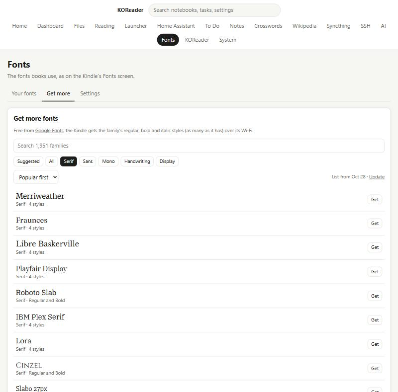

## KOReader

KOReader's own settings, without leaving the launcher on the Kindle:

- **Folders**: the **Home** folder, the **Download folder**, the **Screenshot folder** and the other folders KOReader and its plugins keep. **Change…** opens a folder picker. **Lock home folder** keeps the library from going above the home folder.
- **Folder shortcuts**: your saved folders. **Add shortcut…** picks a folder and names it; each has **Rename** and **Remove**.
- **Common settings**: the same list as on the Kindle's **Settings > KOReader**: **Sleep after**, **Full refresh**, **Rotation**, **Page turn tap zones**, **Invert page turns**, **Status bar in books** and **Progress sync** (when that plugin is on). The font settings are on the **Fonts** tab. Each changes at once on the Kindle. Without the launcher this card is just **Sleep after**.
- **KOReader's menu**: the same menu as on the Kindle, with its tabs (**Settings**, **Tools**, **Main** and the rest), live from KOReader. While a book is open it's the book's menu, with its own settings.
  - Switches (☐ and ☑) and choices (○ and ◉) change right from the page.
  - Tap a name with **›** to open that part of the menu; the line at the top shows where you are.
  - **⋯** does what holding the item on the Kindle does.
  - A choice that opens a dialog (a list, a slider, a time) opens it on the Kindle. The page then shows the Kindle's screen, so you can finish it with the remote.

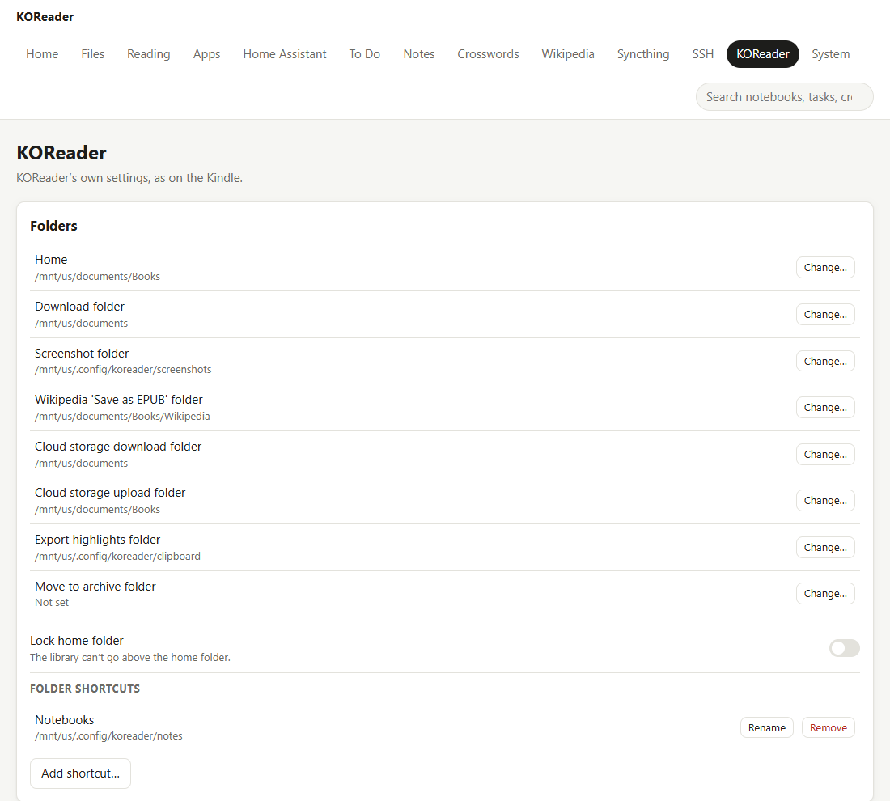

## System

- **Problems**: KOReader's crashes and freezes, read from its log, newest first. Tap one for the details. **Stopped without closing** usually means it froze and you restarted the Kindle by holding the power button. A freeze that it recovers from ("KOReader stopped answering") is only noticed while the web server runs. When KOReader ended badly, the launcher also says so the next time you open it.
- **What's installed**: each plugin's version (the date it was made) and **What changed** in its latest updates.
- **Updates**: the same as the Kindle's Settings > Updates. **Repository** (owner/repository; this project's own to start with), **Select version** (the latest or a previous release) with **Install**, and **Show test versions** (versions for trying changes before they're released, in **Select version**; it warns first). Under them, **Optional apps** lists the apps that aren't in the main install (FlashForge, …) with **Install**, or **Remove**; the installed ones are updated with the rest (**Also updates: …**).
- **Update plugins**: **Install a zip…** installs new versions of the plugins (see Getting started). Everything in the zip is checked first; if anything is wrong, nothing changes. Under **Earlier versions kept**, **Go back** puts a plugin back as it was before its update.
- While either installs, a bar shows how far it is, here and in a pop-up on the Kindle: the upload (or download), then checking and installing a plugin at a time. Then KOReader restarts; don't turn the Kindle off. The web server starts again by itself and this page comes back on its own.
- **Battery**: the level, and KOReader's battery statistics since the last charge (awake, asleep, the last charge, each with how much an hour), what is on now that uses power, and **Reset statistics**. The same as the launcher's Battery screen.
- **Health**: KOReader's memory and the Kindle's free memory, how long KOReader and the Kindle have been running, and:
  - **Detailed logging**: KOReader writes much more to its log, for tracking down a problem. It turns itself off after a day.
  - **Download a diagnostics file**: one zip with the logs, versions, problems, sleep history, memory, battery and network, to send when something goes wrong. Besides the end of KOReader's log, it has a longer history of it (the last hours, kept across restarts, without the lines for every touch and redraw). No passwords, keys or sign-ins.
- **Network**: Wi-Fi, its signal and the Kindle's address, and the connection check (the same as the Kindle's Settings > Launcher > **Connection check**): tick what to test (your internet connection and each app that's set up), then **Test selected**. Each address shows how long it took, or what went wrong with the exact error. The last results are in the diagnostics file.
- **Sleep and wake**: each time the Kindle slept and woke (and when KOReader started), how long, and the battery at each end. A Kindle that never sleeps, or keeps waking, shows here.
- **Backup**: **Download backup** saves one zip with every app's settings (To Do, Notes and Crosswords, Home Assistant, the launcher, your KOReader gestures, the web server, Wikipedia, Syncthing, and SSH's hosts and commands) and all your notebooks; the card lists them. Wikipedia's saved articles stay out (download them again). **Include keys and sign-ins** adds the sign-ins and keys too: Home Assistant's and Microsoft's sign-ins, the AI keys, SSH's passwords and keys, the web server's HTTPS certificates and keys, and Syncthing's own folder (its device keys and database). Keep that file private. **Restore from a backup…** puts one back (Syncthing stops first); KOReader restarts.
- **Automatic backups**: **Weekly backup** saves a backup on the Kindle once a week (settings and notebooks, without sign-ins), keeping the last 2, 4 or 8. **Back up now** makes one straight away; each has **Download** and **Delete**.
- **Logs**: KOReader's own log and the sleep screen updates' log. **Show the end** shows the latest lines; **Download** saves the whole file. Handy when something goes wrong, or to check that sleep screen updates are working.
- **Gestures**: what each KOReader gesture does, in the library and in a book, the same as the launcher's Gestures screen. To look at only: gestures are changed on the Kindle.
- **Tabs**: the order of the tabs at the top, and which are hidden. Drag a tab to move it, or into **Hidden**; on a phone, tap one for **Move up**, **Move down** and **To Hidden**. Home and System always show. It's kept on the Kindle, so every phone and computer shows the same tabs. **Reset** puts them all back.
- **Web server**: **Keep the Kindle awake while on**, **Stop after unused** (**15 min**, **30 min**, **1 hour** or **Never**) and **Port**, as in the Kindle's Tools > Web server. **Stop web server** stops it; the page then says it's stopped, and you start it again on the Kindle. A new port starts the server again and the page follows to it.
- **Password**: set, change or remove the page's password, and **Sign out**.
- **HTTPS**: on or off, the Kindle's own certificate or yours (pasted, or from files), **New certificate** and **Remove yours**. See [HTTPS](#https).

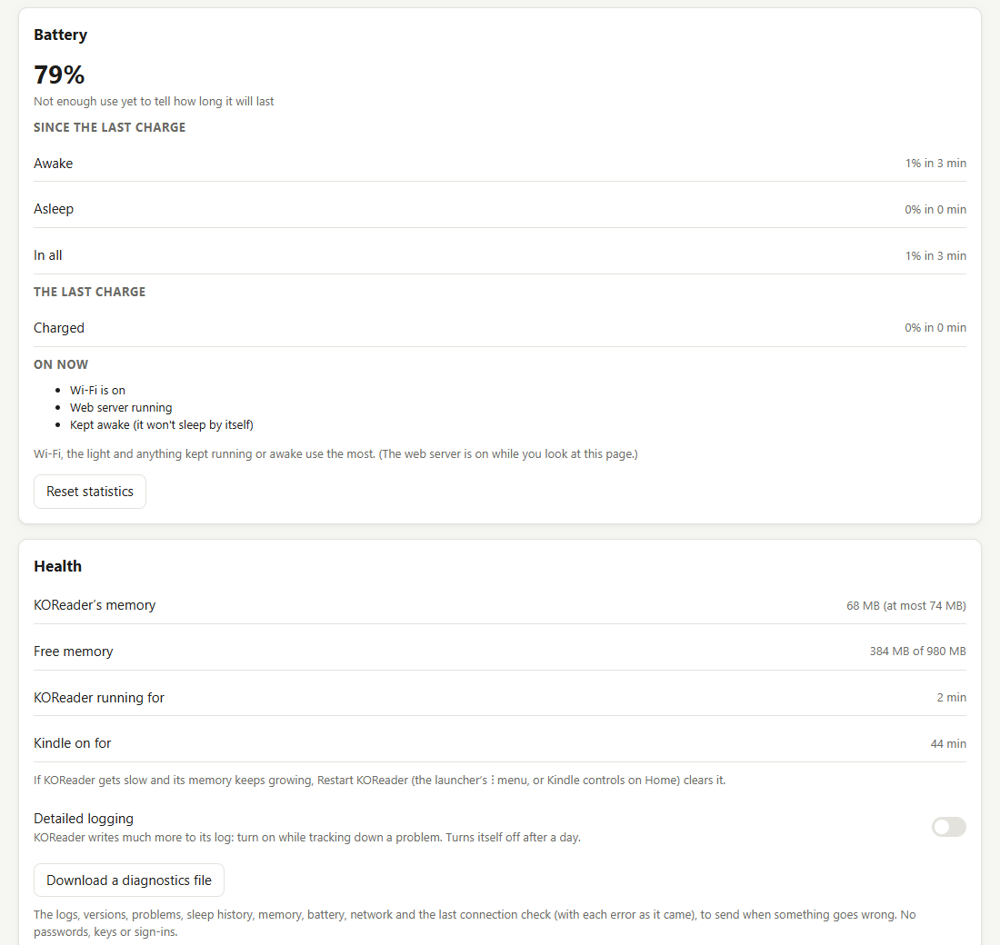

## Notes, Crosswords, Wikipedia, Syncthing and SSH

The **Notes**, **Crosswords**, **Wikipedia**, **Syncthing** and **SSH** tabs are covered in their own chapters.

### Tips

- Bookmark the address on your phone: it stays the same as long as the Kindle gets the same address from your router.
- Updating plugins, restoring a backup and **Restart KOReader** restart KOReader, which stops the web server. Start it again to keep using the page.
- A password signs out every browser when you change it.
- An upload that stops getting through (a phone gone to sleep, say) is stopped with "Upload failed: the Kindle stopped responding"; upload it again.
