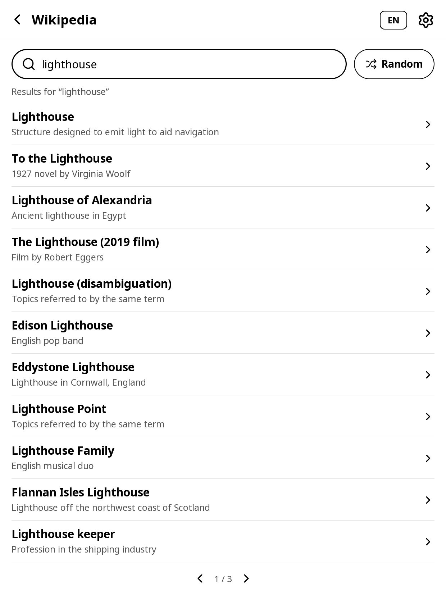
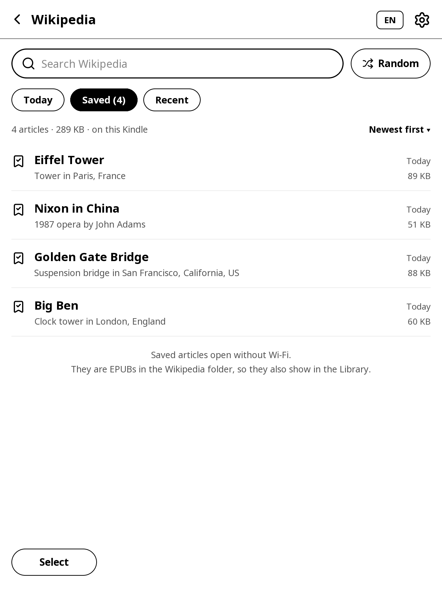
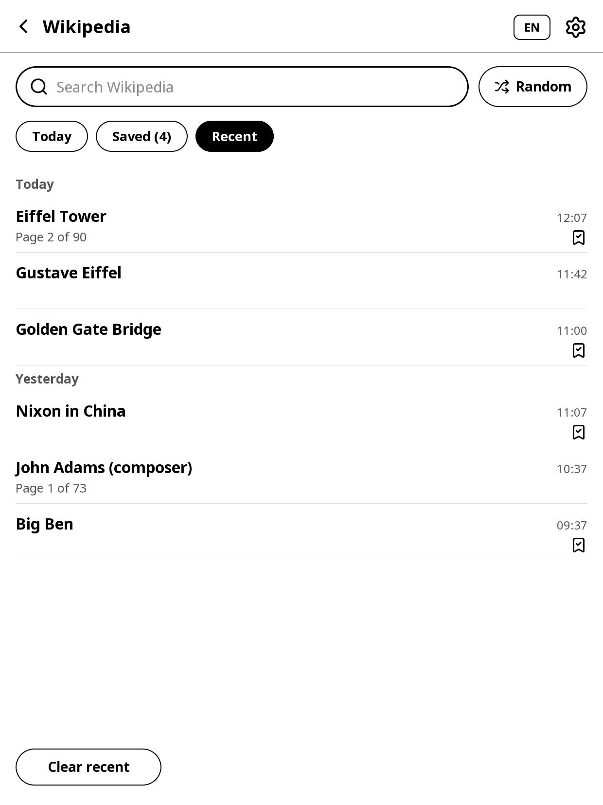
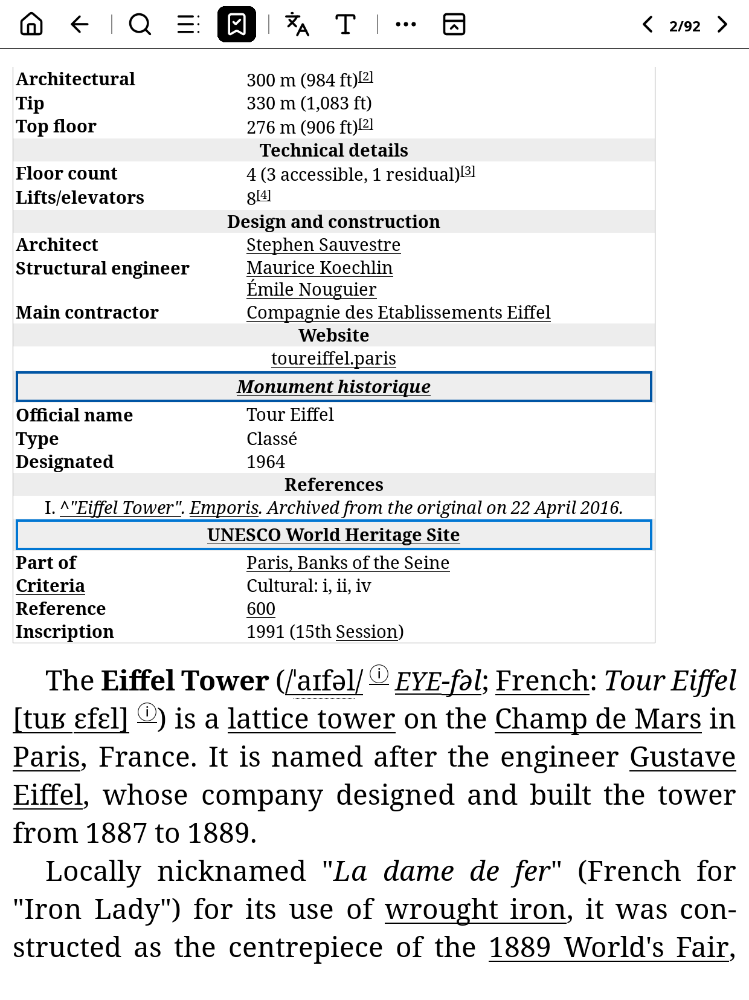
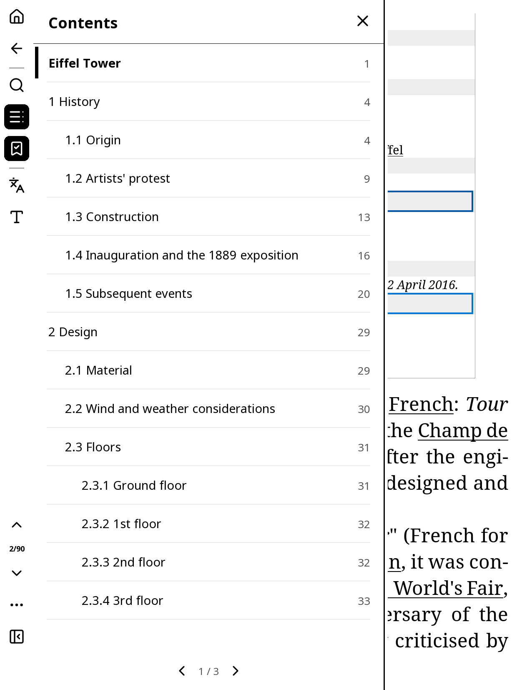
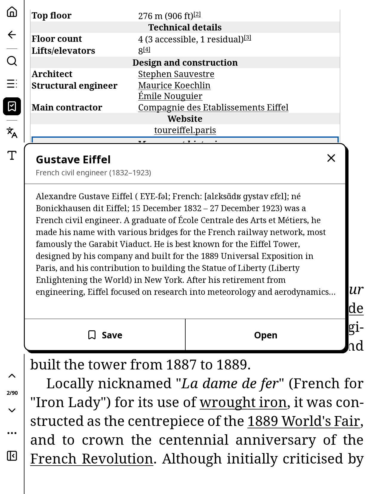
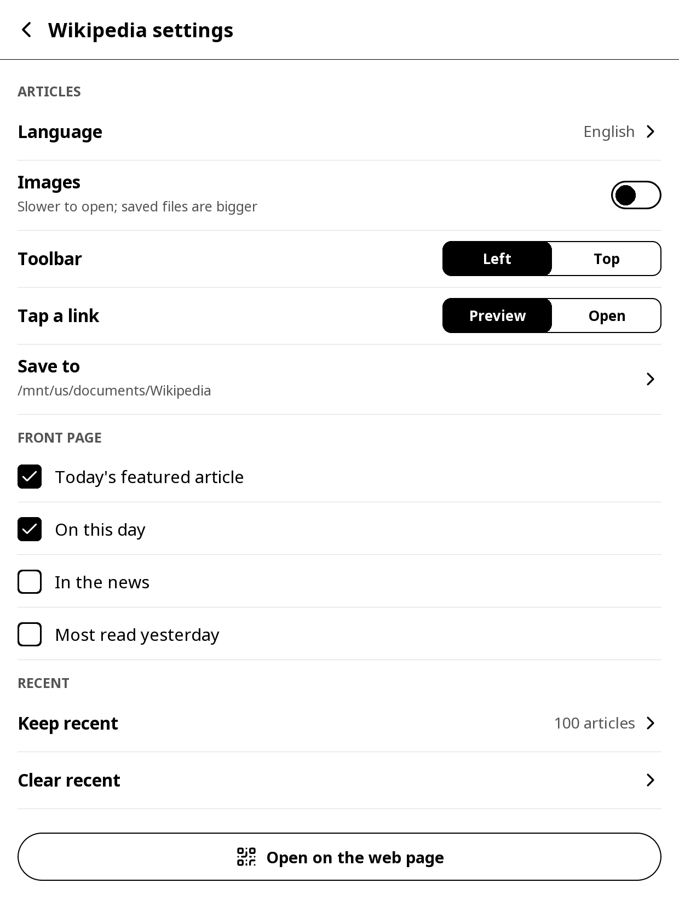
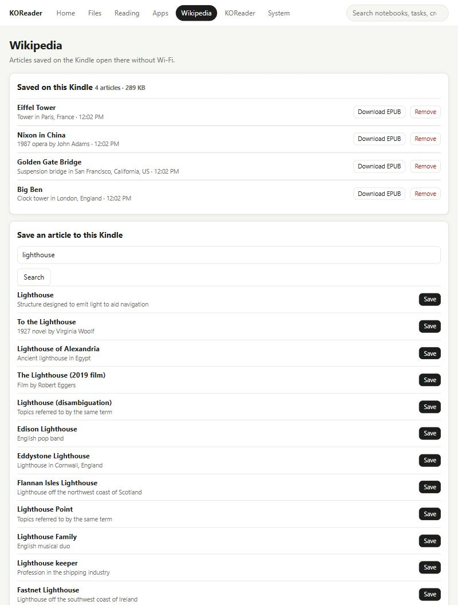

# Wikipedia

Search and read Wikipedia on the Kindle, and save articles to read without Wi-Fi. Articles open in KOReader's reader, so your font, size, margins, highlights and the dictionary all work.

## Opening Wikipedia

- **Tools > Wikipedia** in KOReader's menu.
- A gesture: **Settings > Taps and gestures > Gesture manager**, pick a gesture, then **General > Wikipedia**.
- The **Wikipedia** tile on the Apps launcher.
- An article you read before, from **Continue reading**, the launcher's recent books, KOReader's history or the **Wikipedia** folder in the Library: it opens with the Wikipedia toolbar too.

## The front page

- The **search box** at the top: type a few words and tap **Search**. Tap a result to read it.
- **Random** opens a random article.
- **EN** at the top right is the language; tap it to choose another. The gear opens the settings.
- The back arrow at the top left closes Wikipedia and goes back to where you were: the Apps launcher if you opened Wikipedia from it (or opened an article from Continue reading or a recent list), the book you were reading, or the Library.
- Swipe left or right (or tap the arrows at the bottom) when a list has more than one page.

### Today

- **Today's featured article**: tap **Read** to open it, or **Save** to keep it on the Kindle without opening it.
- **On this day**: events from this date in history. Tap one to read its article; when an event mentions several articles, choose one. **All events** lists the rest.
- **In the news** and **Most read yesterday** can be added in the settings.
- Today needs Wi-Fi the first time each day (**Loading today's articles…** shows meanwhile); after that it shows without Wi-Fi until midnight.
- Without Wi-Fi, Today shows **Turn on Wi-Fi** and your saved articles.

### Saved

- Every article saved on the Kindle, with its size and when it was saved. Saved articles open without Wi-Fi.
- **Newest first** at the top right switches to **By title**.
- Hold an article for **Open**, **Update** (download the latest version), **Open on the web page** and **Remove**.
- **Select** at the bottom picks several articles to remove at once.
- Saved articles are EPUB files in the **Wikipedia** folder, so they also show in the Library.

### Recent

- Every article you opened, by day, with the page you got to. The bookmark marks the saved ones.
- Tap one to open it again. Articles that aren't saved may need Wi-Fi again.
- Hold one for **Remove from Recent**; **Clear recent** at the bottom clears the list.

## While Wikipedia downloads

- Searching, opening, saving and updating articles, previews and languages download in the background, with a message such as **Opening…**, **Searching…** or **Downloading “Nixon in China”…**. The Kindle keeps responding meanwhile.
- Tap the message to stop. A download that is stopped leaves nothing half-saved.
- With Wi-Fi off, KOReader asks to turn it on first.

## Reading an article

An article opens like a book, with the Wikipedia toolbar in place of KOReader's status bar. Tap or swipe to turn pages as in any book.

Your reading settings (font, size, zoom, margins, spacing) carry from one article to the next: change them in one article and the next one you open looks the same.

### The toolbar

- **Home** (the house): the front page. The article stays open underneath.
- **Back** (the arrow): the article you came from, on the page you left, or the front page.
- **Search**: search Wikipedia for another article.
- **Contents**: the article's sections. The section you are in is marked; tap a section to go there. Tap outside the panel to close it.
- **Save** (the bookmark): keeps the article on the Kindle. It fills in when the article is saved; tap it again to remove the article from the Kindle (you keep reading it).
- **Language**: the same article in another language.
- **Text** (the T): KOReader's font, size and margin settings.
- At the bottom (or right, with the toolbar at the top): page up, the page you are on, page down.
- **More** (the three dots): **Update** (download the article again: its latest version, with or without images as the **Images** setting is now; you stay on the same page), **Open on the web page**, **Wikipedia settings**, **KOReader menu** and **Close Wikipedia** (back to where you were, as the front page's back arrow).
- **Hide toolbar**: gives the page the whole screen. A small tab in the top left corner brings the toolbar back.

### Links and sources

- Underlined words are links to other articles. Tap one to see a short preview, then **Open** to read it or **Save** to keep it for later. A link to an article you have saved opens straight away, without Wi-Fi.
- The small numbers in brackets are the article's sources. Tap one to see that source at the bottom of the page without losing your place.

- The full list of sources is at the end of the article, under **References** in **Contents**.
- Each article starts with Wikipedia's summary box (born, died, location and so on) when the article has one, then its sections one after another.

## Settings

Tap the gear on the front page, or **More > Wikipedia settings** while reading.

- **Language**: which Wikipedia to use. Search, articles and **Random** work in every language; Today's featured article and On this day only in the languages Wikipedia publishes them in. **Other…** takes any language code, such as **fr** for fr.wikipedia.org.
- **Images**: off by default. With images on, articles take longer to download and saved files are bigger. Turning it on doesn't change articles already on the Kindle: an unsaved one you read before is downloaded again with its images when you open it (with Wi-Fi), and **Update** (in **More** while reading, or by holding a saved article) adds them to any article. Hold a picture to see it full screen.
- **Toolbar**: **Left** (like Notes) or **Top**.
- **Tap a link**: **Preview** shows a short preview first; **Open** opens the article straight away.
- **Save to**: the folder for saved articles (the **Wikipedia** folder in the Library at first).
- **Front page**: which sections Today shows.
- **Keep recent**: how many articles the Recent list keeps.
- **Clear recent**: empties the Recent list.
- **Open on the web page**: shows a QR code for the web page's Wikipedia tab.

## On the web page

The web page's **Wikipedia** tab (with the web server on):

- **Saved on this Kindle**: each saved article with **Download EPUB** (to read it on your computer or phone) and **Remove**.
- **Save an article to this Kindle**: search Wikipedia from your phone or computer (the search goes straight to Wikipedia from your browser) and tap **Save**. The button shows **Saving…** while the Kindle downloads the article over its own Wi-Fi, in the background, so you can keep using the Kindle; then it shows under **Saved** on the Kindle and on the page.
- **Recent on this Kindle**: what you read lately, with **Read on wikipedia.org** and **Save to Kindle**.

